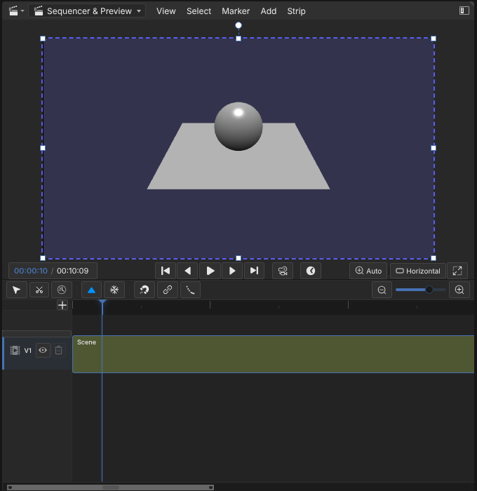

# Bylonder

Full-viewport Babylon.js workspace with modular reactive systems, generated controls, transform tools and browser-local persistence. Licensed under GPL-3.0-or-later (see `LICENSE`). Dependencies are pinned; Inspector is loaded on demand.

## Develop / fork

Node 20+: `npm ci`, `npm run dev`, `npm test`, `npm run build`. Serve `dist/` on any static host. No backend, remote fonts or credentials are needed at runtime. To fork, copy source, remove `.openai/hosting.json` (the original Site identity), rename the package and register a new Site if using Sites hosting.


**Blender reference screenshots.** `tools/blender-reference/capture.sh Layout Compositing Video_Editing` runs Blender 5.2.3 headless on the CPU (Xvfb and Mesa llvmpipe; needs ImageMagick) and saves 1920 x 1080 screenshots of workspaces or app templates to `.blender-reference/shots/`, for comparing Bylonder's UI with Blender's. Blender downloads once into `.blender-reference/`, which is not committed.
## Data model

Three layers, each with one contract and no knowledge of the others' internals:

1. **Channels** (`src/blenkernel/animation/model.js`): every editable scalar is registered once as `{id, path, label, get, set, available}`. Property rows, keyframes, the Timeline and context menus only see channels. Producers: generated controls, objects, materials, modifiers and graph bindings (`src/nodes/bindings.js`).
2. **Document slices** (`src/blenkernel/document.js`): each subsystem that owns state beyond its channels registers a slice with `capture()`, `apply(state)` (undefined means code defaults), and optional `subscribe`/`dispose`. Current slices: `materials`, `compositor`, `logic`, and `channels`, which persists edits to channels no other slice owns as a diff from code values. Object-level data (transforms, modifiers, particle systems) lives on objects and is captured by `src/editors/undo/storage.js`.
3. **Consumers**: undo history and Remember scene edits call only `document.capture()` / `document.apply()`; editors call subsystem APIs. Adding a subsystem means one `register(...)` call, with no changes to history, persistence or UI wiring.

## Materials and node editors

Properties > Material follows Blender: a slot list (+, -, specials, reorder), the material datablock row (browse and link any scene material, rename, user count with make-single-user, fake user, duplicate, unlink, New), a preview sphere, and schema-driven Surface/Settings panels for Principled (PBR), Standard and Node materials. Changing the Surface type converts the material in place and keeps its users and common settings. Texture fields pick project images. Every material property and every uniform input of a Node Material is an animation channel, so the same keyframe, undo and context-menu behaviour as generated controls applies. Structural edits (slots, links, new/duplicated/converted materials, textures, edited node graphs) are undoable and persist with Remember scene edits.

The Node Editor area (pick it from any area's editor-type menu) hosts Babylon's editors with a Blender skin generated from their CSS-module class map (`scripts/graph-editor-classes.mjs`):

| Editor | Babylon system | Context, as in Blender |
| --- | --- | --- |
| Shader Editor | Node Material Editor | Active object's active material slot; Use Nodes converts |
| Geometry Node Editor | Node Geometry Editor | Active object's Geometry Nodes modifier (modifier stack) |
| Compositor | Node Render Graph Editor over the frame graph | Scene; Use Nodes; shown in Rendered shading and camera view |
| Particle Node Editor | Node Particle Editor | Active object's particle system (Properties > Particles) |
| Logic Editor | FlowGraph (own editor; Babylon ships none) | Scene logic; Shift A, drag sockets, Run |

`src/nodes/bindings.js` reflects live graph inputs (uniform Input blocks, geometry and particle inputs, render-graph block settings declared with `editableInPropertyPage`) into animation channels and property rows, resolved by stable block names so they survive editor rebuilds.

## Examples and deployment

File > New from Example (or the splash screen shown on first visit) creates a project from one of the bundled demos in `src/workspace/examples.js`.

`.github/workflows/pages.yml` tests, builds with a relative base (`BASE_PATH=./`), checks the build in headless Chromium (`npm run test:prod`) and deploys `dist/` to GitHub Pages on every push to `main`. Enable it under Settings > Pages > Source: GitHub Actions. Any sub-path works; the service worker scope follows the deployed directory.

## Controls

| Action                             | Input                                                  |
| ---------------------------------- | ------------------------------------------------------ |
| Select / deselect                  | Click object; click selected object again to remove it |
| Multi-select                       | Shift-click objects or scene rows                      |
| Clear selection                    | Click empty viewport                                   |
| Orbit / pan / zoom                 | MMB / Shift MMB / wheel                                |
| Front / right / top                | Numpad 1 / 3 / 7 (number row also works)               |
| Opposite view                      | Ctrl + view key                                        |
| Perspective / orthographic         | Numpad 5                                               |
| Frame selection                    | F or numpad decimal                                    |
| Modal move / rotate / scale        | G / R / S                                              |
| Axis constraint and value          | X / Y / Z, then a number, during transform             |
| Precision / snapping               | Hold Shift / Ctrl                                      |
| Reposition without applying motion | Hold Alt; release to start another sweep               |
| Confirm / cancel                   | Enter or left-click / Escape or right-click            |
| Undo / redo                        | Ctrl Z / Ctrl Shift Z                                  |
| Context menu                       | Right-click (Blender's menu for the editor and mode)   |
| Babylon Inspector                  | Ctrl Shift I, or View > Babylon Inspector              |

No selection is active initially. Selected meshes show an orange outline. Clicking a mesh in a group selects its outermost group; the hierarchy list can select individual children. Grouping creates native Babylon `TransformNode` parents and preserves child world transforms. Ungrouping reparents children without recursively disposing them. Groups can nest.

Move, Rotate and Scale are Blender's transform operators (`TRANSFORM_OT_translate`, `rotate`, `resize`) running in the module, in Object Mode, Edit Mode, Edit Curve and on the 3D cursor (`cursor_transform`): Bylonder's window manager passes them its events and their modal keymap's items (`src/editors/space_view3d/view3d-modal.js`), so constraints, orientation cycling, typed values with units and expressions, snapping, precision and the header text are Blender's own. Touch gestures run the same operators. Pointer lock requests relative input for MMB navigation so the physical screen edge does not stop a gesture.

Browsers may deny pointer lock (including restricted embeds). The app reports this and falls back to ordinary mouse movement. Escape/lost pointer lock/window blur cancels the transform. Toolbar gizmos use Babylon's direct manipulation rather than the modal pointer-lock gesture path. Text inputs suppress scene shortcuts. Touch navigation delegates to Babylon.

## Selection and transforms

`editors/object/selection.js` owns stable selection IDs, outlines, native groups and a transient `TransformNode` pivot. Multi-selection filters parent/child duplicates. The pivot's world delta is applied to selected root nodes and converted back to local space. It is never serialized. Gizmos, numeric fields and modal operations share this transform path. Babylon uses TRS decomposition; arbitrary shear from rotated non-uniform parent scaling is not supported. Grouping is organizational, not mesh merging or geometry editing.

`editors/undo/storage.js` snapshots node transforms and parent IDs, including groups, for undo and the project's saved scene edits. Camera and system parameters remain session-only. Undo/redo covers 100 committed transform/group states; Inspector edits are direct advanced edits outside that history. Mesh names must be unique and stable; change the storage key for independently deployed projects.

## Reactive systems

`systems.js` composes independent definitions `{id,title,schema,connect}`. Each instance owns a store, subscriptions and cleanup. Display, lighting and geometry are separate example systems. `config.js` defines defaults, labels, ranges and options. `editors/interface/ui.js` generates a section per system. `effects.js` connects explicit dependencies to Babylon objects via injected context.

```js
const materialDefinition = {
  id: "material",
  title: "Material",
  schema: {
    roughness: { default: 0.4, min: 0, max: 1, step: 0.01, label: "Roughness" },
  },
  connect(store, { material }) {
    return store.effect(["roughness"], (values) => {
      material.roughness = values.roughness;
    });
  },
};
// createSystem(materialDefinition, { material }, onError)
// Register the instance alongside the other systems for automatic UI generation.
systems.find((s) => s.id === "lighting").store.set("key", 1.5);
```

Store effects run initially and then coalesce once per animation frame by default. Modes: `immediate`, `frame`, `debounce` (with `delay`), or `manual` (explicit flush). `onStale(key)` notifies invalidation. `store.invalidate(key)` forces dependent effects stale; omit key for all. `store.stale` reports pending work. `store.flush()` cancels schedules and applies latest values. An effect may return cleanup; the framework calls it before the next execution and on disposal. Effects are synchronous; use AbortController or generation tokens for async jobs. The geometry example debounces sphere tessellation by 150ms and preserves mesh identity.

`store.set` validates scalar types, finite numbers, ranges and options; schemas may add `validate(value)`. UI and programmatic edits use the same path. Never directly mutate `store.values`. Each store is independent; repeat keys across stores or instantiate the same definition with distinct IDs and dependencies. Cross-system dependencies should be explicit subscriptions with cleanup.

## Source layout

`src/` follows Blender's source tree, so a Blender change set points at the matching folder here:

| Blender | Bylonder | Contents |
|---|---|---|
| `source/blender/blenkernel` | `src/blenkernel/` | Data and its Babylon mapping: scene (time, render, collections, world), animation, materials, text, units, the document slices |
| `source/blender/editors/space_*` | `src/editors/space_*/` | Editors: `space_view3d`, `space_buttons` (Properties, one file per panel group), `space_node`, `space_sequencer`, `space_outliner`, `space_action` (Timeline) |
| `source/blender/editors/{object,transform,undo,curve,render,screen,interface}` | `src/editors/object/`, `undo/`, `curve/`, `render/`, `screen/`, `interface/` | Object mode editing and operators, undo history, text editing, Render Result window, area layout, widgets and menus |
| `source/blender/windowmanager` | `src/windowmanager/` | Pointer capture, gestures, touch input |
| `source/blender/nodes`, `compositor`, `modifiers` | `src/nodes/`, `src/compositor/`, `src/modifiers/` | Geometry, particle and logic graphs; the compositor frame graph; the modifier stack |
| `source/blender/render` | `src/render/` | Offline render context, virtual clock, sampling, encoding |
| `source/blender/sequencer` | `src/sequencer/` | The edit slice, scene strip frames and the KubeezCut adapter |
| `source/blender/bmesh` | `src/bmesh/` | BMesh in typed arrays: `intern/` (kernel, construction, queries, walkers, conversion), `operators/` (`bmo_*`) |
| `source/blender/blenkernel/intern/mesh*` | `src/blenkernel/mesh/` | Mesh data (struct of arrays), normals, tessellation |
| `source/blender/editors/mesh` | `src/editors/mesh/` | Mesh operators (`MESH_OT_*`) |
| `source/blender/draw` | `src/draw/` | Mesh to Babylon geometry |
| `source/blender/makesrna` | `src/makesrna/` | Operator RNA definitions read from Blender |
| `source/blender/blenlib` | `src/blenlib/` | Math |
| `release/scripts` (Blender's Python) | `src/bl_py/` (generated), `src/python/` | All of Blender's scripts, transpiled whole by `tools/blender-ui/tree.py`; `bpy_interface.js` loads them and gives their menus, panels, headers and operators |
| `source/blender/python` | `tools/blender-ui/boundary/`, `src/runtime/` | Blender's C modules for Python (`_bpy`, `mathutils`, ...) at the boundary; running project code: the world builder and the `@workbench/sdk` API |

`src/main.js` composes the viewport frame; `src/workspace/` is the browser IDE around it (projects, files, scenes, sharing) and has no Blender counterpart.

## Blender coverage

Input goes through a small window manager (`src/windowmanager/wm-event-system.js`): one set of listeners turns keys, clicks, drags and the wheel into Blender events (`LEFTMOUSE CLICK`, `LEFTMOUSE CLICK_DRAG`, `WHEELINMOUSE`) and passes them down a handler stack: modal handlers (transforms, box gestures, Loop Cut, Inset), then the mode's own picking and tools, then Blender's own keymaps (transpiled from `blender_default.py`, `src/windowmanager/keyconfig.js`), which run operators registered by Blender idname (`src/windowmanager/wm-operators.js`), then Bylonder's few keys of its own. Modal handlers keep `createKeymap` entries with Blender's names (the Transform Modal Map's `AXIS_X` is C's `TFM_MODAL_AXIS_X`), so the coverage view counts them.

Splash Screen > Blender Coverage shows how much of Blender's interface Bylonder covers, per editor, down to menus, panels, operators and key bindings. Blender's side comes from Blender itself: `tools/blender-reference/surface.py` writes `src/coverage/blender-surface.json`. Bylonder's side is scanned from the Blender identifiers in `src/` (`scripts/blender-coverage.mjs`) and read at run time from the operator registry (`window.__bylonder.coverage()`): an operator counts in the editors that run it, one registered for a space type (the Dope Sheet's and Graph Editor's, Blender's own in the module) only in that space's editors, and a key binding counts when its keymap is dispatched and its operator registered. Design decisions, equivalents and notes for whole subtrees are written by hand in [docs/blender-coverage.md](docs/blender-coverage.md). New UI uses shadcn-vue components on the theme's design tokens (`src/editors/interface/components/`).

## Testing

- `npm test` runs the unit tests in Node, in parallel (`scripts/run-tests.mjs`; `npm test -- wasm` runs those whose names contain `wasm`) on Babylon's NullEngine: stores, gestures, transforms, undo and persistence, mesh ports against Blender fixtures, menus and keymaps.
- `npm run gates` runs everything that must pass before `main` (`scripts/gates.mjs`): the unit tests while the production build is made, then the smoke tests and the workflows in parallel shards (`SHARD=i/n` on either script), then the production check.
- `npm run test:e2e` runs the smoke tests (`tests/e2e/smoke.mjs`) in Chromium through Playwright, which is expected to be installed with its browser. They build `dist/` when a source file is newer, serve it with `vite preview`, and drive core flows with real mouse and keyboard input: boot, Render Image and Render Animation, the File and Object menus, view, select, delete and undo keys, Edit Mode extrude, adding a modifier, and splitting a 3D Viewport. Assertions read state through `window.__bylonder` in the 3D Viewport frame. `npm run test:e2e -- Render` runs the checks whose name contains `Render`; `E2E_URL` tests a running server instead.
- `npm run test:prod` checks a built `dist/` (run `npm run build` first) in headless Chromium: it boots the app, opens the topbar menus (File, File > New, Edit, Render, Window, Help) and the 3D View header menus, switches to every workspace tab, and fails on any page or console error. CI runs it between the build and the deploy, since some failures only happen in the production build. `E2E_URL` checks a running server instead.
- `node tools/blender-reference/parity.mjs --out DIR` compares Bylonder with Blender 5.2.3. `tools/blender-reference/ui-shots.py` captures Blender under Xvfb in the UI states of `ui-states.json` (startup scene, menus, Edit Mode, the Modifiers tab, the Move tool, the sidebar's Item tab), driven by simulated input; Playwright captures Bylonder in the same states on the Default Cube example, Blender's startup scene, at the same window size and UI scale. Each state gets both screenshots, a side-by-side and a diff image, and `report.json` holds the share of differing pixels overall and per Blender editor. The default output folder `.shots/parity/` is not committed.

## Browser project workspace

The hosted entry is now a Monaco project editor. `viewport.html` runs each project in a fresh same-origin iframe. The initial `index.js` exactly follows the supplied sphere/ground scene and cannot be deleted or renamed. OPFS stores SHA-256-addressed file bodies and immutable version manifests; HEAD advances only after successful writes. Autosave, named checkpoints, snapshot diff/restore, ZIP import/export, multiple projects, and conflict detection are in `src/workspace/`. Browser storage remains local, with an optional durable-storage request.

`workspace-sw.js` serves per-run immutable module URLs from Cache Storage. This preserves native relative/dynamic imports, cycles, asset URLs and remote HTTPS ESM imports. TS/JSX use esbuild-wasm; bare imports use `importmap.json`. Node/CommonJS modules require browser-compatible ESM builds. External modules must allow CORS. The cache is only delivery infrastructure; OPFS is the source of truth.

Monaco includes all 2,125 pinned Babylon declaration files, typed SDK globals, local module models and remote type acquisition (declaration headers, sibling declarations, recursive dependencies and JavaScript inference). `types.json` maps any import string to an explicit local/remote declaration source. Types that are unpublished or inaccessible cannot be synthesized precisely; unresolved sources are reported in the Types panel.

`workbench.controls({id,title,schema,connect})` creates an independent reactive store and generated UI section. `workbench.editable`, `asset`, and `onDispose` complete the SDK. See the project's generated README and examples/controls.js. Edit mode uses the Blender-style camera; Scene mode restores the camera created by user code. Remember scene edits persists transform/group overrides and control values in project snapshots, separately from source files.

## Object-mode tools

Shift+A opens Blender's Add menu. The new object's Adjust Last Operation panel (the 3D View's HUD region) edits the operator's properties live, Align, Location and Rotation included; the next edit makes it one undo step. F9 reopens it until another edit. Plane, Cube, Circle, Cylinder, Cone and Grid are Blender's own primitives, built by a port of Blender's BMesh operators and matching Blender 5.2 vertex for vertex; their fields are the operators' RNA properties (`src/makesrna/rna-operators.json`, written from Blender by `tools/blender-reference/operators.py`). UV Sphere, Ico Sphere and Torus still use Babylon builders, and Add > Mesh > Babylon has Babylon-only shapes, with arguments reflected from Babylon's TypeScript declarations (`scripts/mesh-schema.mjs`).

```js
workbench.meshTools({
  include: ['box', 'sphere', 'cylinder'],
  defaults: { box: { width: 3 }, sphere: { segments: 24 } },
  fields: { box: { size: { default: 2, min: 0.1, max: 10, step: 0.1 } } }
});
```

Call this during createScene. Code builds the same primitives with `createPrimitive('Cube', 'mesh.primitive_cube_add', { size: 2 }, scene)`, which Edit Mode edits as Blender's Mesh (quads, not Babylon's triangles). `workbench.meshBuilders` exposes the reflected parameter catalog. New numeric/boolean/string field subsets are validated against the actual builder signature. Avoid combining size and axis overrides unless intended; Babylon's axis-specific options take precedence.

`createMesh('Profile', { vertices, edges, faces, smooth }, scene)` builds Mesh data like Blender's `Mesh.from_pydata`, in Blender's axes (Z up): faces may be n-gons, and a mesh of loose edges only is a profile that the Screw modifier turns. `shadeSmooth(mesh)` is Blender's Shade Smooth (Blender's primitives start flat, so Subdivision Surface shows facets without it). `renderSettings({ render, eevee, viewSettings })` sets the scene's render settings (samples, motion blur, raytracing, view transform) as the baseline that Properties edits are saved against. The examples in `examples/` show all three.

Tab enters Edit Mode on the active mesh, with Blender's select modes (1, 2, 3, Shift to combine), click select (Shift toggles, clicking again cycles through overlapping elements), box select by dragging or B (Shift extends, Ctrl subtracts), A, Alt A, Ctrl I, H, Shift H and Alt H. G, R and S move, rotate and scale the selection about its median point, with X, Y and Z (Shift for a plane) constraining in Blender's axes. E extrudes and moves along the normal, I insets faces. Ctrl R cuts edge loops with Blender's preview and slides the new loop; GG slides selected edges. Edge > Subdivide subdivides, and its Adjust Last Operation panel re-runs it with new settings. X or Delete opens the Delete menu (Vertices, Edges, Faces, Only Edges & Faces, Only Faces, Dissolve Faces). Edits are stored as Mesh data on the object (`wbCreation.mesh`) and saved with scene edits, so they replace the geometry that code builds. Selection and every edit are undo steps.

Keys and right-click menus are Blender's: every editor runs Blender's keymaps, and right-click opens the editor's context menu through `wm.call_menu` (Object Mode's `VIEW3D_MT_object_context_menu`, Edit Mode's, the Outliner's, and so on); a property's right-click opens Blender's button context menu. Object Mode's operators that Bylonder runs itself are in `src/editors/object/object-actions.js`. Shift+D duplicates with independent geometry, then starts Move; cancelling Move keeps the duplicate. X/Delete removes selection, F2 renames, A/Alt+A/Ctrl+I selects/deselects/inverts, H/Shift+H/Alt+H controls visibility, / isolates, Alt+G/R/S resets transforms, Ctrl+P parents to the active object, and Alt+P unparents. Native groups remain available.

The Outliner runs Blender's own outliner code (tree building, drawing, selection, restriction toggles, rename, drag and drop) in the WASM module over the shared Blender world.

Stable IDs separate object identity from display names. History and project overrides store primitive recipes or duplicate vertex data plus hierarchy, visibility, locks and deletion tombstones. Deleted authored nodes are disabled rather than disposed so user-code references remain valid. Duplicates share material resources; rig/skeleton independence is not implemented. Turn on Remember scene edits to preserve interactive additions/deletions across Run and reload.

## Text

Shift+A > Text creates real extruded glyph outlines. Tab edits the selected text. The font field searches the Google Fonts catalogue and accepts any family name; the preview uses the same downloaded font as the geometry. Weight, italic, size, depth, spacing, line height, alignment and curve resolution share `textSchema`. Unsupported styles report an error. Color-only glyphs cannot be extruded; outline fonts render as monochrome meshes. Text is capped at 2,000 characters per object.

Apply commits one undo step; Cancel restores the previous geometry. Saved overrides include baked geometry and text settings, so restoration does not need the font network request. Font requests use Google Fonts CSS2 and CacheStorage; the searchable catalogue comes from Fontsource. First use requires network access. Font loading uses Fontkit (WOFF2, TrueType and OpenType); Babylon PolygonMeshBuilder and Earcut preserve glyph holes.

```js
import { createText, updateText, textSchema, controls } from '@workbench/sdk';
const label = await createText('Label', {text: 'Hello', family: 'Inter'}, scene);
controls({id: 'label', schema: textSchema, connect(store) {
  return store.effect(Object.keys(textSchema), values => {
    updateText(label, values).catch(console.error);
  }, {mode: 'debounce', delay: 250});
}});
```

`updateText` discards stale asynchronous results. Use a subset of `textSchema` for smaller UI sections. Text meshes retain normal Babylon materials, parenting and transform behavior.

## Application source

**File > Download App Source** downloads the complete unminified application source for the deployed build, including its lockfile, tests and build scripts. Run `npm ci` then `npm run dev`; `npm run build` regenerates the ZIP from tracked and nonignored source files. Dependencies, Git metadata and hosting credentials are excluded. **Export ZIP** separately exports the current in-browser scene project.

## Layout and mobile input

Vue 3 and [Splitpanes](https://antoniandre.github.io/splitpanes/) own the workspace and viewport layouts. Drag splitters to resize; each section selector swaps its contents with another section. Collapse, maximize, restore, change split directions, or reset from **Layout**. On touch screens the Layout menu exposes those same controls without using space for a second title bar. Layout profiles are saved by default in localStorage, independently of projects, for desktop, portrait and landscape. Disable **Remember layout** to stop persistence. Resetting the outer workspace also resets the inner viewport layout.

Split a 3D Viewport (right-click its header, Vertical or Horizontal Split, or drag an area corner) to add another 3D Viewport. Each has its own view, navigation, shading (Wireframe, Solid, Rendered), overlays and camera view (Numpad 0); selection, tools and gizmos are shared, and keys act on the viewport under the pointer. Viewports redraw only while something changes (input, playback, animated or loading content), so an idle scene costs no GPU time. With Compositing on, the last clicked rendered viewport shows the composite.

Portrait defaults to the scene with section tabs; landscape shows code beside the scene. The viewport has separate Objects and Properties sections. Pane contents remain in stable DOM hosts, so swaps and layout changes do not reload the iframe, scene or Monaco models. Splitpanes handles mouse, touch and keyboard resizing.

Touch viewport controls:

- Tap selects/toggles; **Multi** makes selection additive. Double-tap frames an object.
- Long-press in the viewport or object tree opens the same object-action registry. **Actions** opens it without a long-press.
- One finger orbits in Select mode. Move/Rotate/Scale tools transform the current selection with the same screen-space math as desktop. Lift to commit; repeated strokes extend a transformation. OS cancellation rolls back the active stroke.
- Two fingers pan and pinch to zoom without selecting objects. Switching from a transform to two fingers commits that stroke and navigates.
- X/Y/Z, Snap, Fine, Apply, Cancel, Undo and Redo are touch buttons. Parenting, grouping, duplication, visibility, text editing and other commands are available through Actions. Numeric transforms and generated scene controls are in Properties.
- The code toolbar exposes undo, redo, indentation, suggestions, find and format without modifier keys. Project/file operations remain available through the top menu and Files section.

`src/windowmanager/input/touch-session.js` recognizes tap, drag, hold, pinch transitions and cancellation. `viewport-touch.js` dispatches those gestures to the existing editor/navigation operations; it does not maintain a second transform implementation. The authored camera still controls input in Scene mode.

## Share links and resolution

**Share** encodes the current project files/assets into a compressed URL fragment. Current transforms, created objects and control-store values are included by default, even when Remember scene edits is off; uncheck the option to share source only. Finish pending creation/transform operations before sharing. Links contain a snapshot, not history. Opening one offers a new local copy and does not automatically run the sender's JavaScript. The fragment is not uploaded as a project by this app; anyone possessing the link can read its contents. Links are limited to 128 KB and decoded projects to 8 MB; for larger projects or messaging apps that truncate URLs, use project ZIP export/import.

**Render > Render Resolution** controls Babylon's hardware scaling ratio for all projects on this device. Native resolution (`1 / devicePixelRatio`) is the default. Custom ratios range from 0.25 to 4: lower is sharper and more expensive, 1 is CSS-pixel resolution, 2 is half resolution. Render settings and layouts are device preferences and are not included in share links.

## Rendering

Properties > Output sets the render size (Resolution X, Y and %), frame rate, frame range and the file format: PNG, JPEG, WebP or FFmpeg Video with a container (MPEG-4, QuickTime, Matroska, WebM), codec (H.264, H.265, AV1, VP9, VP8), output quality and keyframe interval. Properties > Render > Sampling > Render sets how many samples each frame averages.

**Render > Render Image** (F12) renders the current frame from the scene camera; **Render Animation** (Ctrl F12) renders the frame range and downloads the video, or a ZIP of images for image formats; **View Render** (F11) shows the Render Result window. Escape cancels a running render. Renders run in a hidden copy of the project built from the current scene edits, so the viewport keeps working and nothing needs to be saved first.

Renders are deterministic: time, `engine.getDeltaTime()`, `Date.now()` and `Math.random()` follow a virtual clock, and frames are pre-rolled from Frame Start, so code that integrates time reaches the same state on every machine. Each sample shifts the camera by a sub-pixel offset; with Motion Blur on, samples also spread across the shutter for true sub-frame blur. Video is encoded in the browser with WebCodecs; codecs the browser cannot encode report an error. With **Post Processing > Sequencer** on (the default) and strips in the Video Sequencer, renders output the edit with its audio instead of the camera. File paths and saving directly to disk are not implemented yet.

The Compositor (Node Editor > Compositor, Use Nodes) shows its result behind the nodes; the header's backdrop button turns it off.

## Video Sequencer

Pick **Video Sequencer** or **File Browser** from any area's editor type menu. The Video Sequencer has Blender's view types (Sequencer, Preview, Sequencer & Preview) and a sidebar (N) with the active strip's properties; the File Browser imports footage, audio and images into the project's media pool. Both are KubeezCut editors ([Propolisa/KubeezCut](https://github.com/Propolisa/KubeezCut), MIT) running as embedded islands in Bylonder's theme, loaded on first use. The video uses the scene's output resolution and frame rate, and its playhead is the scene frame. The edit belongs to the scene: Ctrl Z undoes it with everything else and Remember Scene Edits keeps it. Media is referenced, not copied, and stays in the browser per project. Requires a Chromium-based browser (File System Access, WebCodecs).

**Add > Scene** adds a scene strip that shows a scene of the project through its camera. Its frames render in the background at the **Proxy** size from the Sequencer header and are cached until the scene changes; **Strip > Rebuild Proxy** keeps them across reloads.



## Scenes

A project holds one or more scenes, like a Blender file. The top bar's scene selector switches, adds (New, Copy Settings, Full Copy) and deletes scenes; double-click it or use Properties > Scene to rename. A new empty scene starts without objects; Full Copy builds from the same code with a copy of the scene edits and animation. With **Edit > Preferences > Keep Scenes Loaded** (on by default), scenes stay loaded after switching away, so switching back is instant.

## Animation

Timeline is a dockable pane. Select objects and press **I** to key Location / Rotation / Scale. Each property also has a diamond; hover and press **I** to insert or **Alt-I** to delete. Right-click a property for keying and its stable data path. Yellow means keyed here, green animated elsewhere, orange modified from the evaluated curve. Axes use red / green / blue. The red record toggle auto-keys changed transforms; other properties are keyed explicitly, as in Blender.

**Space** plays/pauses. Drag the ruler to scrub. Click diamonds to select, Shift-click to extend, drag to move, Alt-drag to duplicate, and X/Delete to remove. Timeline's menu provides the same actions for touch, frame range, FPS, interpolation, pan and zoom. Shift-D duplicates selected keys using the menu's frame offset. Each curve uses Babylon `Animation`; numeric curves support auto-clamped cubic tangents, linear, or constant interpolation. Boolean/string/enum channels use constant interpolation. This is a keyframe editor, not a full Blender Graph Editor, NLA editor, constraint or driver implementation.

Every `workbench.controls` scalar property is automatically addressable and keyable (`animatable:false` opts out). Playback writes through `store.set`, preserving validation, effects, and scheduling. Choose immediate or frame effects for responsive motion; debounce/manual scheduling remains intentional. Geometry construction dialogs and application preferences are not animation channels. Expensive geometry/text changes can be exposed through a controls store with an explicit effect and scheduling policy.

```js
const lightControls = workbench.controls({
  id: 'lighting',
  schema: { intensity: { default: 0.7, min: 0, max: 2 } },
  connect: store => store.effect(['intensity'], values => {
    light.intensity = values.intensity;
  }, { mode: 'immediate' })
});
workbench.animation.insert(lightControls.ref('intensity'), 1, 0.2);
workbench.animation.insert(lightControls.ref('intensity'), 48, 1.5);
```

For direct Babylon properties, one declaration generates the UI and channels. Vector/color properties expand into independently addressable scalar components:

```js
const lighting = workbench.animate(light, {
  id: 'key-light', title: 'Key light',
  properties: { intensity: { min: 0, max: 4 }, diffuse: {} }
});
workbench.animation.insert(lighting.ref('intensity'), 1, 0.5);
workbench.animation.insert(lighting.ref('intensity'), 48, 2);
```

Addresses are `animation.ref(stableTargetId, propertyPath)` (an encoded pair, avoiding delimiter ambiguity). Editable transforms use `object:<stable wbId>` plus `position.x`, `rotation.y`, `scaling.z`; controls use `store:<id>` plus the schema key. Rotation curve values are radians; the UI displays degrees. Renames retain object identities. Deleted or missing targets retain their curves as unresolved channels.

Animation actions are project data: autosaved, versioned, undoable, forked, zipped and shared even when transform overrides are excluded. Objects created only as optional overrides still require those overrides to resolve their animation targets. Runtime `animation.toAnimationGroup(scene)` returns a native Babylon AnimationGroup with live property adapters; pause the editor transport before starting it and dispose the group when done. The group is a runtime adapter, not a standalone serialization of custom store effects.

## Properties and modifiers

Properties follows Blender's Object / Modifiers / Scene context structure. Add an array from **Modifiers > Add Modifier > Generate > Array**. The modifier stack is independent of the original mesh, animatable, undoable, and retained with **Remember Scene Edits**. `Apply` writes evaluated geometry to the source; removing a modifier restores the input geometry.

```js
workbench.addModifier(sphere, 'ARRAY', {
  count: 5,
  'offset.x': 1.2,
  realizeInstances: false
});

workbench.curve(pathObject, BABYLON.Curve3.CreateCatmullRomSpline(points, 32));
workbench.addModifier(sphere, 'ARRAY', {
  shape: 'Curve', curveObject: pathObject.metadata?.wbId || pathObject.name, count: 12
});
```

Use stable `workbench.editable(node, { id })` identities for referenced objects. Curve points are local-space evaluated samples; they can be updated by calling `workbench.curve` again. Modifiers expose scalar addresses as `animation.ref('modifier:'+objectId+':'+modifier.id, propertyPath)` where `objectId` is the object's stable `wbId` (without the `object:` prefix).

New modifier modules register a schema and evaluator with `registerModifier`; new Properties contexts/panels register with `registerPropertiesContext` / `registerPropertiesPanel`. Both code and UI use the same modifier values. `src/editors/interface/primitives.js` provides panels, subpanels and field rows. `src/editors/screen/dock.js` provides editor factories with persistent area instances. Babylon Node Geometry handles generated topology; thin instances avoid realizing geometry until requested.

See [interface assessment](docs/blender-interface-assessment.md) for reference coverage, architectural decisions and explicit Blender compatibility limits, the [video sequencer proposal](docs/video-sequencer-proposal.md) for the KubeezCut, render output and glTF plan, the [render architecture proposal](docs/render-architecture-proposal.md) for viewports, previews and deterministic rendering, and the [mesh editing proposal](docs/mesh-editing-proposal.md) for Mesh data and Edit Mode. Blender SVG icons are distributed under their upstream terms in `public/icons/blender/`.
