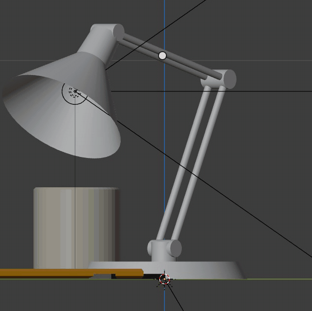
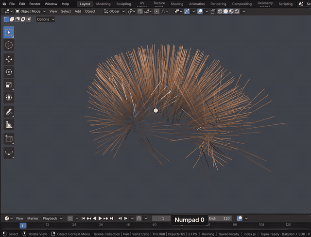
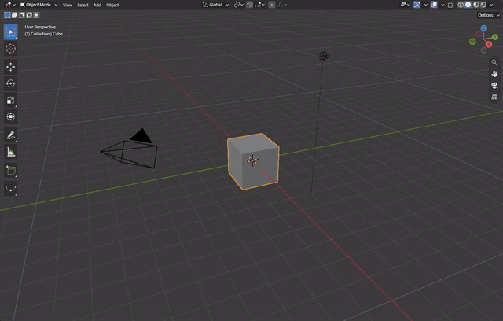

# Bylonder

Blender's interface and Blender's own code, running in the browser, drawn by Babylon.js.

[Open Bylonder](https://propolisa.github.io/bylonder/) | [Manual](docs/features/README.md) |
[Babylon.js docs](https://doc.babylonjs.com/) | [Blender manual](https://docs.blender.org/manual/en/5.2/)

[](https://propolisa.github.io/bylonder/#example=island)

Bylonder puts two communities' work in one place. Blender's modeling, modifiers, geometry nodes, rigging and
animation run as Blender's C and Python, compiled to WebAssembly. Babylon.js draws the result in real time and turns it
into a scene you can ship on the web. Nothing to install, and your projects stay in your browser.

## Why it exists

I started with Blender as a kid, about 15 years ago, and grew up loving its community and its commitment to being free
and state of the art at once. Later Babylon.js won me over as a developer: it is a joy to hack on, and it runs
everywhere without an installer. Bylonder brings the two together. I build it for the plain happiness both projects
give me, and to make my own art when time allows, such as the birds movie I am working on. I would love for others to
enjoy it too, so feedback and contributions are very welcome.

| Pose a rigged character | Simulate hair | Build materials from nodes |
| --- | --- | --- |
| [](docs/features/rigging.md) | [](docs/features/hair-dynamics.md) | [](docs/features/shader-nodes.md) |

## For Blender artists

The menus, panels, shortcuts and tools are Blender's, generated from Blender 5.2's own UI scripts, so what you know
carries over: Tab into Edit Mode, G R S, Shift A, the N panel, the Outliner and the Properties editor all work as you
expect. The operators behind them are Blender's own code, not lookalikes.

- Open `.blend` files and save your scene as one.
- Model in Edit Mode and Sculpt Mode; stack modifiers, including geometry nodes.
- Rig with armatures in Edit and Pose Mode, then animate in the Timeline, Dope Sheet and Graph Editor.
- Curves, text, particle hair and simulated hair.
- Run Python in the Scripting workspace.
- Render stills and video in the browser, and edit them in the Video Sequencer.

What runs in real time is Babylon.js, not EEVEE or Cycles, so the picture differs from Blender's render engines. Every
feature page says how far it goes.

## For Babylon.js developers

Bylonder is a full scene editor for Babylon.js, with an interface many artists already know.

- Every project is code: an `index.js` that builds a Babylon scene. Edits made in the editor are saved on top of it.
- Export to `.babylon` or to a JavaScript module (File > Export), ready for your own app.
- Babylon's node editors (Node Material, Node Geometry, Node Render Graph, Node Particle) open inside the editor, next to
  Blender's nodes.
- Where both sides have a feature, you can choose who evaluates it per object (see Runtimes below). An armature can run
  as a Babylon `Skeleton` in the viewport and in your export.

New to Babylon.js? Start with the [Babylon.js documentation](https://doc.babylonjs.com/) and the
[Playground](https://playground.babylonjs.com/).

## Try it

[Open Bylonder](https://propolisa.github.io/bylonder/) in a desktop Chromium browser (Chrome, Edge). The splash screen
offers example projects; each one also has a direct link:

| Example | Open |
| --- | --- |
| Rigged Character | [#example=rigged-character](https://propolisa.github.io/bylonder/#example=rigged-character) |
| Hair Dynamics | [#example=hair-dynamics](https://propolisa.github.io/bylonder/#example=hair-dynamics) |
| Lava Sphere | [#example=lava](https://propolisa.github.io/bylonder/#example=lava) |
| 3D Text | [#example=text](https://propolisa.github.io/bylonder/#example=text) |
| Procedural City | [#example=city](https://propolisa.github.io/bylonder/#example=city) |

The [Manual](docs/features/README.md) has a page per feature: steps with GIFs that recreate an example from an empty
scene, and links to the matching pages of Blender's manual.

## What is Blender's and what is Babylon's

| Part | Who does it |
| --- | --- |
| Scene data (objects, meshes, armatures, materials, animation) | Blender, kept in Blender's own data structures |
| Editing: operators, modifiers, geometry nodes, tools | Blender's code |
| Interface: menus, panels, shortcuts | Blender's UI scripts, drawn by Bylonder |
| Drawing the viewport, materials, lights | Babylon.js |
| Rendering stills and video | Babylon.js |
| Export | Babylon formats (`.babylon`, JavaScript) |

Some features can run either way, chosen per object. They are marked with the Bylonder icon:

- **Blender**: Blender's settings, Blender's evaluation. Matches desktop Blender.
- **Babylon (mapped)**: Blender's settings, evaluated by Babylon's matching class. Small differences are listed in the UI.
- **Babylon (native)**: Babylon's own settings, for features where Babylon's model is a complete alternative.

[docs/runtimes.md](docs/runtimes.md) describes the model.

**Not there yet.** EEVEE and Cycles, the Image and UV editors, Texture Paint and Blender's Compositor nodes are not
available. Large scenes are slower than desktop Blender. The
[Blender coverage](docs/blender-coverage.md) notes and the Blender Coverage view (Splash Screen) track what is in.

## Develop

Node 20 or later:

```sh
npm ci
npm run dev      # dev server
npm test         # unit and integration tests
npm run build    # static site in dist/
```

The build is a static site: serve `dist/` from any host. Pushes to `main` are tested and deployed to GitHub Pages
(`.github/workflows/pages.yml`).

Where to read next:

- [CLAUDE.md](CLAUDE.md): conventions for contributors and coding agents.
- [docs/blender-boundary.md](docs/blender-boundary.md): how Blender's code sees Bylonder's data.
- [docs/runtimes.md](docs/runtimes.md): Blender and Babylon runtimes.
- [docs/node-editors.md](docs/node-editors.md): Blender and Babylon nodes.
- [README.backup.md](README.backup.md): the previous, longer README with subsystem notes.

## Contributing

Feedback, bug reports and ideas are welcome as [issues](https://github.com/propolisa/bylonder/issues), and pull
requests are welcome too. A good bug report names the example or steps, the browser, and what you expected from
Blender or Babylon.js. Before a pull request, run `npm test`, `npm run build` and `npm run test:prod`; the conventions
are in [CLAUDE.md](CLAUDE.md).

## License and thanks

GPL-3.0-or-later (see [LICENSE](LICENSE)). Bylonder is built on the work of the
[Blender Foundation](https://www.blender.org/) and Blender's contributors (GPL) and of the
[Babylon.js](https://www.babylonjs.com/) team and community (Apache-2.0). It is an independent project, not
affiliated with or endorsed by either.
