# Features

Each user-facing feature of Bylonder, with a page that recreates its demo project step by step. Generated by
`scripts/feature-docs.mjs` from the pages' front matter.

| | Feature | What to expect | Coverage | Open | Blender manual |
|---|---|---|---|---|---|
| 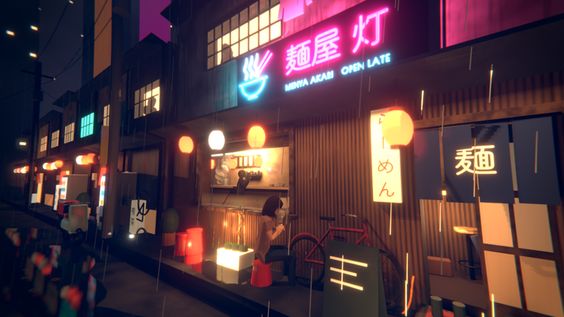 | [Compositor](compositor.md): Finish a render in Blender's Compositor, here a ramen bar's neon sign in a wet lane at night with Glare's Fog Glow, Lens Distortion, a Color Balance grade and a vignette, composited by Blender's own code. | Render Image composites with Blender's own compositor, so every node renders as in Blender (Glare, Blur, Lens Distortion and the other multi-pass nodes included); the Compositor's backdrop and a Rendered view with Viewport Shading > Compositor on run the pixel nodes and Blender's own GPU passes for Glare, Blur, Lens Distortion, Kuwahara, Filter and the masks live; in camera view only the camera's frame is composited, as in Blender. | Operators: 108 complete, 1 working in part, of 173; Menus and panels: 30 of 31 | [Open in Bylonder](https://propolisa.github.io/bylonder/#example=compositor) | [Manual](https://docs.blender.org/manual/en/5.2/compositing/index.html) |
| 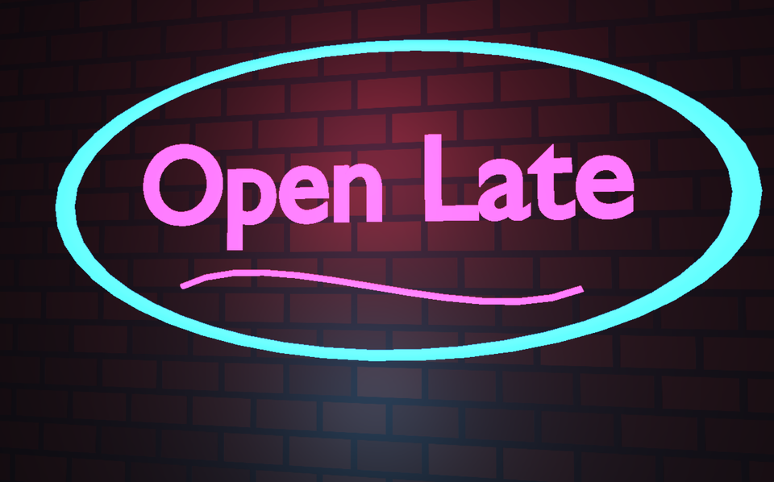 | [Curves and Text](curves-and-text.md): Add a text object, type into it in Edit Mode, give it depth with Extrude and Bevel, and bevel a Bézier curve into a tube, here the letters and tubes of a neon sign. | Text and Bezier curves are typed, edited, extruded and beveled as in Blender; in a curve's Edit Mode, View Selected does not frame the selected points. | Operators: 103 of 140; Menus and panels: 37 of 43 | [Open in Bylonder](https://propolisa.github.io/bylonder/#example=neon-sign) | [Manual](https://docs.blender.org/manual/en/5.2/modeling/texts/index.html) |
| 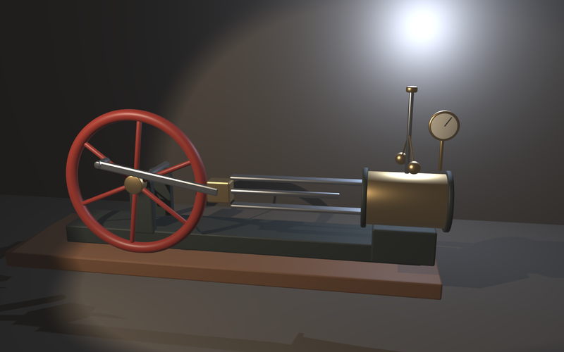 | [Drivers and the Graph Editor](drivers-and-graph-editor.md): Shape animation as F-curves in the Graph Editor, repeat or shake them with F-curve modifiers, and drive one property from others with drivers, here a steam engine whose flywheel moves everything else. | F-curves, their modifiers and drivers are Blender's and evaluate as in Blender, simple expressions without Python; a driver's Python expression starts Python on first use, which takes a few seconds. | Operators: 70 complete, 1 working in part, of 106; Menus and panels: 10 of 21 | [Open in Bylonder](https://propolisa.github.io/bylonder/#example=drivers-and-graph-editor) | [Manual](https://docs.blender.org/manual/en/5.2/editors/graph_editor/introduction.html) |
| 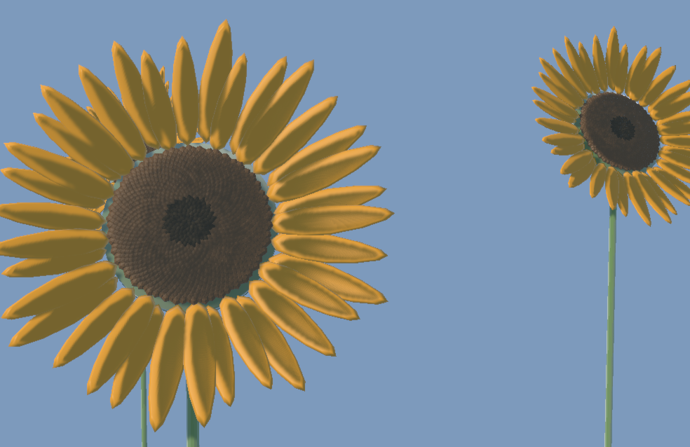 | [Geometry Node Editor](geometry-node-editor.md): Show and edit the node group of the active Geometry Nodes modifier: add nodes from Shift A's search, link sockets and set values, here to lay out a sunflower's seeds by the golden angle. | Node groups open, edit and evaluate as in Blender; the sidebar's Group tab is missing, and Bylonder's own Geometry Nodes modifier opens in Babylon's editor instead. | Operators: 371 complete, 3 working in part, of 401; Menus and panels: 76 of 81 | [Open in Bylonder](https://propolisa.github.io/bylonder/#example=geometry-node-editor) | [Manual](https://docs.blender.org/manual/en/5.2/editors/geometry_node.html) |
| 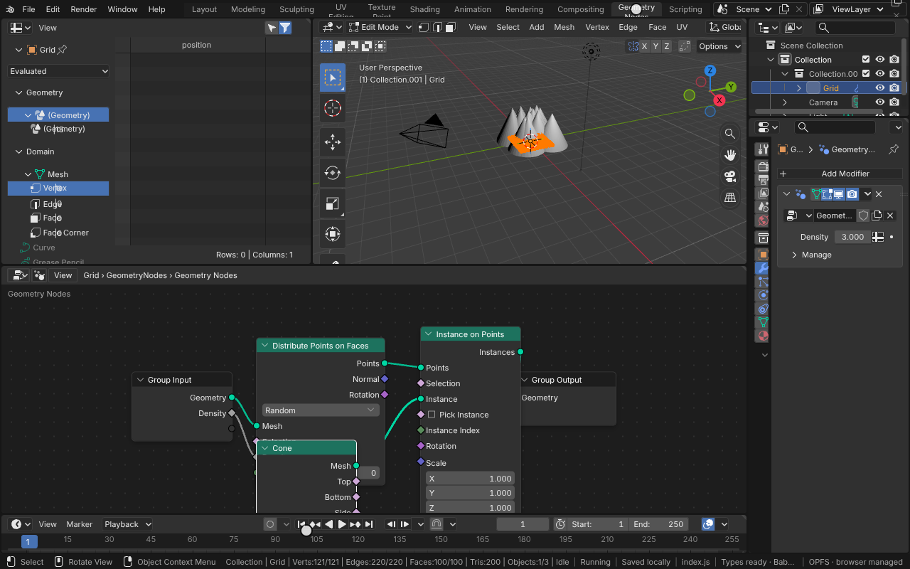 | [Geometry Nodes](geometry-nodes.md): Build a Geometry Nodes modifier from an empty node group, shape a mesh, instance objects on points, expose inputs, and see the evaluated mesh, points and instances drawn. | Meshes, points and mesh instances evaluate and draw as in Blender; volumes and instanced curves are not drawn, and instances take their mesh's first material. | Operators: 375 complete, 1 working in part, of 406; Menus and panels: 73 of 75 | [Open in Bylonder](https://propolisa.github.io/bylonder/#example=geometry-nodes) | [Manual](https://docs.blender.org/manual/en/5.2/modeling/geometry_nodes/index.html) |
|  | [Grease Pencil](grease-pencil.md): Draw and animate 2D strokes in the 3D Viewport with Blender's Grease Pencil, its brushes, modes, layers and onion skins, drawn by Babylon's GreasedLine. | Drawing, editing, layers and animation run Blender's code; stroke ends are flat, some blend modes, masks, gradient and texture fills and shader effects draw differently. | Operators: 79 of 115; Menus and panels: 86 of 103 | [Open in Bylonder](https://propolisa.github.io/bylonder/#example=grease-pencil) | [Manual](https://docs.blender.org/manual/en/5.2/grease_pencil/index.html) |
| 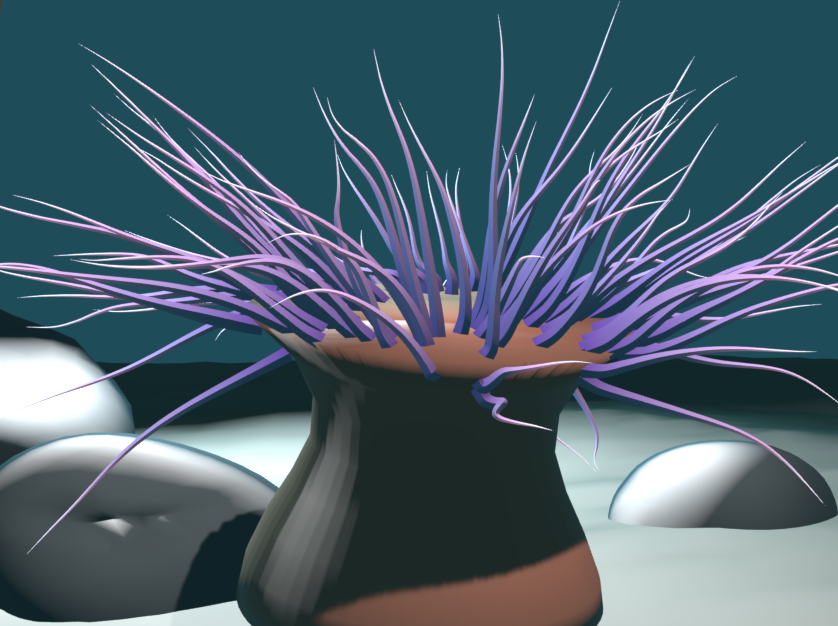 | [Hair Dynamics](hair-dynamics.md): Hair curves grown by Generate Hair Curves and simulated by Blender's Hair Dynamics node group in a simulation zone. | The simulation matches Blender frame by frame; a jump to a far frame simulates every frame up to it, and the Shader Editor does not show the hair's material. | Operators: 35 complete, 1 working in part, of 66; Menus and panels: 21 of 22 | [Open in Bylonder](https://propolisa.github.io/bylonder/#example=hair-dynamics) | [Manual](https://docs.blender.org/manual/en/5.2/modeling/geometry_nodes/simulation/hair_dynamics.html) |
| 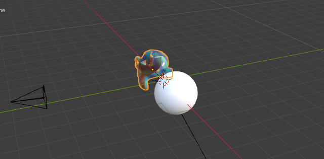 | [Images and Image Textures](image-textures.md): Open, create, pack and save images with Blender's own readers and writers, view them in the Image Editor, and draw them on materials through the Image Texture node with Babylon's texture sampling, here a framed screen print, its paper grain and an oak floor, each an image. | Images open, save, pack and draw on materials with Blender's readers; colors show with the Standard view, and Clip, Cubic, Box projection and UDIM sampling are simplified. | Operators: 18 complete, 1 working in part, of 19; Menus and panels: 19 of 20 | [Open in Bylonder](https://propolisa.github.io/bylonder/#example=framed-print) | [Manual](https://docs.blender.org/manual/en/5.2/editors/image/index.html) |
| 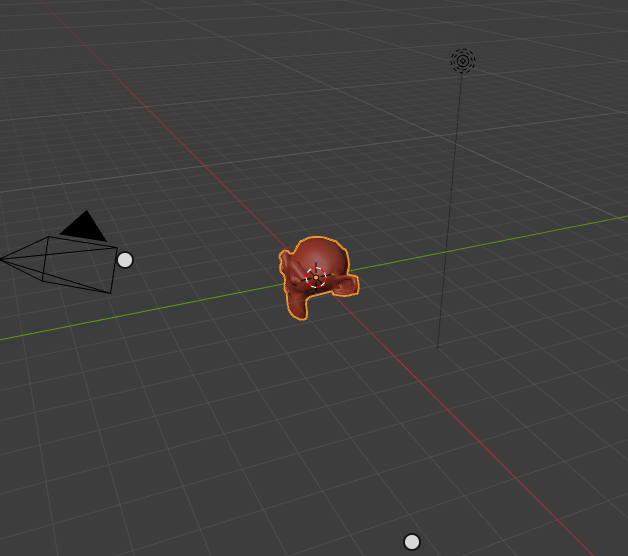 | [Import and Export](import-export.md): Bring scenes in and write them out with Blender's own importers and exporters (Wavefront OBJ, Stanford PLY, STL, FBX) and its default add-ons (glTF 2.0, FBX export, Motion Capture, SVG as Curves), through the browser's file dialogs with each format's options. | OBJ, PLY, STL, FBX, glTF 2.0, BVH and SVG import and export with Blender's own code and options; the add-ons' entries wait a few seconds for Python the first time File opens, Alembic and USD are greyed out, and an export's extra files download. | Operators: 18 complete, 22 working in part, of 50; Menus and panels: 8 complete, 2 working in part, of 10 | [Open in Bylonder](https://propolisa.github.io/bylonder/#example=import-export) | [Manual](https://docs.blender.org/manual/en/5.2/files/import_export/index.html) |
| 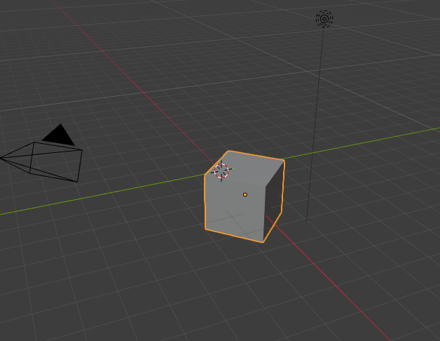 | [Keyframe Animation](keyframe-animation.md): Key an object's rotation with I at two frames, shape the motion between them with an F-curve's interpolation and easing in the Graph Editor, and play it. | Keying with I, the Timeline, the Graph Editor's interpolation and easing modes and playback work as in Blender, evaluated by Blender's animation code; the Graph Editor's Frame All does not frame the curves yet. | Operators: 73 complete, 1 working in part, of 112; Menus and panels: 19 of 25 | [Open in Bylonder](https://propolisa.github.io/bylonder/#example=newtons-cradle) | [Manual](https://docs.blender.org/manual/en/5.2/animation/keyframes/introduction.html) |
| 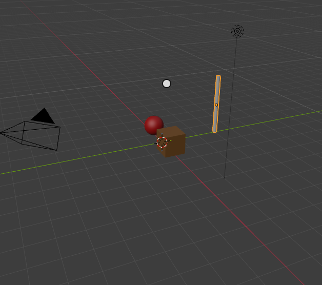 | [Link and Append](link-append.md): Bring collections, objects, materials and any other data-block in from another .blend with File > Link and File > Append, browsing inside the file in Blender's own File Browser, and make linked data editable with library overrides. | Link and Append run Blender's own code with all their options and browse the .blend in Blender's File Browser; the .blend comes from the browser's file dialog, the project keeps it in its libraries folder, and a .blend saved with File > Save As refers to it at /libraries/. | Operators: 25 complete, 22 working in part, of 57; Menus and panels: 15 complete, 2 working in part, of 21 | [Open in Bylonder](https://propolisa.github.io/bylonder/#example=link-append) | [Manual](https://docs.blender.org/manual/en/5.2/files/linked_libraries/link_append.html) |
| 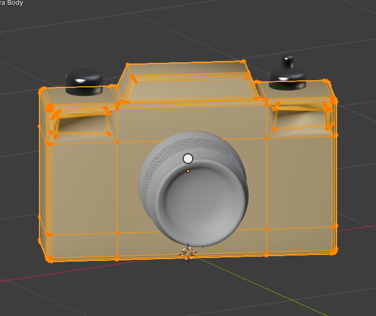 | [Mesh Modeling](mesh-modeling.md): Model a mesh in Edit Mode with Blender's own tools, Loop Cut, Inset, Extrude, Bevel, Bisect and Spin, here shaping a rangefinder camera. | Edit Mode's tools, their keys, modal options and gizmos are Blender's code and give Blender's result; picking elements under the pointer works as in X-ray, so hidden faces can be picked. | Operators: 172 of 199; Menus and panels: 29 of 32 | [Open in Bylonder](https://propolisa.github.io/bylonder/#example=mesh-modeling) | [Manual](https://docs.blender.org/manual/en/5.2/modeling/meshes/editing/index.html) |
| 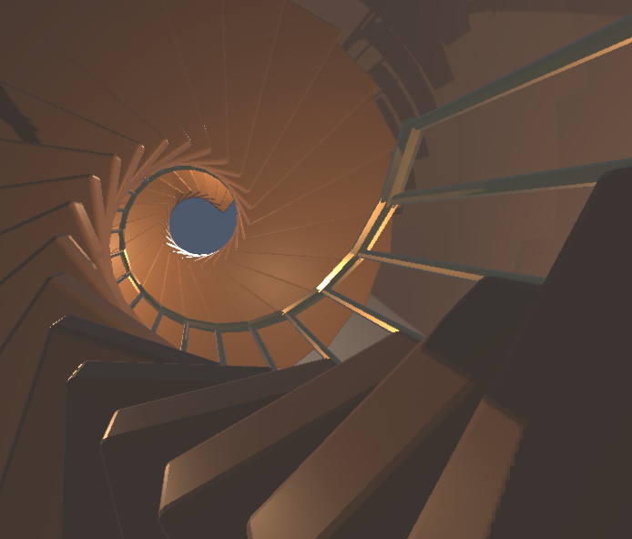 | [Modifiers](modifiers.md): Add, edit and stack modifiers in Properties > Modifiers, here a Bevel and an Array with an Object Offset that turn one box into a spiral stair. | Blender's modifiers run Blender's code and give its result; modifier panels cut long labels short. | Operators: 29 of 59; Menus and panels: 8 of 9 | [Open in Bylonder](https://propolisa.github.io/bylonder/#example=arrays) | [Manual](https://docs.blender.org/manual/en/5.2/modeling/modifiers/index.html) |
| 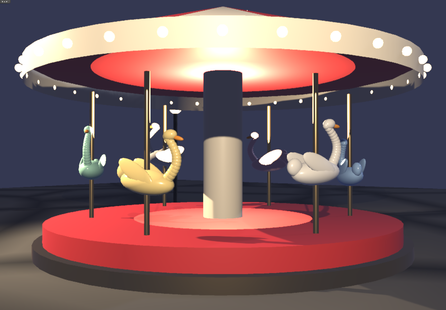 | [Nonlinear Animation](nla.md): Layer and mix actions as strips on tracks in Blender's Nonlinear Animation editor, with push down, tweak mode, strip blending, influence and repeats, evaluated by Blender's animation system. | Tracks, strips, tweak mode and strip blending run Blender's code and evaluate as in Blender; the action line has no Push Down button, and sound strips and control curves are listed but not checked against Blender's drawing. | Operators: 61 complete, 1 working in part, of 72; Menus and panels: 15 of 22 | [Open in Bylonder](https://propolisa.github.io/bylonder/#example=carousel) | [Manual](https://docs.blender.org/manual/en/5.2/editors/nla/index.html) |
| 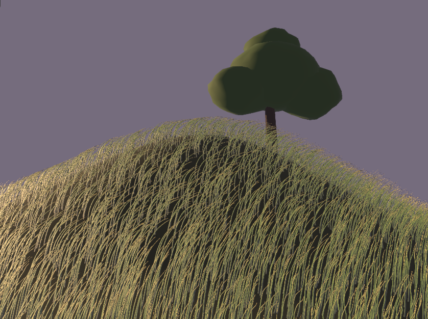 | [Particle Hair](particle-hair.md): A hair particle system on a mesh, set up in Properties > Particles and shaped with the Comb brush in Particle Edit Mode, here the grass of a hill combed by the wind. | Hair systems, children and Particle Edit Mode's brushes run Blender's code; hair UV and color attributes are not drawn. | Operators: 9 of 11; Menus and panels: 58 of 59 | [Open in Bylonder](https://propolisa.github.io/bylonder/#example=particle-hair) | [Manual](https://docs.blender.org/manual/en/5.2/physics/particles/hair/index.html) |
| 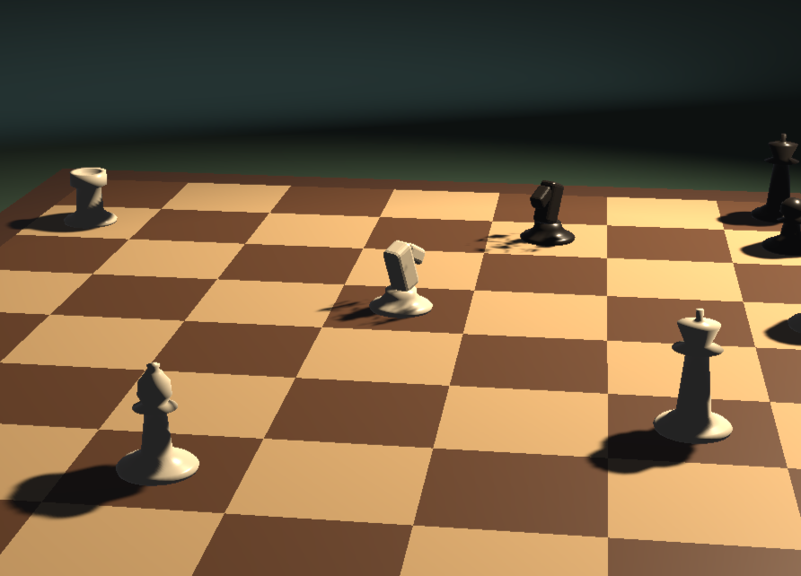 | [Preferences](preferences.md): Blender's Preferences editor with all of its sections and settings, kept in this browser, with laptop input (Emulate 3 Button Mouse, Emulate Numpad, trackpad gestures), Blender's keymaps to edit, and its themes on the interface. | Input, navigation, keymaps and themes work and are kept in this browser; settings a browser cannot honor (NDOF, file paths, viewport quality, add-on installs) are greyed out. | Operators: 15 of 20; Menus and panels: 16 complete, 164 working in part, of 188 | [Open in Bylonder](https://propolisa.github.io/bylonder/#example=chess) | [Manual](https://docs.blender.org/manual/en/5.2/editors/preferences/index.html) |
| 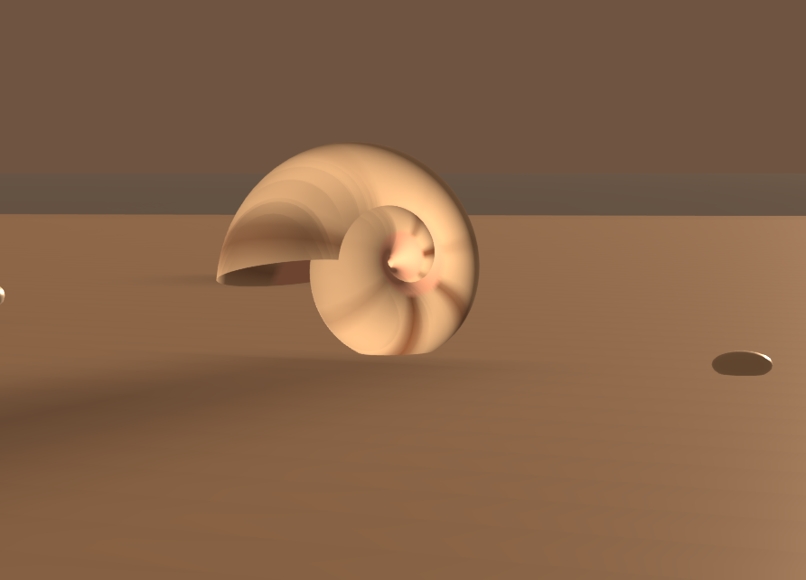 | [Python Scripts, Console and Add-ons](python.md): Run Python scripts, type in the Python Console and install add-ons, with Blender's own bpy and numpy in CPython 3.13. | Scripts, the Python Console and add-ons and extensions run on Blender's own bpy and numpy as in Blender once Python has loaded (a few seconds the first time); no threads, network or gpu module, and the interface itself stays on the app's own drawing. | Operators: 197 complete, 16 working in part, of 292; Menus and panels: 41 complete, 5 working in part, of 54 | [Open in Bylonder](https://propolisa.github.io/bylonder/#example=python) | [Manual](https://docs.blender.org/manual/en/5.2/editors/text_editor.html) |
| 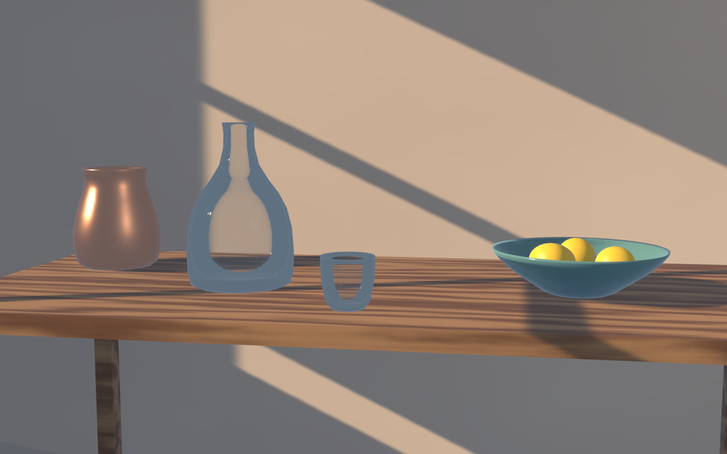 | [Rendering](rendering.md): Light a scene with Blender's lights and world and render it as EEVEE does, in Rendered shading and with Render Image, through Blender's camera. | Lights, shadows, the world's color, glass and anti-aliasing render close to EEVEE from Blender's own settings; reflections and refraction see only the world, not the room around them. | Operators: 5 of 6; Menus and panels: 26 of 26 | [Open in Bylonder](https://propolisa.github.io/bylonder/#example=rendering) | [Manual](https://docs.blender.org/manual/en/5.2/render/eevee/index.html) |
| 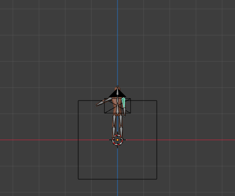 | [Rigging and Posing](rigging.md): Pose an armature's bones in Pose Mode, select them with clicks, boxes, circles, lassos and L, key the pose with I, organize bones with bone collections and constraints, keep poses in the pose library's asset shelf, and paint a mesh's weights. | Posing, selecting, keying, bone collections, constraints, weight paint and the pose library work as in Blender; bone selection ignores depth and pose assets have no preview. | Operators: 139 complete, 1 working in part, of 167; Menus and panels: 92 complete, 1 working in part, of 99 | [Open in Bylonder](https://propolisa.github.io/bylonder/#example=desk-lamp) | [Manual](https://docs.blender.org/manual/en/5.2/animation/armatures/posing/index.html) |
| 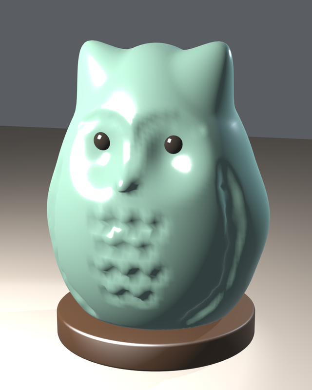 | [Sculpting](sculpting.md): Sculpt a mesh in Sculpt Mode with Blender's brushes, Grab, Draw, Crease, Inflate and Smooth, each stroke one undo step, here on a ceramic owl. | Sculpt Mode, its brushes, their keys and strokes are Blender's code and move the mesh as Blender's do; dynamic topology and multiresolution sculpting are not set up in the steps. | Operators: 52 complete, 1 working in part, of 54; Menus and panels: 19 of 19 | [Open in Bylonder](https://propolisa.github.io/bylonder/#example=sculpting) | [Manual](https://docs.blender.org/manual/en/5.2/sculpt_paint/sculpting/introduction/index.html) |
| 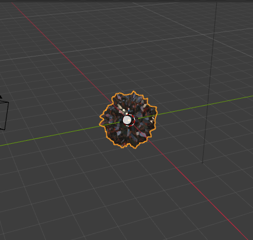 | [Shader Nodes](shader-nodes.md): Build a material from Blender's shader nodes in the Shader Editor, here a planet's seas, coasts, land and ice caps, a cratered moon and a starry sky, with no image at all. | 76 of Blender's shader nodes run; textures, converters and inputs run Blender's GLSL and match EEVEE pixel for pixel, while shaders are Babylon's PBR lighting, close to EEVEE but not equal; lights cast shadows, a sun's softened by its Angle (area lights none); Material Preview lights the scene with Blender's studio light and the sun EEVEE takes from it. | Operators: 144 complete, 2 working in part, of 173; Menus and panels: 37 of 40 | [Open in Bylonder](https://propolisa.github.io/bylonder/#example=blue-planet) | [Manual](https://docs.blender.org/manual/en/5.2/editors/shader_editor.html) |
| 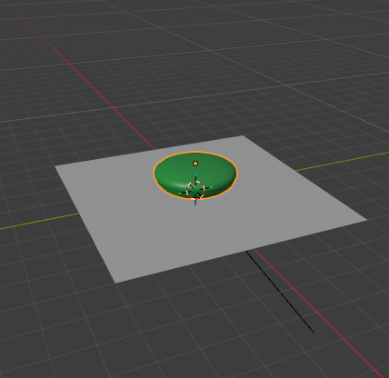 | [Shape Keys](shape-keys.md): Shape a mesh with Blender's shape keys, their values, ranges, vertex groups, relative keys, pinning and locks, edit a key in Edit Mode and key its value, drawn as Blender evaluates them or blended by Babylon's morph targets on the GPU. | Shape keys, their values, ranges, pinning and Edit Mode work as in Blender; on Babylon (mapped) shading differs slightly between keys and only relative keys on unmodified meshes blend on the GPU. | Operators: 26 of 28; Menus and panels: 7 of 7 | [Open in Bylonder](https://propolisa.github.io/bylonder/#example=lotus) | [Manual](https://docs.blender.org/manual/en/5.2/animation/shape_keys/introduction.html) |
| 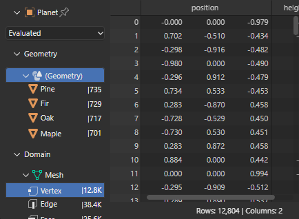 | [Spreadsheet](spreadsheet.md): Blender's Spreadsheet editor, listing the active object's evaluated or original geometry by component and domain, with its attributes as columns. | Components, domains and evaluated or original data list as in Blender; the sidebar's row filters are missing and columns cannot be resized or reordered. | Operators: 1 of 1; Menus and panels: 3 of 3 | [Open in Bylonder](https://propolisa.github.io/bylonder/#example=geometry-nodes) | [Manual](https://docs.blender.org/manual/en/5.2/editors/spreadsheet.html) |
| 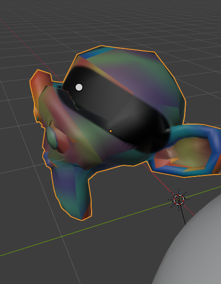 | [Texture Paint and Vertex Paint](texture-paint.md): Paint an object's image texture in the 3D Viewport or the Image Editor with Blender's brushes and projection painting, and paint its color attribute in Vertex Paint Mode, here a vase hand painted in cobalt and a dish with a blue rim. | Painting in the 3D Viewport, the Image Editor and Vertex Paint runs Blender's brushes; colors show with the Standard view, and brush textures are not drawn in the cursor. | Operators: 16 of 16; Menus and panels: 38 of 40 | [Open in Bylonder](https://propolisa.github.io/bylonder/#example=texture-paint) | [Manual](https://docs.blender.org/manual/en/5.2/sculpt_paint/texture_paint/index.html) |
| 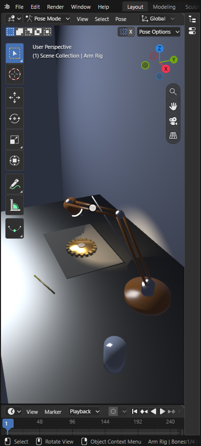 | [Touch and Pen](mobile.md): Blender's own screens, keymaps and operators on large phones and tablets, with gestures for navigation, press and hold for tooltips and right clicks, pinch to scale the interface, drawers for areas that do not fit and a touch bar for keys. | Blender's screens, menus, tools and context menus work by touch on a large phone or a tablet; the UI stays dense (pinch over it to scale it); a dragged value shows above the finger with soft Shift and Ctrl; area edges and headers take a long press; a one row touch bar gives modifier keys, a keys pie and a keyboard, with tappable bubbles while a transform runs; hover needs a pen. | Operators: 9 of 13; Menus and panels: 5 of 8 | [Open in Bylonder](https://propolisa.github.io/bylonder/#example=robot-arm) | [Manual](https://docs.blender.org/manual/en/5.2/editors/3dview/navigate/navigation.html) |
| 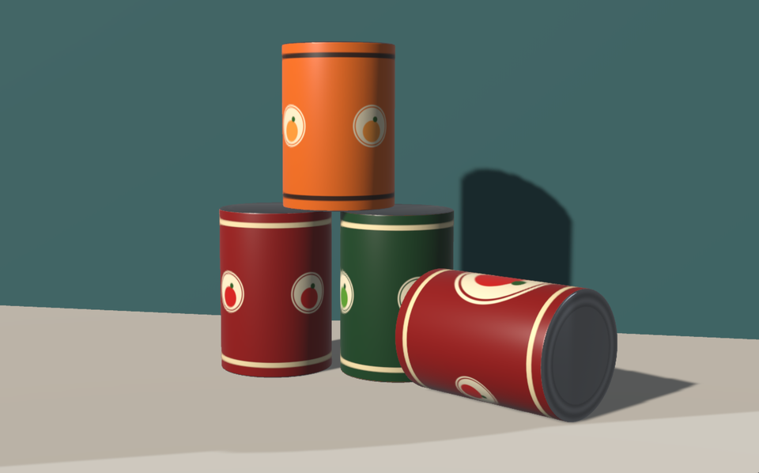 | [UV Editing](uv-editing.md): Unwrap a mesh with UV > Unwrap, Smart UV Project or Project from View, mark seams, and select, move, pin, stitch and pack its UVs in the UV Editor over the image they map, here four food cans whose labels and lids come from one image. | Unwrapping and UV editing run Blender's operators; UV Sculpt has no brush cursor and Display Stretch is not drawn. | Operators: 17 of 17; Menus and panels: 23 of 23 | [Open in Bylonder](https://propolisa.github.io/bylonder/#example=tin-cans) | [Manual](https://docs.blender.org/manual/en/5.2/modeling/meshes/uv/index.html) |
| 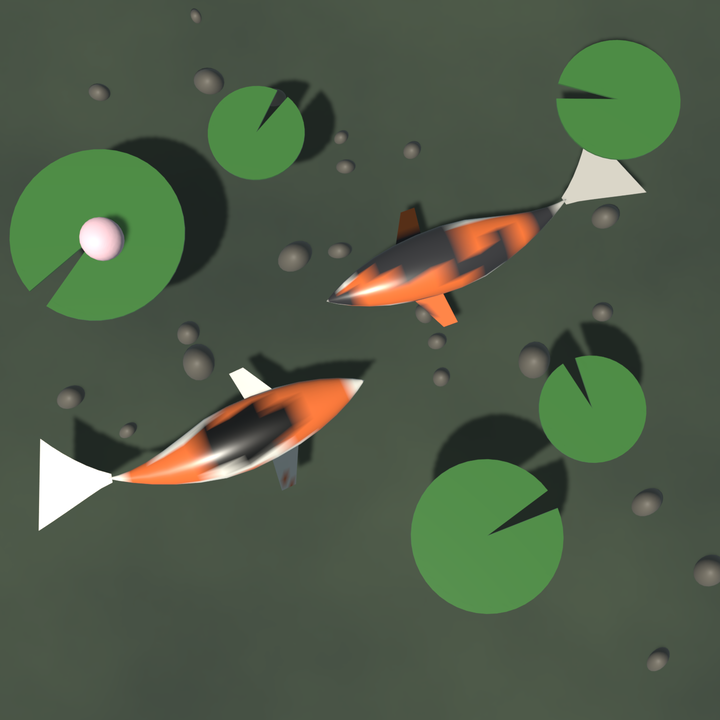 | [Vertex and Weight Paint](vertex-and-weight-paint.md): Paint a mesh's color attribute in Vertex Paint and a vertex group's weights in Weight Paint, here the markings of two koi and the part of them a modifier swings. | Vertex Paint and Weight Paint, their brushes, strokes and overlays are Blender's code and paint as Blender does, one undo step per stroke; a material shows a color attribute through the Color Attribute node. | Operators: 15 of 16; Menus and panels: 5 of 5 | [Open in Bylonder](https://propolisa.github.io/bylonder/#example=vertex-and-weight-paint) | [Manual](https://docs.blender.org/manual/en/5.2/sculpt_paint/vertex_paint/index.html) |
| 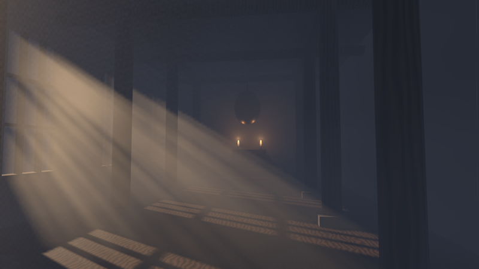 | [Volumes](volumes.md): Fill an object with fog, dust or smoke from a material's Volume shader and light it as EEVEE does, here sunset shafts through a temple's windows into drifting dust. | Principled Volume, Volume Scatter and Volume Absorption on objects and the world draw in EEVEE's froxel grid from the scene's Volumes settings, lit by sun, spot and point lights through their shadows (light shafts) and by the world, close to EEVEE in shape, density and color; a volume fills its object's bounding box rather than its mesh, a 4D Noise Texture's density draws empty, and a moving view shows the grid's noise until it holds still. | Operators: 4 of 4; Menus and panels: 7 of 7 | [Open in Bylonder](https://propolisa.github.io/bylonder/#example=volumes) | [Manual](https://docs.blender.org/manual/en/5.2/render/shader_nodes/shader/volume_principled.html) |
