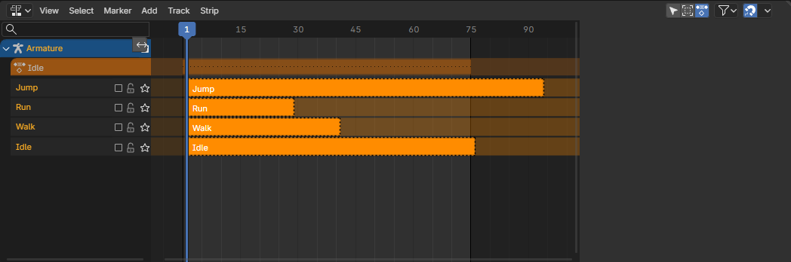
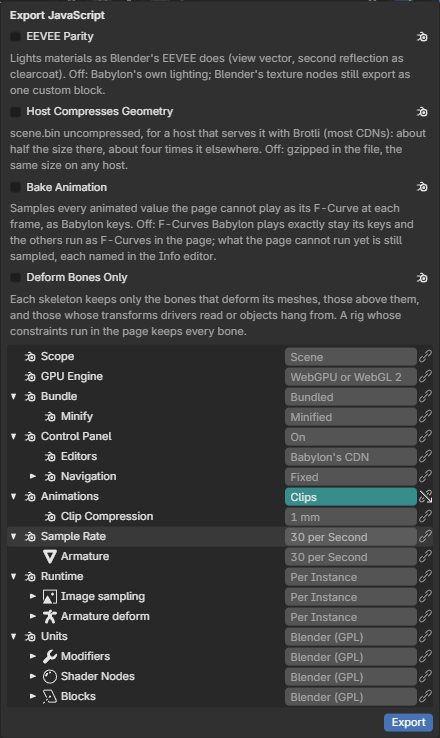
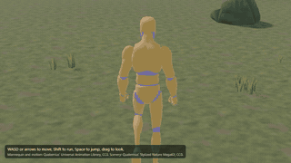
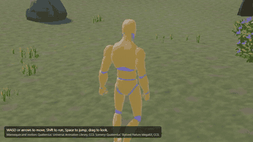

# Character Animation

A character is an armature of an exported scene that moves in the page. The animator makes its actions in Blender;
input says what the character wants (a velocity, a facing, a jump); locomotion picks and blends its actions from how
it moves; effects fit the pose to the world, the feet planted on the ground and the head turned toward what is near;
the rig's own constraints solve the result as in Blender. A basic character needs only a skeleton and a few baked
actions named Idle, Walk, Run and Jump: their foot contacts, gait speeds and the jump's flight are found from the
actions when the page loads. The guide, with the whole API, is [Character animation](../character-animation.md).

[Open in Bylonder](https://propolisa.github.io/bylonder/#example=basic-character)

The same system on a production rig: [Open Snow in Bylonder](https://propolisa.github.io/bylonder/#example=character-controller),
Blender Studio's character walking, running and acting through its rig's own constraints, built by
`examples/character-controller/character-controller.py`.

## Steps

1. Build the example: `blender -b --factory-startup -P examples/basic-character/basic-character.py`. It downloads
   Quaternius' Universal Animation Library (CC0), keeps its mannequin as an armature named Armature with four baked
   actions (Idle, Walk, Run, and Jump joined from the library's start, airborne loop and landing), each on a muted
   track of the Nonlinear Animation editor, and puts it in the character examples' environment
   (`environment.build()` from `examples/character-controller/environment.py`): a 60 m field of rolling turf ringed
   by a rim of hills, with steps, a slope, sparse grass and a few rocks, bushes and pines. No markers, root motion or
   IK are needed.

   

2. Export it with File > Export > JavaScript, Animations set to Clips, so each action becomes a clip the page plays by
   its name.

   

3. In the page, make the character from its armature, give it the default input (arrows or WASD, Shift to run, Space
   to jump, a stick on touch screens) and let locomotion play its body; the scene's camera follows it, drag to orbit:

   ```js
   import { createEngine, load, Character, followCamera } from './basic-character/scene.js';

   const engine = await createEngine(canvas);
   const blend = await load(engine);
   const hero = new Character(blend, 'Armature', { input: 'default' });
   hero.body.play(hero.locomotion);
   followCamera(hero);
   engine.runRenderLoop(() => blend.scene.render());
   ```

   Locomotion blends Walk and Run by speed on one shared cycle, played at the rate that keeps a planted foot still; a
   stop finishes its step where the movement comes to rest, a turn in place steps the feet round, and Space plays the
   jump from its takeoff.

   

4. Fit it to the world: `feet()` sets each foot on the ground's height and slope under it, locks it where it lands
   while its action has contact and lowers the hips when a foot must reach down, eased so steps do not pop; `gaze()`
   turns the eyes, then the head, toward the most interesting target near it.

   ```js
   import { feet, gaze } from './basic-character/scene.js';

   hero.add(feet());
   hero.add(gaze({ targets: [blend.scene.activeCamera] }));
   ```

   

## Project files

- [basic-character.py](../../examples/basic-character/basic-character.py): builds the character, its four actions and
  their tracks, and the environment, in Blender 5.2.
- [environment.py](../../examples/character-controller/environment.py): the demo environment the character examples
  share.
- `docs/demos/basic-character/`: the exported page, step 3 and 4's code as it runs.
- Recorded by [record-character-animation.mjs](../../tools/docs/record-character-animation.mjs).
