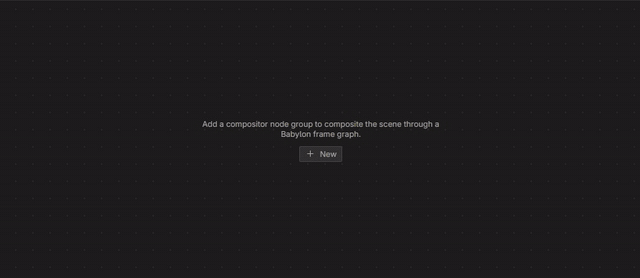
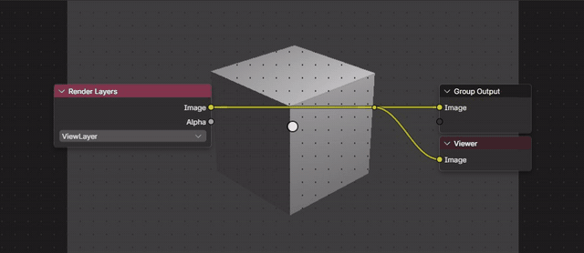
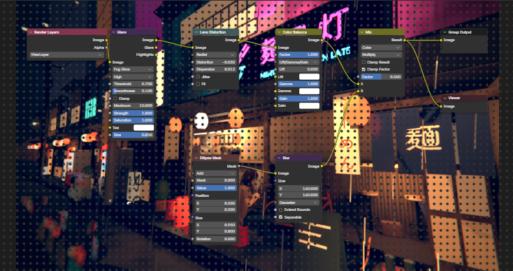
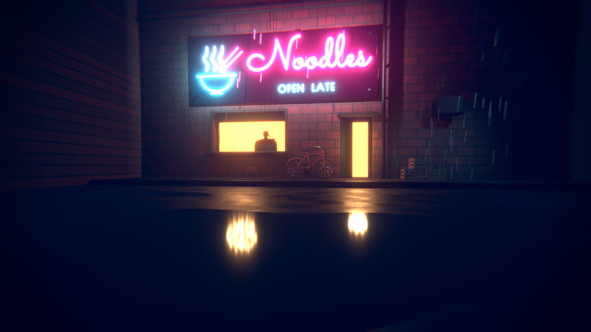
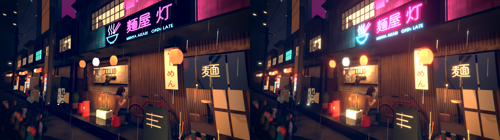
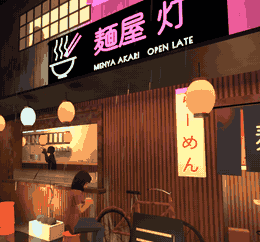

# Compositor

The Compositor finishes a render with nodes, as in Blender: the scene's compositing node group takes the render from
Render Layers and gives the Group Output the final image. Bylonder edits Blender's own node group, so the tree is the
one a .blend saves and Blender opens. Render > Render Image composites it with Blender's own compositor, every node as
Blender runs it; the Compositor's backdrop and a Rendered view with Viewport Shading > Compositor on show the pixel
nodes live.

[Open in Bylonder](https://propolisa.github.io/bylonder/#example=compositor)

The demo, Akari Noodle House, is a small ramen bar's neon sign in a narrow lane on a wet night, with customers at the counter
behind the window and the lane's lanterns mirrored in a puddle, built in Blender by
`compositor.py`. It is also a 10 s animation that loops: keyframes repeated by F-Curve Cycles modifiers sway the
lanterns and the noren, flicker the dead neon tube and move the woman's rig for a breath and a sip. The steps below make a compositing node group from the Default Cube, then open the example for its
tree and render.

## Steps

1. **A compositing node group.** Click the Compositing tab and New in the Compositor: Blender's new node group,
   Render Layers into the Group Output. The backdrop shows the render through the camera.

   

2. **A grade.** Shift A, type Color Balance, Enter and click to place it. Drag from Render Layers' Image to its
   Image, and from its Image to the Group Output. Click Gain and type 1.8: the backdrop brightens.

   

3. **The example's tree.** Open the example. Render Layers goes through Glare (Fog Glow, Threshold 0.7, Size 0.85, Strength 1.8),
   which spreads a glow around everything brighter than the threshold, then Lens Distortion (Distortion -0.03,
   Dispersion 0.012) for a slight barrel and color fringes at the edges, and Color Balance (Lift a little blue, Gain a
   little warm). An Ellipse Mask, softened by a Blur, is multiplied over the image by a Mix for the vignette. A Viewer
   shows the result.

   

4. **The render.** Render > Render Image renders through the camera and composites the result with Blender's
   compositor; the Render window shows Compositing while it runs.

   

5. **What Glare does.** Click Glare and press M to mute it, then Render Image again. Without it (left) the tubes, the
   window and the doorway are flat; with it (right) they glow.

   

6. **The loop.** Press Space in the 3D Viewport to play the timeline: frames 1 to 240 run into each other.

   

## Project files

- [compositor.py](../../examples/compositor/compositor.py): builds the scene and its compositing node group in Blender
  5.2.
- [compositor.blend](../../examples/compositor/compositor.blend): the file the script saves.
- [fonts](../../examples/compositor/fonts): Zen Maru Gothic (a subset of the glyphs the scene uses) and Poiret One, with their SIL Open Font License files.
- [index.js](../../examples/compositor/index.js): opens the .blend with Blender's reader.
- Recorded by [record-compositor.mjs](../../tools/docs/record-compositor.mjs).
