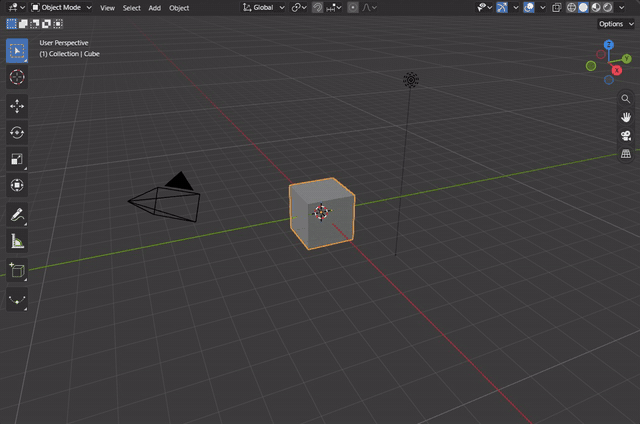
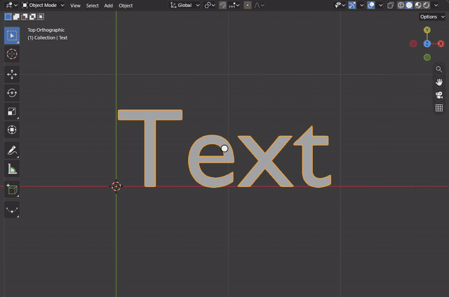
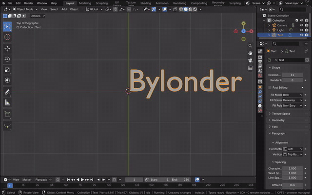
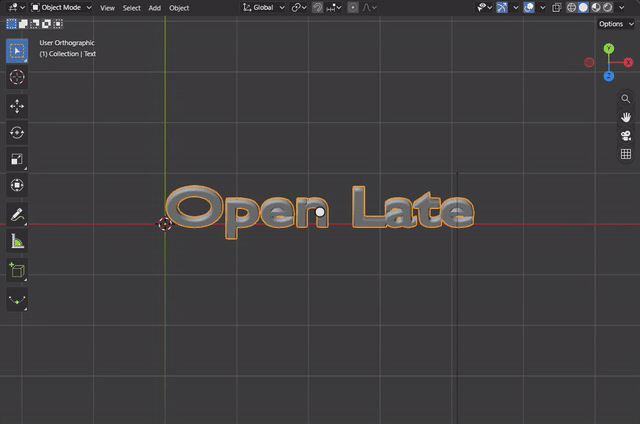
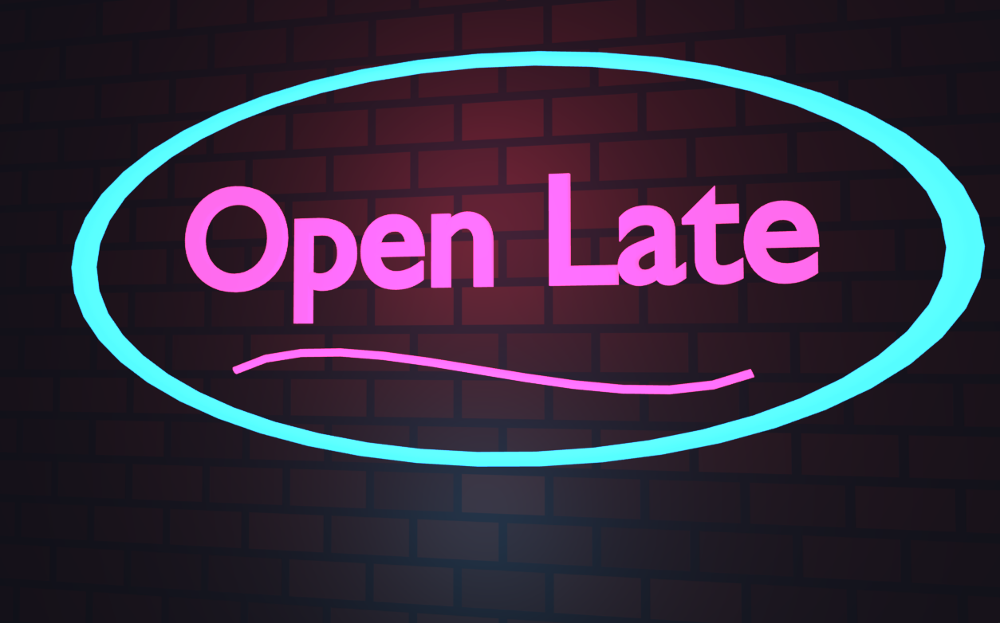

# Curves and Text

Blender's Curve and Text objects are Blender's own data in the module: the text layout, the curve evaluation with
bevel and extrude, and Edit Mode on both (`docs/curves-and-text.md`). Tab enters Edit Mode, where a text takes typed
characters and a curve's points are selected, moved and extruded with Blender's operators and keymaps.

[Open in Bylonder](https://propolisa.github.io/bylonder/#example=neon-sign)

The demo, Neon Sign, is a sign on a brick wall at night: its words a text object, its frame and swoosh Bézier curves,
all beveled round so they read as glass tubes, built in Blender by `neon-sign.py`. The steps below make a text and a
tube by hand from the Default Cube.

## Steps

1. **Add a text.** Click the cube, press X > Delete, hover the viewport and press Shift A > Text. Numpad 7 looks from
   the top, where the text lies, and Numpad . frames it.

   

2. **Type.** Press Tab for Edit Mode, Backspace four times to delete the word Text, type Open Late and press Tab to
   leave.

   

3. **Give it depth.** In Properties > Data, open Geometry: Extrude 0.02 sets the thickness, and Bevel's Depth 0.03
   rounds the edges into a tube. Numpad 8 tilts the view to see them.

   

4. **A tube.** Shift A > Curve > Circle adds a Bézier circle; S X 3 Enter stretches it into an oval around the words.
   In Properties > Data, Bevel's Depth 0.05 turns the curve into a round tube.

   

5. **The sign.** The example gives the words and the swoosh, a Bézier curve whose two points' handles draw a wave, a
   pink emissive material, and the oval a blue one. Two point lights in the tubes' colors light the wall, a Brick
   Texture. Numpad 0 and Rendered shading show it through the camera.

   

## Project files

- [neon-sign.py](../../examples/neon-sign/neon-sign.py): builds the wall, the text, the curves, the materials and the
  lights in Blender 5.2.
- [neon-sign.blend](../../examples/neon-sign/neon-sign.blend): the file the script saves.
- [index.js](../../examples/neon-sign/index.js): opens the .blend with Blender's reader.
- Recorded by [record-curves-and-text.mjs](../../tools/docs/record-curves-and-text.mjs).
