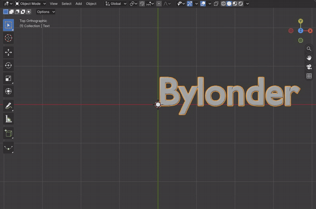

# Curves and Text

Blender's Curve and Text objects are Blender's own data in the module: the text layout, the curve evaluation with
bevel and extrude, and Edit Mode on both (`docs/curves-and-text.md`). Tab enters Edit Mode, where a text takes typed
characters and a curve's points are selected, moved and extruded with Blender's operators and keymaps.

[Open in Bylonder](https://propolisa.github.io/bylonder/#example=text)

The demo, 3D Text, is an extruded title in a Google Fonts family made from code. The steps below make a text and a
curve by hand from the Default Cube.

## Steps

1. **Add a text.** Click the cube, press X > Delete, hover the viewport and press Shift A > Text. Numpad 7 looks from
   the top, where the text lies.

   

2. **Type.** Press Tab for Edit Mode, Backspace to delete the word Text, type a new one and press Tab to leave.

   

3. **Give it depth.** In Properties > Data, open Geometry: Extrude sets the thickness, and Bevel's Depth rounds the
   edges. Numpad 8 tilts the view to see them.

   

4. **A curve.** Shift A > Curve > Bézier adds a curve. In Edit Mode, E extrudes the selected end point and the mouse
   places it; V sets handle types and Alt C closes the curve.

   

## Project files

- [index.js](../../examples/text/index.js): the title made from code with the project SDK, its font from Google
  Fonts and its settings in a store.
- Recorded by [record-curves-and-text.mjs](../../tools/docs/record-curves-and-text.mjs).
