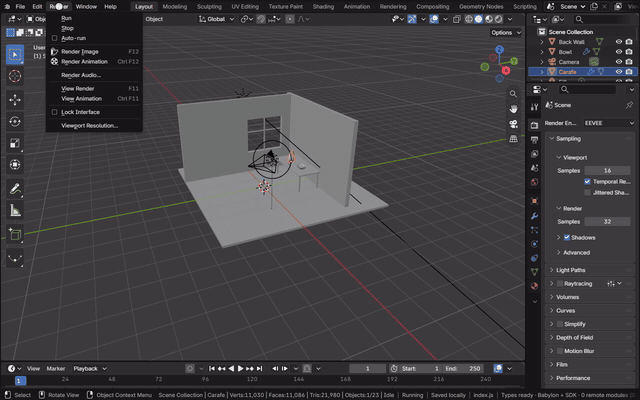
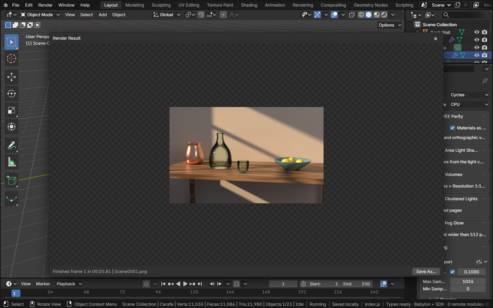

# Cycles

Cycles is Blender's path tracer, built from Blender's own sources as a module of its own that the page fetches the
first time the render engine becomes Cycles (about 1 MB compressed, with its add-on). It runs Blender's render job on
a thread of its own and traces on all the processors the page has, while the page goes on; Render Image shows the
result in the Render Result window, through the scene's view transform, as Blender shows it.

[Open in Bylonder](https://propolisa.github.io/bylonder/#example=rendering)

The demo is Window Light, the Rendering page's scene: a table by a window in late sun, rendered here by Cycles instead
of the EEVEE look.

## Steps

1. **Cycles as the render engine.** Properties > Render > Render Engine: Cycles. The first time, the page fetches
   Cycles and starts it, and its panels (Device, Sampling and the rest) join Properties > Render.

   

   

2. **Render Image.** Render > Render Image (F12) renders through the scene camera at the output's resolution, here a
   quarter of it, in the Render Result window, which shows how far Cycles is; Cancel stops it.

   

3. **The result.** The finished frame; Save As saves it.

   

## Project files

- [rendering.py](../../examples/rendering/rendering.py): builds the room, the objects, their materials, the lights,
  the world and the camera, in Blender 5.2.
- [rendering.blend](../../examples/rendering/rendering.blend): the file the script saves.
- Recorded by [record-cycles.mjs](../../tools/docs/record-cycles.mjs).
