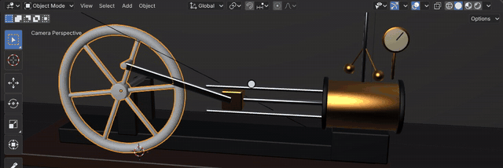
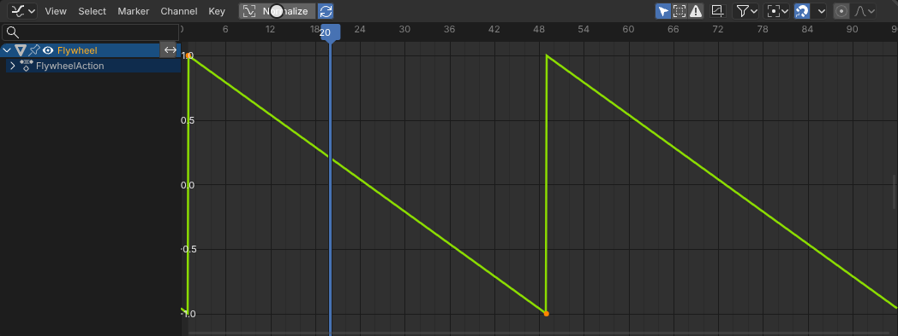
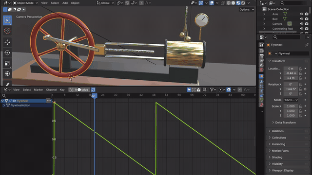
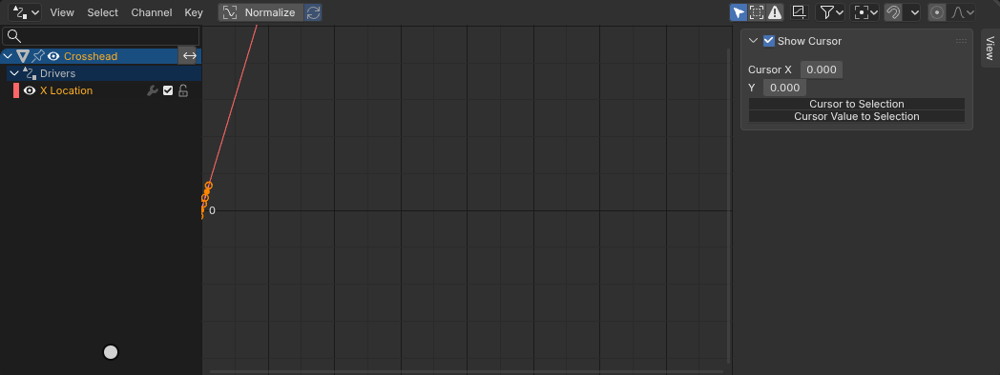
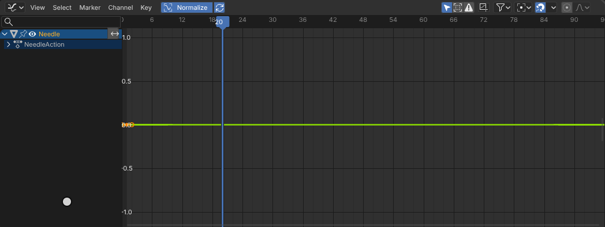

# Drivers and the Graph Editor

The Graph Editor shows an object's animation as F-curves, one per animated property, with their keys and handles;
its sidebar holds the active F-curve's and key's properties and its modifiers, which change the curve after its keys:
Cycles repeats it, Noise shakes it, Generator, Envelope, Stepped and Limits reshape it. A driver sets a property from
an expression over variables (other properties, transforms, distances), evaluated every time those change; the
Drivers editor lists them. All of it is Blender's animation system in the module: the editors are Blender's spaces,
drawn by Blender's code.

[Open in Bylonder](https://propolisa.github.io/bylonder/#example=drivers-and-graph-editor)

The demo, Steam Engine, is made in Blender by a script (`drivers-and-graph-editor.py`). Only the flywheel is keyed;
drivers turn its angle into the crosshead's travel, the connecting rod's position and tilt, the governor's spin and
the swing of its arms, and a Noise modifier shakes the pressure gauge's needle.

## Steps

1. **Play it.** Press Space: the flywheel turns and everything linked to it follows.

   

2. **The flywheel's F-curve.** Select Flywheel and switch the Timeline to the Graph Editor (Editor Type menu). Its Y
   Euler Rotation has two keys a turn apart, linear; the sidebar's (N) Modifiers tab shows the Cycles modifier that
   repeats them for as long as the scene runs.

   

3. **Change its speed.** With the pointer over the graph, A selects both keys and S X 0.5 Enter scales them in time
   to half: the flywheel turns twice as fast, and every driven part keeps up. Ctrl Z puts them back.

   

4. **A driver.** Select Crosshead and switch to Drivers. Its X Location's driver reads the flywheel's Y rotation as
   `a` and computes the slider-crank's travel, `0.45*cos(a) + sqrt(2.25 - 0.45*sin(a)*0.45*sin(a))`. Right click a
   property > Add Driver makes one; an expression like this one runs without Python.

   

5. **A Noise modifier.** Select Needle: its rotation has one key, and a Noise modifier on the curve makes it tremble.

   

## Project files

- [drivers-and-graph-editor.py](../../examples/drivers-and-graph-editor/drivers-and-graph-editor.py): builds the
  engine, its keys, F-curve modifiers and drivers, the lights and the camera, in Blender 5.2.
- [drivers-and-graph-editor.blend](../../examples/drivers-and-graph-editor/drivers-and-graph-editor.blend): the file
  the script saves.
- [index.js](../../examples/drivers-and-graph-editor/index.js): opens the .blend with Blender's reader.
- Recorded by [record-drivers-and-graph-editor.mjs](../../tools/docs/record-drivers-and-graph-editor.mjs).
