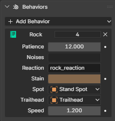
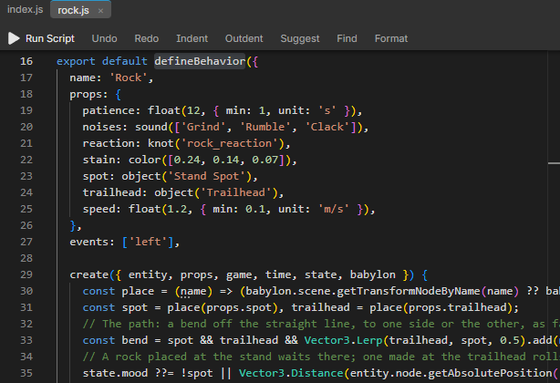
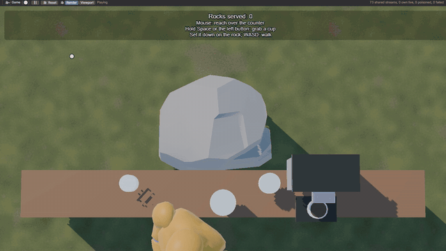

# Game Code

Game code is plain JavaScript in the project's `src/`, written with three definers from `bylonder`:
`defineBehavior` for logic on an object (one instance per object it is added to), `defineSystem` for game-wide
logic, and `defineGame` for the composition. A behaviour's props are custom properties of its object, so artists set
them in Object properties > Behaviors as Blender properties, and the playing game reads them live. The Game area plays
it all; saving a file swaps its code into the running game, keeping each behaviour's `state`.

[Open in Bylonder](https://propolisa.github.io/bylonder/#example=rock-hard-cafe)

The demo, Rock Hard Café, is a one-minute shift at an open-air coffee stand in a forest by a brook, whose only
customers are rocks: one at a time a rock rolls up from the trailhead, you pour a coffee at the machine and hand it
over, and it shivers with delight, makes a rock noise, spills it on itself and rolls back down. Each rock's path,
shiver and noise come from the run's seeded random, so every serve plays out differently and a replay plays the same.
The example opens on the Game workspace, the 3D View beside the Game area.

## Steps

1. **Add a behaviour.** Select a rock, open Object properties > Behaviors and choose Add Behavior > Rock. Its props
   (Patience, Noises, Reaction, Stain, Spot, Trailhead, Speed) appear as Blender properties; the count beside its name is its users, and
   hovering it lists the objects that carry it.

   

2. **Edit its code.** Click the behaviour's name (Edit Source): the code editor opens its file at
   its `defineBehavior`. Names of the .blend's actions, sounds and collections and the Ink story's knots complete,
   and a misspelt one is flagged.

   

3. **Play.** The Game area's Play runs the scene with its game code and gives it the keys (a click on the game takes
   them back after you work elsewhere): WASD walks the barista, E pours at the machine and serves a rock. Drag Patience while it plays and the waiting rocks change at once; save `rock.js` and its code is
   swapped in without restarting.

   

## Project files

- [cafe.py](../../examples/rock-hard-cafe/cafe.py): builds the café, its prefabs, sounds and behaviours in Blender 5.2.
- [src/behaviors/](../../examples/rock-hard-cafe/src/behaviors/): Rock, Barista, Machine and Spawner.
- [src/systems/](../../examples/rock-hard-cafe/src/systems/): Shift and Subtitles.
- [src/game.js](../../examples/rock-hard-cafe/src/game.js): the composition.
- [content/dialogue/cafe.ink](../../examples/rock-hard-cafe/content/dialogue/cafe.ink): the rocks' lines, an Ink story.
- Recorded by [record-game-code.mjs](../../tools/docs/record-game-code.mjs).
- Credits: the barista and the forest are Quaternius' Universal Animation Library and Stylized Nature MegaKit (CC0),
  [CREDITS.md](../../examples/rock-hard-cafe/CREDITS.md).
