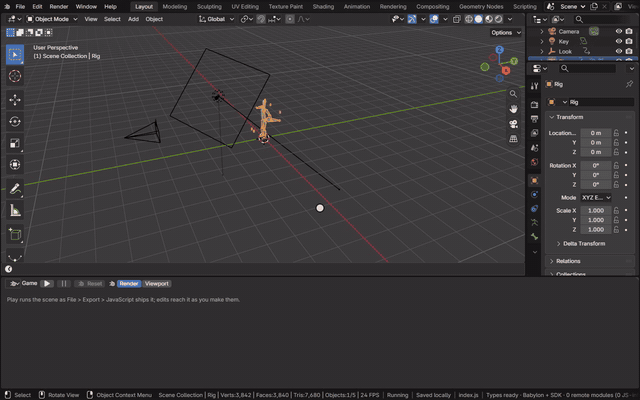
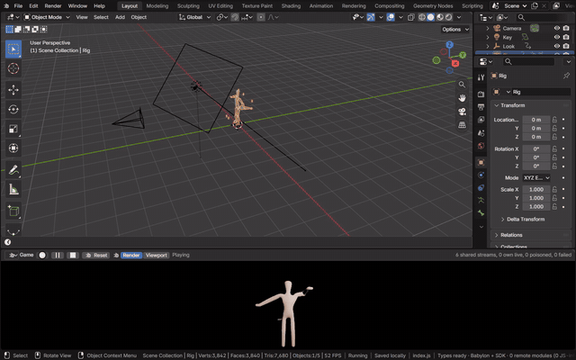
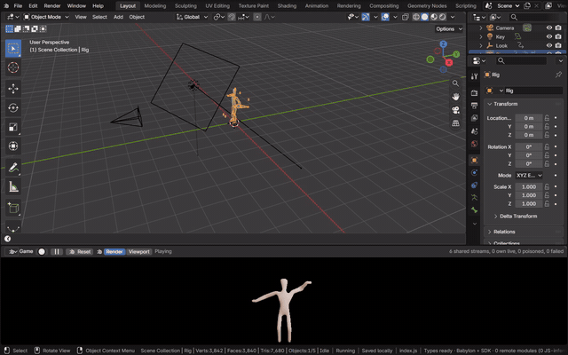
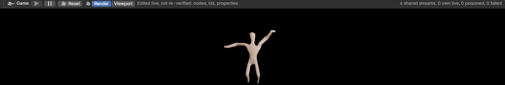
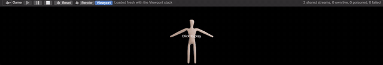

# Game

The Game area plays the scene the way an exported page does: File > Export > JavaScript's package, written in memory
and run by the page's own runtime in the app's own modules, on an engine of its own. While it plays, what you change in the app reaches it: an edit, undo or redo becomes
a patch the running game applies, keeping its state. Nothing the game does writes back to the scene. It is Bylonder's
own editor, chosen from an area's editor type menu.

[Open in Bylonder](https://propolisa.github.io/bylonder/#example=rigged-character)

## Steps

1. Open an area's editor type menu and choose Game, then press Play. The scene is exported and its page plays in the
   area, in Focus Mode: the area alone, without its header, and the page fullscreen. Preferences > System > Bylonder >
   Play in Focus Mode turns that off.

   

2. Press Esc, the phone's Back, or the faint button in the top right corner: the area goes back to its place in the
   layout and the game keeps playing. In its header, Pause holds the game and Reset starts it again from the scene as
   it is now. While the layout hides the area (another area maximized, or a folded drawer closed), the game draws
   nothing.

   

3. Edit the scene while it plays: move an object, change a material's colour or a light's power. The game shows the
   value on its next frame. Behind it the change is exported and checked; the header shows the export and says when
   the game was loaded fresh. Undo and redo of a value reach it the same way. Structural edits (a mesh, node links, a
   new modifier or object) reach the game once that export is done.

   

   The scene camera follows too: moving it in the 3D View (a grab or the sidebar's Transform),
   or changing its lens, moves the game's view. Game code that moves the camera builds on it: each frame it starts
   from `game.camera.authored`, the camera as the scene places it now, so the authored camera stays the base. Where the
   game's code holds a part of the camera itself (a follow camera's place, a field of view fitted to the play area),
   an edit of that part is not shown, and the header says so.

4. Choose the modifier stack the game evaluates in its header, Viewport or Render. It is the scene's export setting
   (File > Export > JavaScript's Modifier Stack, saved in the .blend), Render by default. Choosing one exports the scene
   again and loads the game fresh; the header says so. Here the body's Armature modifier is off in viewports and on in
   renders: Render poses the body by its rig, Viewport leaves it at rest.

   

   

5. Press Stop. The game ends: its engine, scene, physics, game code and sound are disposed and its render loop stops,
   so the app runs as fast as before Play. Play starts it again from the scene.

   

## Project files

The [Rigged Character](../../examples/rigged-character/) example's files.
