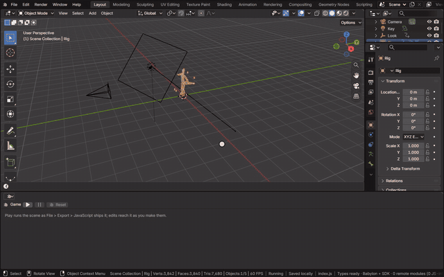
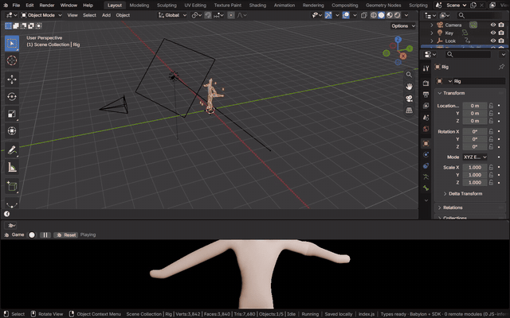

# Game

The Game area plays the scene the way an exported page does: File > Export > JavaScript's package, written in memory
and run by the page's own runtime. While it plays, what you change in the app reaches it: an edit, undo or redo becomes
a patch the running game applies, keeping its state. Nothing the game does writes back to the scene. It is Bylonder's
own editor, chosen from an area's editor type menu.

[Open in Bylonder](https://propolisa.github.io/bylonder/#example=rigged-character)

## Steps

1. Open an area's editor type menu and choose Game, then press Play. The scene is exported and its page plays in the
   area. Pause holds the game; Reset starts it again from the scene as it is now.

   

2. Edit the scene while it plays: move an object, change a light. Once the app is idle, the running game takes the
   change. Undo and redo reach it the same way.

   

## Project files

The [Rigged Character](../../examples/rigged-character/) example's files.
