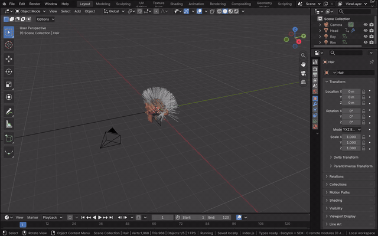
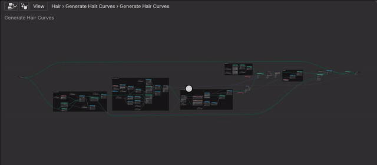
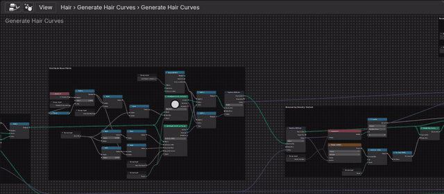
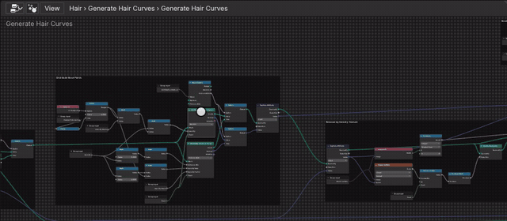

# Geometry Node Editor

The Geometry Node Editor shows the node group of the active object's active Geometry Nodes modifier, as in Blender.
The tree is Blender's, held in Main, and evaluated by Blender's geometry nodes; the editor reads it through RNA and
edits it with Blender's own operators, so each edit is an undo step and the 3D Viewport updates
(`docs/node-editors.md`, decision 10).

[Open in Bylonder](https://propolisa.github.io/bylonder/#example=hair-dynamics)

The demo is the [Hair Dynamics](hair-dynamics.md) example, built by a Blender script. Its Hair object has two
Essentials node groups as modifiers; the steps below open the first, Generate Hair Curves, and change it.

## Steps

1. **Open the editor.** With Hair selected, click the Shading tab, then pick Geometry Node Editor in the bottom area's
   editor type menu. Hover the editor and press Home to see the whole group.

   

2. **Navigate.** Scroll to zoom at the mouse and drag with the middle mouse button to pan. Frames group the nodes as
   their author laid them out.

   

3. **Mute a node.** Click a node's header to select it and press M. A muted node passes its first input through, and
   the hair is evaluated again; M again unmutes it.

   

4. **Add a node.** Press Shift A over the editor and type to search Blender's Add menu; Enter picks the best match
   and a click places it. Drag from an output socket to an input to link it.

   

> **Note** Properties > Modifiers makes a modifier active when its panel is clicked; the editor follows it, so the
> Hair Dynamics group opens the same way.

## Project files

- [hair-dynamics.py](../../examples/hair-dynamics/hair-dynamics.py) and
  [hair-dynamics.blend](../../examples/hair-dynamics/hair-dynamics.blend): the scene and its node groups.
- Recorded by [record-geometry-node-editor.mjs](../../tools/docs/record-geometry-node-editor.mjs).
