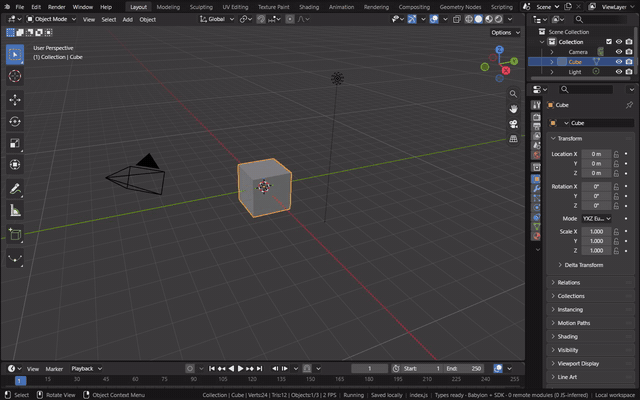
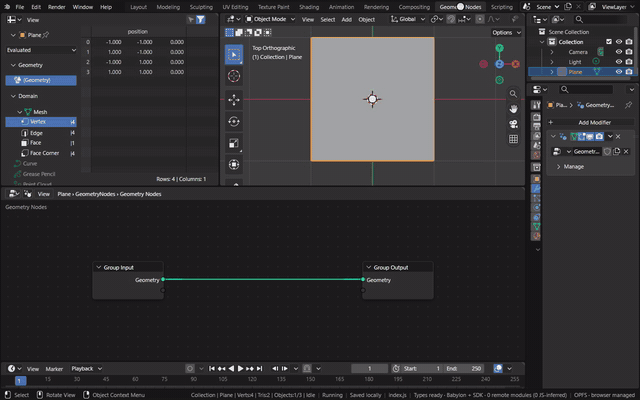
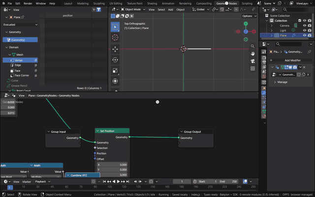
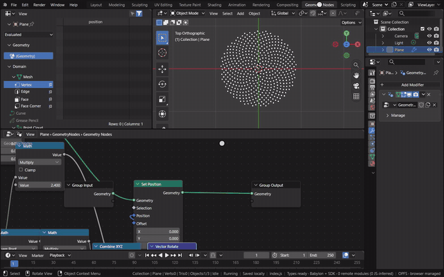
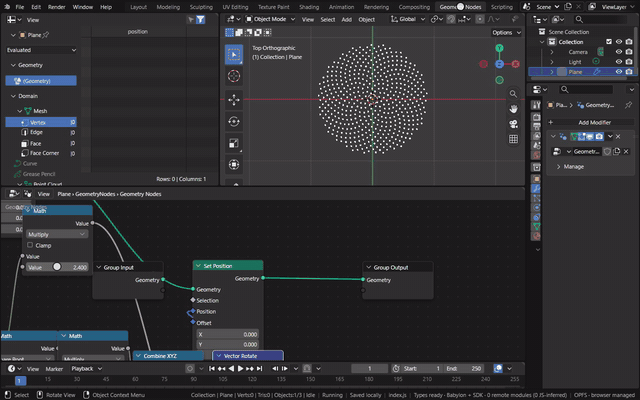
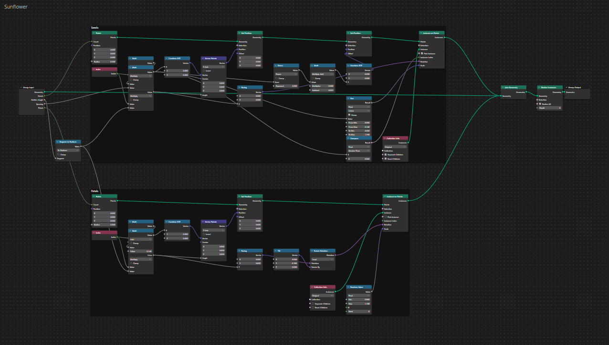

# Geometry Node Editor

The Geometry Node Editor shows the node group of the active object's active Geometry Nodes modifier, as in Blender.
The tree is Blender's, held in Main, and evaluated by Blender's geometry nodes; the editor reads it through RNA and
edits it with Blender's own operators, so each edit is an undo step and the 3D Viewport updates
(`docs/node-editors.md`, decision 10).

[Open in Bylonder](https://propolisa.github.io/bylonder/#example=geometry-node-editor)

The demo is a group of sunflowers (`geometry-node-editor.py`). Each head is a plain disc whose node group places its
seeds by Vogel's model of phyllotaxis: the n-th seed turns by n times the golden angle and sits at the square root of
n times a spacing from the middle. The steps below build that spiral from the Default Cube's scene.

## Steps

1. **Start a group.** Delete the cube, Add > Mesh > Plane, then in Properties > Modifiers Add Modifier > Geometry
   Nodes and New. Click the Geometry Nodes workspace tab; the editor shows the new group. Numpad 7 looks down on the
   plane.

   

2. **Points on a line.** Over the editor, press Shift A and type to search Blender's Add menu; Enter picks the best
   match and a click places it. Add Points (Count 500, Radius 0.015) and Set Position, and link them to Group Output.
   Index, Square Root, Math (Multiply, 0.04) and Combine XYZ give each point an X of the square root of its index
   times 0.04: the points line up, closer together as they go out.

   

3. **Turn by the golden angle.** Add a second Math (Multiply) taking the Index, set to 2.39996 (137.5 degrees in
   radians), and Vector Rotate, which turns the position about Z by it. Linking Vector Rotate to Set Position's
   Position replaces the old link, and the line winds into the sunflower's spirals.

   

4. **Change a value.** Click the angle's field and type. 2.3 and 2.4 radians break the pattern into curved arms; only
   the golden angle packs the points evenly.

   

5. **Seeds.** Add Instance on Points and UV Sphere (Radius 0.02) and link them: a seed sits on every point.

   

6. **The sunflower.** The example's group does the same in its Seeds frame, with the angle and spacing as modifier
   inputs, a domed head, and seeds that grow and ripen toward the rim (two seed objects picked by the radius); its
   Petals frame runs the same spiral at the rim and instances a petal. Home over the editor shows the whole group.

   

## Project files

- [geometry-node-editor.py](../../examples/geometry-node-editor/geometry-node-editor.py): builds the sunflowers, their
  node group, seed and petal objects, sun and camera in Blender 5.2.
- [geometry-node-editor.blend](../../examples/geometry-node-editor/geometry-node-editor.blend): the file the script
  saves.
- Recorded by [record-geometry-node-editor.mjs](../../tools/docs/record-geometry-node-editor.mjs).
