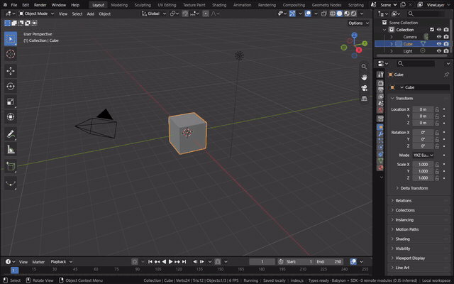
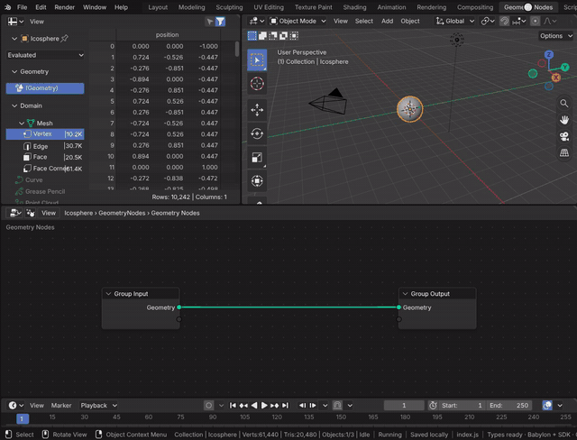
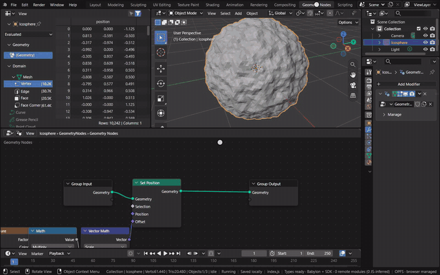
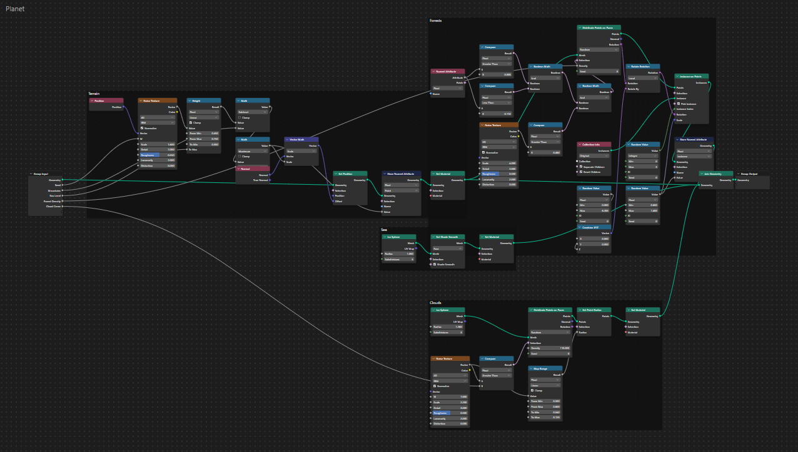

# Geometry Nodes

A Geometry Nodes modifier evaluates a node group on its object's geometry. The tree is Blender's, held in Main and
evaluated by Blender's geometry nodes in the module; the Geometry Node Editor edits it with Blender's own API and
operators (see [Geometry Node Editor](geometry-node-editor.md)). The view draws what the evaluation made: the mesh,
point clouds and instances: every instance of one mesh is a Babylon thin instance of a single mesh, and every point a
camera-facing quad drawn as a sphere of its radius.

[Open in Bylonder](https://propolisa.github.io/bylonder/#example=geometry-nodes)

The demo is a tiny planet whose terrain, sea, forests and clouds all come from one modifier on an ico sphere
(`geometry-nodes.py`). The steps below build its core from the Default Cube's scene: terrain lifted along the normals
by noise, and trees instanced on points that stand on the ground.

## Steps

1. **Add a sphere.** Hover the 3D Viewport, press Delete, then Add > Mesh > Ico Sphere. In the Adjust Last Operation
   panel set Subdivisions to 6, enough faces for the noise to shape.

   

2. **Add the modifier.** In Properties > Modifiers, Add Modifier > Geometry Nodes, then New. The new group passes the
   sphere through.

   

3. **Open the Geometry Nodes workspace.** Its Geometry Node Editor shows the modifier's group, with the Spreadsheet
   and the 3D Viewport above it.

   

4. **Lift the terrain.** Over the editor, Shift A and type to add Set Position between Group Input and Group Output.
   Add Noise Texture, Math (Multiply), Normal and Vector Math (Scale): the noise, times 0.25, scales the normal, and
   that is Set Position's Offset. Every vertex moves out along its normal by the noise at its position.

   

5. **Grow a forest.** Add Distribute Points on Faces on the terrain (Density 80), Instance on Points with a small
   Cone as the instance, and Join Geometry to keep the terrain with the trees. Linking the points' Rotation into
   Instance on Points stands each cone on the surface, along its normal.

   

6. **Expose an input.** Drag from Group Input's empty socket to Noise Texture's Scale. The group gains a Scale input,
   which Properties > Modifiers shows on the modifier: a smaller scale makes larger continents.

   

7. **The planet.** The example adds to the same pattern in frames: the height is stored as an attribute the terrain
   material colors by (sand, meadow, forest, rock, snow), land below Sea Level sinks under a smooth sea sphere,
   forests pick one of four tree objects from a collection where a second noise says woods, and clouds are points on a
   larger sphere, their radius following a noise.

   

The [Spreadsheet](spreadsheet.md) lists what the modifier made, component by component.

## Project files

- [geometry-nodes.py](../../examples/geometry-nodes/geometry-nodes.py): builds the planet, its node group, materials,
  trees, sun and camera in Blender 5.2.
- [geometry-nodes.blend](../../examples/geometry-nodes/geometry-nodes.blend): the file the script saves.
- Recorded by [record-geometry-nodes.mjs](../../tools/docs/record-geometry-nodes.mjs).
