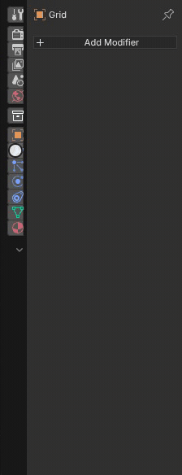
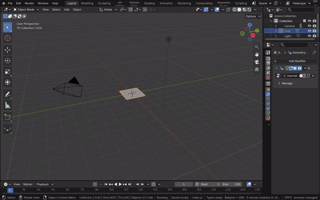
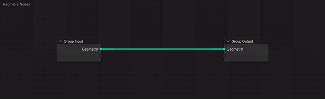
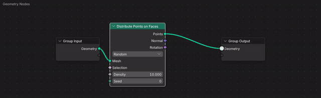
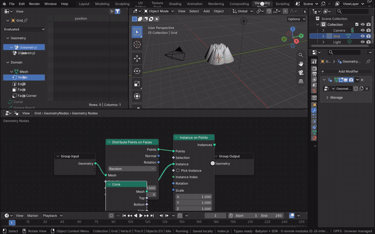
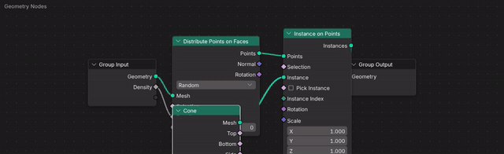

# Geometry Nodes

A Geometry Nodes modifier evaluates a node group on its object's geometry. The tree is Blender's, held in Main and
evaluated by Blender's geometry nodes in the module; the Geometry Node Editor edits it with Blender's own API and
operators (see [Geometry Node Editor](geometry-node-editor.md)). The view draws what the evaluation made: the mesh,
point clouds and instances: every instance of one mesh is a Babylon thin instance of a single mesh, and every point a
camera-facing quad drawn as a sphere of its radius.

[Open in Bylonder](https://propolisa.github.io/bylonder/#example=geometry-nodes)

The demo is the Geometry Nodes Meadow example, made by `geometry-nodes.mjs`: a grid whose Scatter group distributes
points, stores a random `height` on each, and instances a Tree group scaled by it. The steps below build its start from
the Default Cube's scene.

## Steps

1. **Add a grid.** Hover the 3D Viewport, press Delete to delete the cube, then Add > Mesh > Grid.

   

2. **Add the modifier.** In Properties > Modifiers, Add Modifier > Geometry Nodes, then New. The new group passes the
   grid through.

   

3. **Open the Geometry Nodes workspace.** Its Geometry Node Editor shows the modifier's group, with the Spreadsheet
   and the 3D Viewport above it.

   

4. **Distribute points.** Over the editor, press Shift A, type Distribute, press Enter and click to place the node.
   Drag from Group Input's Geometry to its Mesh, and from its Points to Group Output. The grid becomes a point cloud,
   each point drawn at its radius.

   

5. **Instance on the points.** Add Instance on Points and Cone the same way, link the points and the cone into it and
   its Instances to Group Output. A cone stands on every point.

   

6. **Expose an input.** Drag from Group Input's empty socket to Distribute Points on Faces' Density. The group gains a
   Density input, which Properties > Modifiers shows on the modifier; change it there.

   

7. **Make a group.** Click the Cone node and press Ctrl G: it becomes a group node. Tab enters the group, Ctrl Tab
   leaves it, and Ctrl Alt G ungroups.

   

The [Spreadsheet](spreadsheet.md) lists what the modifier made, component by component.

## Project files

- [geometry-nodes.mjs](../../examples/geometry-nodes/geometry-nodes.mjs) and
  [geometry-nodes.blend](../../examples/geometry-nodes/geometry-nodes.blend): the Meadow, its Scatter and Tree groups.
- Recorded by [record-geometry-nodes.mjs](../../tools/docs/record-geometry-nodes.mjs).
