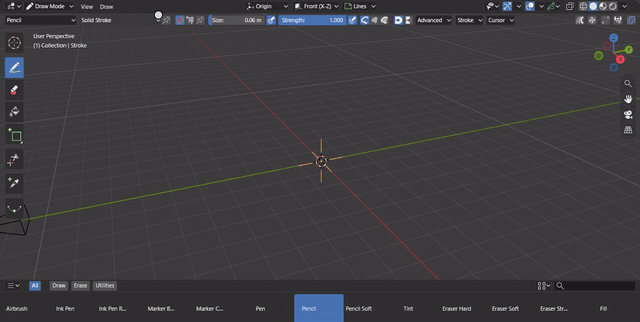
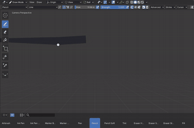
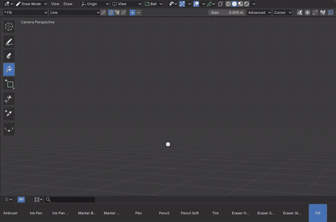
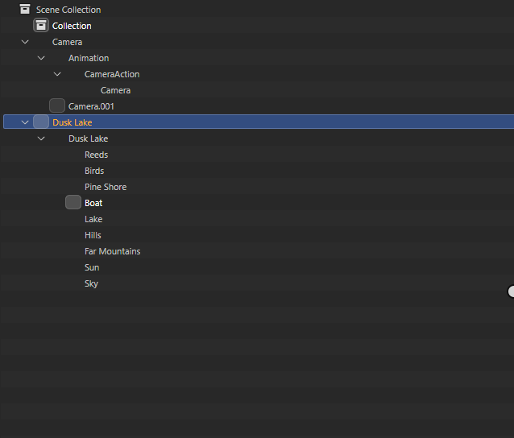

# Grease Pencil

Grease Pencil is Blender's 2D drawing and animation object: strokes of points with a radius, opacity and color, in
layers whose keyframes hold drawings, filled where the strokes close a shape. Everything about the data is Blender's
code in the module: the GreasePencil ID, its layers and frames, the brushes of Draw, Sculpt, Weight Paint and Vertex
Paint Modes, Edit Mode's operators, the modifiers, interpolation, onion skins and the .blend file. Babylon draws it:
each visible drawing's strokes are a GreasedLine mesh of their points' radii and colors, its fills a mesh of Blender's
fill triangles, and a stroke being drawn updates only a small mesh of the drawing's last strokes.

[Open in Bylonder](https://propolisa.github.io/bylonder/#example=grease-pencil)

The demo, Dusk Lake, is a 2D diorama: each layer is a flat drawing of fills and strokes (sky, sun, mountains, hills,
the lake, a boat, a pine shore, birds and reeds) placed at its own depth in front of the camera. The camera slides
sideways over 120 frames, so near layers pass faster than far ones (parallax); the boat, the birds and the reeds are
drawn on twos. It is made in Blender by a script (`grease-pencil.py`). File > New > 2D Animation opens Blender's own 2D Animation
template with its 2D Animation and 2D Full Canvas workspaces, in Draw Mode.

## Steps

1. **Play it.** Hover the 3D Viewport, press Numpad 0 to look through the camera, pick Rendered shading and press
   Space to play. The layers move at the speeds their depths give; the Timeline shows each layer's keys.

   

2. **Draw.** Open File > New > 2D Animation: its Stroke object is in Draw Mode. The tool header holds the
   brush, its material, radius and strength, the asset shelf Blender's brushes (Pencil, Ink Pen, Marker, Airbrush,
   Tint, Erasers, Fill). Drag to draw on the active layer, with a pen's pressure; onion skins show the frames before
   and after.

   

3. **Fill.** Draw a closed shape, pick Fill in the brush menu or the asset shelf, and click inside it. Blender's fill
   renders the strokes around the click (on Babylon) and traces the area they close; Gap Closure and Dilate are in
   the tool header.

   

4. **Edit.** Switch to Edit Mode: the points show, A selects them all and G moves them. The Grease Pencil, Point and
   Stroke menus hold Blender's operators (Subdivide, Simplify, Set Curve Type, Join, Extrude, Interpolate Sequence).

   

5. **Layers.** In Dusk Lake, the Outliner lists the object's layers under its data, from Reeds in front to Sky
   at the back. In Blender, Properties > Data lists them with their opacity, blend mode, onion skinning and masks.

   

> **Tip** Babylon's own stroke settings are in Properties > Data > Runtime (with the Bylonder icon): on Babylon
> (mapped), strokes can keep their thickness on screen at any distance (Size Attenuation) or draw dashed.

## Project files

- [grease-pencil.py](../../examples/grease-pencil/grease-pencil.py): builds the camera and its move, the layers at
  their depths, the materials and the drawings of each key, in Blender 5.2.
- [grease-pencil.blend](../../examples/grease-pencil/grease-pencil.blend): the file the script saves.
- [index.js](../../examples/grease-pencil/index.js): opens the .blend with Blender's reader.
- [2d-animation](../../examples/2d-animation/README.md): Blender's 2D Animation template, File > New > 2D Animation.
- Recorded by [record-grease-pencil.mjs](../../tools/docs/record-grease-pencil.mjs).
