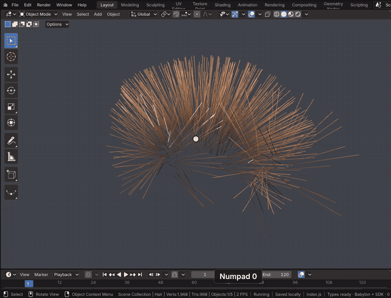
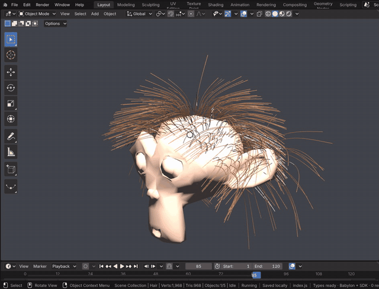
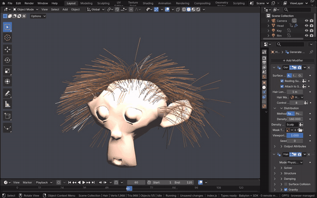

# Hair Dynamics

Blender 5's hair is a Curves object whose strands come from geometry node groups in its modifier stack. Generate Hair
Curves grows strands on a surface, and Hair Dynamics simulates them with an XPBD solver inside a simulation zone, one
step per frame. Both are Blender's Essentials node groups, evaluated by Blender's geometry nodes in the module, so the
strands match Blender 5.2's frame by frame (`tests/hair-dynamics.test.js`).

[Open in Bylonder](https://propolisa.github.io/bylonder/#example=hair-dynamics)

The demo is built by a Blender script (`hair-dynamics.py`): Suzanne turns her head and the hair swings. In Blender
the same setup is Add > Curve > Empty Hair on the head, then Add Modifier > Hair > Generate Hair Curves and Add
Modifier > Hair > Hair Dynamics. The steps below explore and change the example.

## Steps

1. **Play the simulation.** Press Space over the 3D Viewport (or the Timeline's play button). The simulation runs
   from the start frame; Space again stops it.

   

2. **Jump to a frame.** Type a frame in the Timeline's current frame field. Bylonder simulates every frame up to it,
   as playing does, so the result is the same as when played.

   

3. **Change the hair.** Select Hair and open Properties > Modifiers. Generate Hair Curves has the strand length,
   density and control points; Hair Dynamics has the solver, stiffness, damping, collision and gravity. A change
   evaluates both node groups again.

   

> **Tip** The Geometry Node Editor shows the node group of the active modifier: see
> [Geometry Node Editor](geometry-node-editor.md).

## Project files

- [hair-dynamics.py](../../examples/hair-dynamics/hair-dynamics.py): builds the scene in Blender 5.2: the head and its
  scalp group, the Hair object with both modifiers, the turning animation, camera and lights.
- [hair-dynamics.blend](../../examples/hair-dynamics/hair-dynamics.blend): the file the script saves.
- [index.js](../../examples/hair-dynamics/index.js): opens the .blend with Blender's reader.
- Recorded by [record-hair-dynamics.mjs](../../tools/docs/record-hair-dynamics.mjs).
