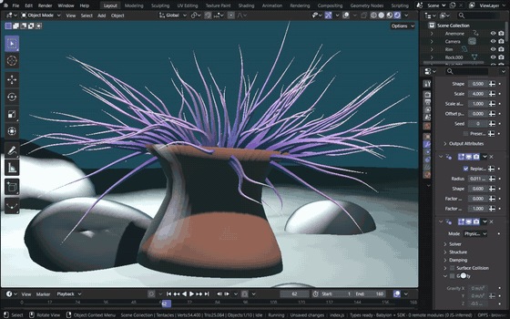

# Hair Dynamics

Blender 5's hair is a Curves object whose strands come from geometry node groups in its modifier stack. Generate Hair
Curves grows strands on a surface, and Hair Dynamics simulates them with an XPBD solver inside a simulation zone, one
step per frame. Both are Blender's Essentials node groups, evaluated by Blender's geometry nodes in the module, so the
strands match Blender 5.2's frame by frame (`tests/hair-dynamics.test.js`).

[Open in Bylonder](https://propolisa.github.io/bylonder/#example=hair-dynamics)

The demo is a sea anemone on a reef (`hair-dynamics.py`): its tentacles are hair curves that sway as the anemone rocks
in the current. In Blender the setup is: select the anemone, Add > Curve > Empty Hair (which adds the Curves object
with Hair Dynamics), then Add Modifier > Hair > Generate Hair Curves above it, with the anemone as its Surface and its
Disc vertex group as the Density Mask. The script also adds Hair Curves Noise for waviness and Set Hair Curve Profile
for a radius from root to tip, sets Hair Dynamics to Physics, and turns its Gravity down to what water leaves of it.
The steps below play and change the simulation.

## Steps

1. **Play the simulation.** Press Space over the 3D Viewport (or the Timeline's play button). The simulation runs from
   the start frame, one solver step per frame, and the tentacles trail behind the anemone's motion; Space again stops
   it.

   

2. **Grow the strands.** Select Tentacles and open Properties > Modifiers. Generate Hair Curves has the Hair Length,
   Density and Control Points; a change grows the strands again and the simulation restarts from them.

   

3. **Change the forces.** Hair Dynamics has the solver's substeps, stiffness, damping, collision and Gravity. A
   stronger downward gravity makes the tentacles droop over the rim; typing a frame in the Timeline simulates every
   frame up to it, so the result is the same as when played.

   

> **Tip** The Geometry Node Editor shows the node group of the active modifier: see
> [Geometry Node Editor](geometry-node-editor.md).

## Project files

- [hair-dynamics.py](../../examples/hair-dynamics/hair-dynamics.py): builds the reef in Blender 5.2: the anemone and
  its Disc group, the Tentacles object with its four modifiers and material, the rocking animation, lights, fog and
  camera.
- [hair-dynamics.blend](../../examples/hair-dynamics/hair-dynamics.blend): the file the script saves.
- Recorded by [record-hair-dynamics.mjs](../../tools/docs/record-hair-dynamics.mjs).
