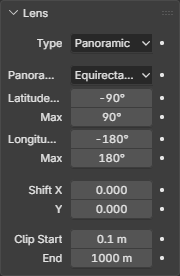
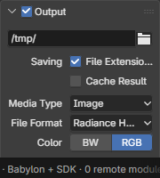
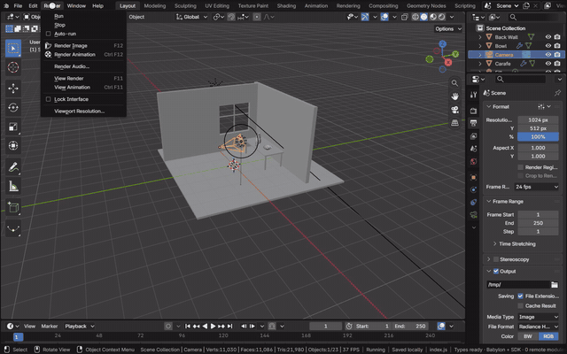
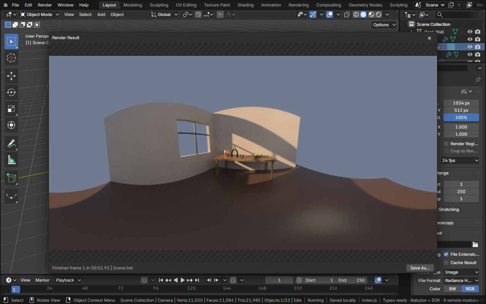

# HDRI Authoring

An HDRI is an environment map: the light around a point, in every direction, with its full range. Blender makes one
with Cycles and a panoramic camera: the camera sees the whole sphere around it, unrolled into an equirectangular image
twice as wide as high, and Blender's image writer keeps the light above white in a Radiance HDR or OpenEXR file. That
file can light a World in Blender, an exported page's code (Babylon's HDRCubeTexture) or any tool that takes an HDRI.

[Open in Bylonder](https://propolisa.github.io/bylonder/#example=rendering)

The demo is Window Light, the Rendering page's scene, captured from its camera's place by the table.

## Steps

1. **Cycles as the render engine.** Properties > Render > Render Engine: Cycles (see Cycles).

2. **A panoramic camera.** With the camera selected, Properties > Camera > Lens > Type: Panoramic, Panorama Type:
   Equirectangular.

   

3. **The output.** Properties > Output > Format: a resolution twice as wide as high (1024 x 512 here); Output > File
   Format: Radiance HDR (or OpenEXR).

   

4. **Render Image.** Render > Render Image (F12) renders the sphere around the camera.

   

5. **Save As.** The Render Result window's Save As writes the file with Blender's image writer, so it keeps the light
   above white.

   

## Project files

- [rendering.py](../../examples/rendering/rendering.py): builds Window Light, in Blender 5.2.
- [rendering.blend](../../examples/rendering/rendering.blend): the file the script saves.
- Recorded by [record-hdri.mjs](../../tools/docs/record-hdri.mjs).
