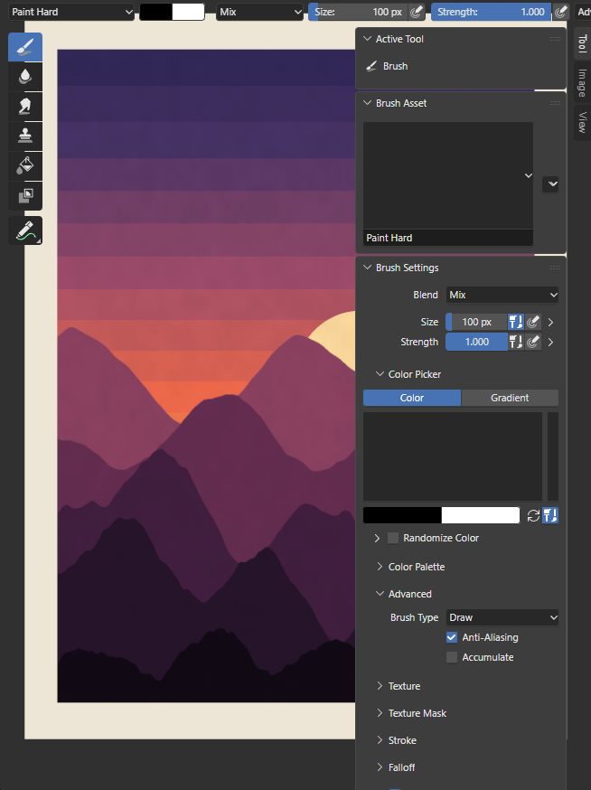
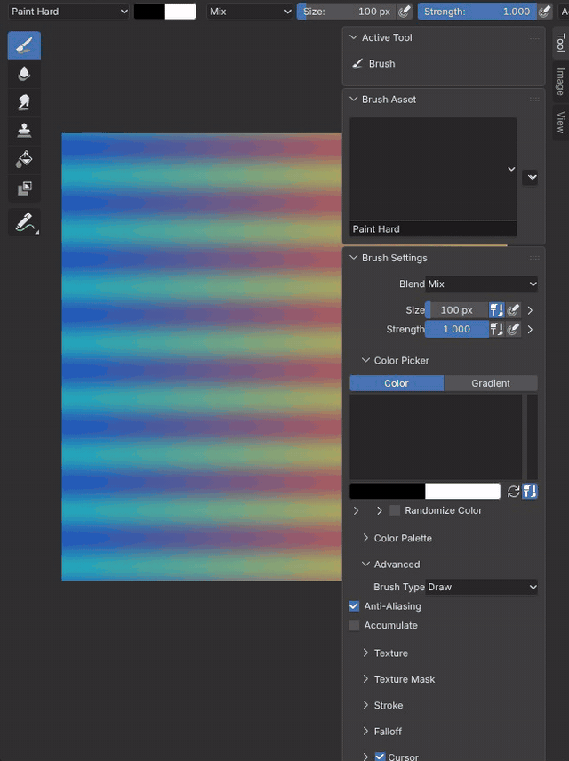
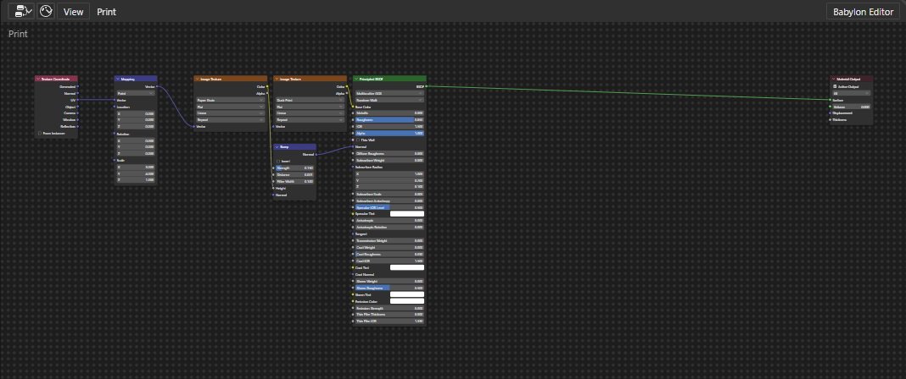
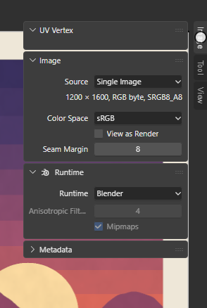

# Images and Image Textures

Images are Blender's Image data-blocks in Main, read and written by Blender's own image libraries in the module
(libjpeg-turbo, libpng, OpenEXR, OpenImageIO for TIFF, Radiance HDR, Targa, BMP and the others) with Blender's
OpenColorIO color management. Each image is drawn by one Babylon texture, which every user of the image shares: the
Image Editor, the Image Texture node of a material, Material Preview's Principled BSDF base color and Solid shading's
Texture color. When Blender changes the image (a paint stroke, a reload), only the changed regions reach the GPU.

[Open in Bylonder](https://propolisa.github.io/bylonder/#example=texture-paint)

The demo, Texture Paint, has a packed image, Suzanne Paint, in the Base Color of Suzanne's material.

## Steps

1. **View an image.** The Texture Paint workspace's Image Editor shows Suzanne Paint; any other Image Editor (Editor
   Type menu) shows an image picked in its header. Scroll zooms, middle drag pans and Home fits the image (View > Frame
   All). The sidebar (N) shows the image's settings in its Image tab.

   

2. **Open or create an image.** Image > Open reads a file from your computer with Blender's reader for its format.
   Image > New makes a generated image: Blank, UV Grid or Color Grid, at the size and color given. Image > Save As
   writes a PNG copy to download. Saving the project or a .blend packs every image into it (painted and generated ones
   as they are), since image files live only in the page's memory.

   

3. **Use it in a material.** In the Shader Editor add Texture > Image Texture, pick the image and link Color to the
   Principled BSDF's Base Color. Material Preview and Rendered show it, and so does Solid shading with its Color set
   to Texture (the Viewport Shading popover). An Image texture (Texture tab) shows an image to modifiers such as
   Displace.

   

4. **Choose its sampling.** The image's Runtime panel (Image Editor sidebar, Image tab, Bylonder icon) keeps Blender's
   sampling (the node's interpolation and Preferences > Viewport > Textures > Anisotropic Filtering) or switches to
   Babylon (native) with Babylon's anisotropic filtering and mipmaps. The pixels stay Blender's either way.

   

## Project files

- [texture-paint.py](../../examples/texture-paint/texture-paint.py): the Blender script that builds the demo.
- [texture-paint.blend](../../examples/texture-paint/texture-paint.blend): the file the script saves, with its image
  packed.
- [index.js](../../examples/texture-paint/index.js): opens the .blend with Blender's reader.
- Recorded by [record-texture-paint.mjs](../../tools/docs/record-texture-paint.mjs).
