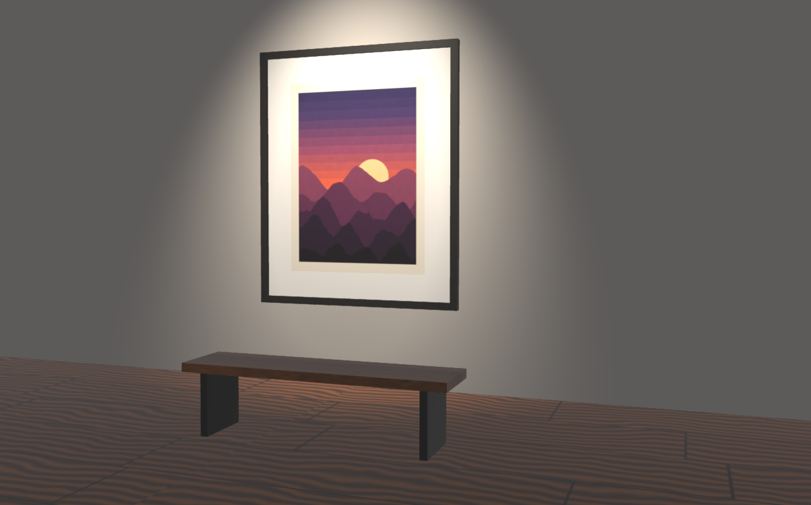

# Images and Image Textures

Images are Blender's Image data-blocks in Main, read and written by Blender's own image libraries in the module
(libjpeg-turbo, libpng, OpenEXR, OpenImageIO for TIFF, Radiance HDR, Targa, BMP and the others) with Blender's
OpenColorIO color management. Each image is drawn by one Babylon texture, which every user of the image shares: the
Image Editor, the Image Texture node of a material, Material Preview's Principled BSDF base color and Solid shading's
Texture color. When Blender changes the image (a paint stroke, a reload), only the changed regions reach the GPU.

[Open in Bylonder](https://propolisa.github.io/bylonder/#example=framed-print)

The demo, Framed Print, is a screen print of mountains at dusk framed on a gallery wall under a spotlight. Three
packed images make it: the print's colors (Dusk Print), its paper's grain as height (Paper Grain, Non-Color), and the
oak boards of the floor and the bench (Oak Boards). It is built by a Blender script (`framed-print.py`).

## Steps

1. **View an image.** Open the example and pick the Texture Paint workspace: its Image Editor shows Dusk Print. Any
   other Image Editor (Editor Type menu) shows an image picked in its header. Scroll zooms, middle drag pans and Home
   fits the image (View > Frame All). Image > Open reads a file from your computer with Blender's reader for its
   format; Image > New makes a generated image (Blank, UV Grid or Color Grid); Image > Save As writes a PNG copy to
   download. Saving the project or a .blend packs every image into it, since image files live only in the page's
   memory.

   

2. **Use it in a material.** Pick the Shading workspace: the Print's material has two Image Texture nodes. Dusk
   Print's Color feeds the Principled BSDF's Base Color; Paper Grain, read through Texture Coordinate's UV and a
   Mapping node that repeats it, feeds Bump's Height. In your own material, Shift A > Texture > Image Texture adds the
   node and its image menu picks the image. Material Preview and Rendered show it, and so does Solid shading with its
   Color set to Texture (the Viewport Shading popover).

   

3. **Choose its sampling.** In the UV Editing workspace, the UV Editor's sidebar Image tab has the image's Runtime
   panel (Bylonder icon). It keeps Blender's sampling (the node's interpolation and Preferences > Viewport > Textures >
   Anisotropic Filtering) or switches to Babylon (native) with Babylon's anisotropic filtering and mipmaps. The pixels
   stay Blender's either way.

   

## Project files

- [framed-print.py](../../examples/framed-print/framed-print.py): the Blender script that builds the demo and paints
  its three images.
- [framed-print.blend](../../examples/framed-print/framed-print.blend): the file the script saves, with its images
  packed.
- [index.js](../../examples/framed-print/index.js): opens the .blend with Blender's reader.
- Recorded by [record-texture-paint.mjs](../../tools/docs/record-texture-paint.mjs).
