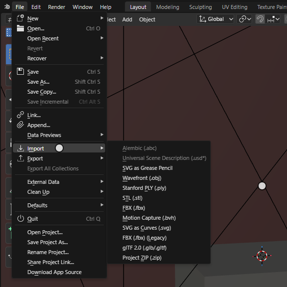
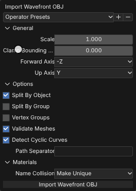
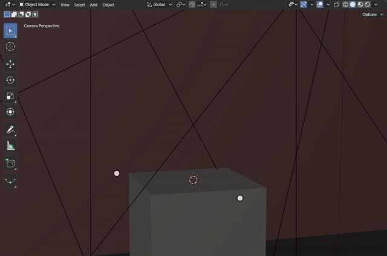
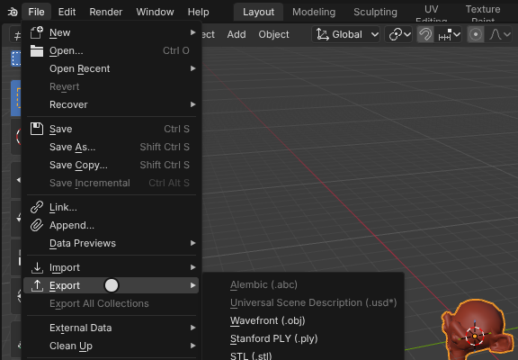
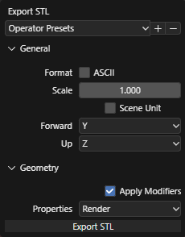
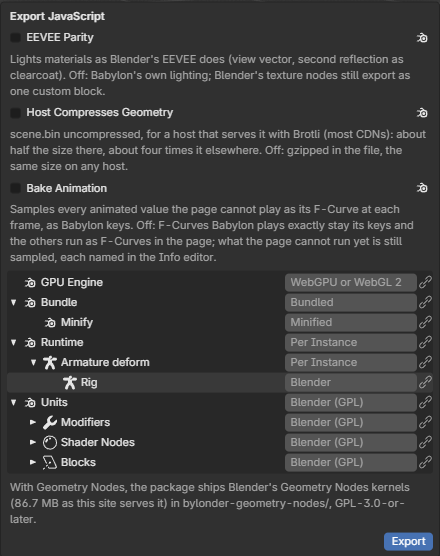
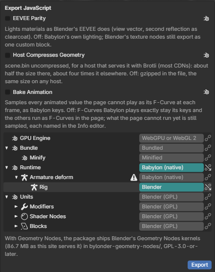
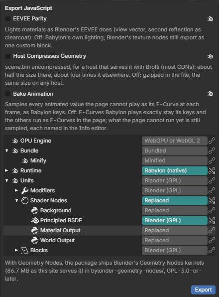

# Import and Export

File > Import and File > Export are Blender's own menus, and each format is Blender's own importer or exporter
compiled into the WebAssembly module: Wavefront OBJ (with its .mtl materials), Stanford PLY, STL and FBX import. The
add-ons Blender enables by default, glTF 2.0, FBX export, Motion Capture (.bvh) and SVG as Curves, are Blender's Python,
which runs in the module's CPython: opening File starts it, and their entries, at Blender's places, become live once
they have registered. Where
Blender opens its File Browser, Bylonder opens the browser's file dialog; the format's options are the ones Blender's
File Browser shows beside the files, drawn from the operator's own layout. What an import makes is in Main, so it is
undone with Ctrl Z, saved in the project and drawn by Babylon with its UVs, materials and normals, custom normals
included.

[Open in Bylonder](https://propolisa.github.io/bylonder/#example=import-export)

The demo, Import and Export, is a gallery: a plinth between two spot lights, and on it a bronze bust brought in
from the example's [bust.glb](../../examples/import-export/bust.glb), a glTF 2.0 file with the bust's mesh and its
Bronze and Marble materials. The steps below take the bust out and import it again.

## Steps

1. **Make room.** Click Bust in the Outliner, hover the 3D Viewport and press Delete. Open File > Import: OBJ, PLY,
   STL, FBX, SVG, Motion Capture and glTF 2.0 run; Alembic and USD are greyed out, their tooltip says why.

   

2. **Import.** Choose glTF 2.0 (.glb/.gltf) and pick bust.glb in the file dialog. The importer's options follow;
   click Import glTF 2.0. The bust arrives at the world origin with its materials, selected and active.

   

3. **Place it.** Hover the 3D Viewport and press G, Z, type 1.1 and press Enter: the bust stands on the plinth.

   

4. **Look at it.** Press Numpad 0 and pick Rendered shading: the spot lights pick out the bronze, as before.

   

5. **Export.** File > Export lists the exporters. Choose STL (.stl): its options come first (General, Geometry),
   then the save dialog. Wavefront (.obj), Stanford PLY (.ply), FBX and glTF 2.0 export the same way.

   

   

6. **Export for Babylon.** File > Export > JavaScript (.zip) writes a package that loads in plain Babylon.js. Below its
   checkboxes, its settings are a tree: GPU Engine; Bundle, on by default, which writes one minified bundle with the
   Babylon.js modules the scene uses, so the page needs no CDN, import map or bundler (Off: ES modules importing
   Babylon module by module), and under it Minify; then Runtime with each feature that has a runtime choice and, under
   each, the scene's instances of it, then Units: the scene's units by category, each Blender's code (GPL) or Replaced
   by a unit your page registers, whose code the package then leaves out ([Escaping the GPL](../escaping-the-gpl.md)). A setting left unset shows what it inherits greyed, with a linked decorator; hover
   it to see where the value comes from. Unset everywhere, each instance exports with its own
   [runtime](../runtimes.md).

   

7. **Override.** Set Runtime to Babylon (native): every feature inherits it, and an armature, which does not offer it,
   shows an error icon (its instances export with their own, reported in the Info editor). Right click Rig and choose
   Blender: its field turns teal with the override decorator, as Blender draws an overridden property; Remove Override
   in the same menu, or the decorator, makes it inherit again.

   

8. **Replace units.** Under Units, set Shader Nodes to Replaced: each shader node inherits it, its icon a script for
   your own code instead of Blender's logo. Set Principled BSDF back to Blender (GPL). The package leaves out the
   replaced nodes' code, and your page registers its own units for them
   ([Escaping the GPL](../escaping-the-gpl.md)).

   

## Project files

- [import-export.py](../../examples/import-export/import-export.py): writes bust.glb with Blender 5.2's glTF exporter,
  builds the gallery, imports the bust onto the plinth and saves import-export.blend.
- [bust.glb](../../examples/import-export/bust.glb): the asset.
- [import-export.blend](../../examples/import-export/import-export.blend): the file the script saves.
- [index.js](../../examples/import-export/index.js): opens the .blend with Blender's reader.
- [io-fixtures.py](../../tools/blender-reference/io-fixtures.py) and
  [io-addon-fixtures.py](../../tools/blender-reference/io-addon-fixtures.py): the files and Blender's own import results
  the tests compare with ([io-wasm.test.js](../../tests/io-wasm.test.js),
  [io-addons-wasm.test.js](../../tests/io-addons-wasm.test.js)).
- [record-import-export.mjs](../../tools/docs/record-import-export.mjs) and
  [record-export-javascript.mjs](../../tools/docs/record-export-javascript.mjs) (on the Rigged Character example):
  record this page's pictures.
