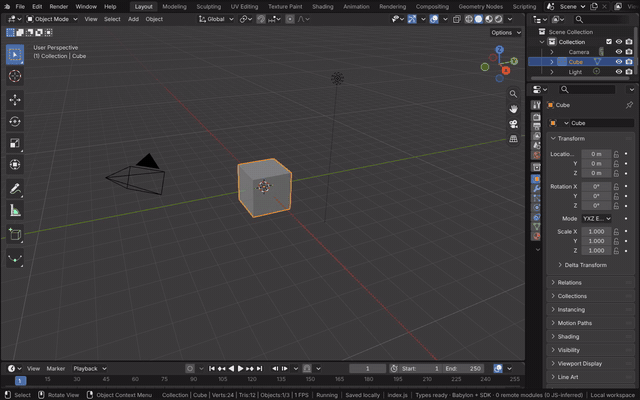
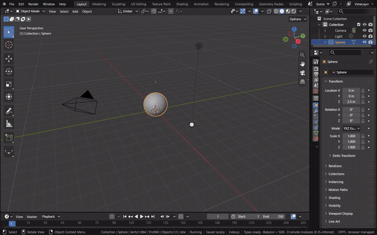
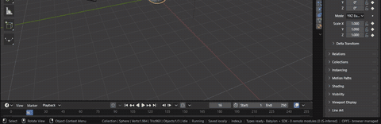
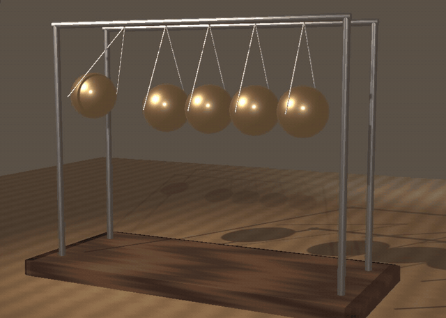

# Keyframe Animation

A keyframe stores a property's value at a frame; between keys Blender interpolates along an F-curve. Hovering the 3D
Viewport and pressing I keys the selected objects' location, rotation and scale at the current frame. How the value
travels between two keys is the F-curve's interpolation (Constant, Linear, Bezier or an easing curve such as Sine) and
its easing (In, Out or both), set in the Graph Editor. Keys are Blender's actions in the module (`anim-api.cc`),
evaluated by Blender's code.

[Open in Bylonder](https://propolisa.github.io/bylonder/#example=newtons-cradle)

The demo is a Newton's cradle. Each pendulum is an empty with a ball and two threads parented to it, so one keyed
rotation swings the whole pendulum. The outer pendulums are keyed with Sine interpolation: Ease In on the way down, so
a ball falls faster and faster into the row, and Ease Out on the way up, so it slows to a stop at the top of its swing.
Between the two the right ball holds still at 0 degrees.

## Steps

1. **A pendulum.** In a new file, hover the 3D Viewport and press Delete to remove the cube. Shift A > Mesh > UV Sphere
   adds the ball and G Z 2.5 Enter raises it. Tab, G Z -2 Enter and Tab again move the ball's mesh down in Edit Mode,
   so its origin, the point it turns about, stays 2 m above it.

   

2. **Key the swing.** Press R Y 40 Enter to raise the ball, then I to key the rotation at
   frame 1. Type 16 in the Timeline's current frame field, press Alt R to bring the ball back down and I again.

   

3. **Ease the fall.** Switch the Timeline to the Graph Editor with its Editor Type menu and drag its top edge up.
   Normalize in the header scales each curve to -1 to 1. Middle drag over the curves to bring the keys to the middle,
   then Ctrl middle drag to the right to stretch time. A selects every key. Key > Interpolation Mode (T) > Sinusoidal,
   then Key > Easing Mode (Ctrl E) > Ease In: the curve starts flat and ends steep, so the ball gains speed as it falls.

   

4. **Play.** Go back to frame 1 and press Space; Space again stops. The playhead runs along the curve.

   

5. **The cradle.** The example keys two pendulums this way over a 60 frame cycle. Its brass balls mix two Glossy BSDFs
   (a sharp and a rough lobe), a warm spot light and a cool rim light cast soft shadows on the walnut base, and the
   scene camera frames it in Rendered shading.

   

## Project files

- [newtons-cradle.py](../../examples/newtons-cradle/newtons-cradle.py): builds the cradle, its materials, lights and
  camera, and keys the two outer pendulums with Sine easing, in Blender 5.2.
- [newtons-cradle.blend](../../examples/newtons-cradle/newtons-cradle.blend): the file the script saves.
- [index.js](../../examples/newtons-cradle/index.js): opens the .blend with Blender's reader.
- Recorded by [record-keyframe-animation.mjs](../../tools/docs/record-keyframe-animation.mjs).
