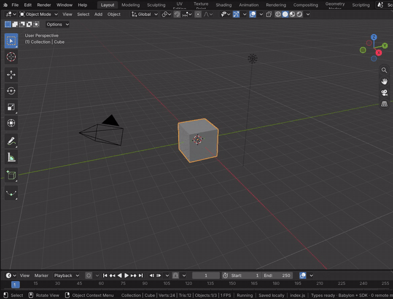
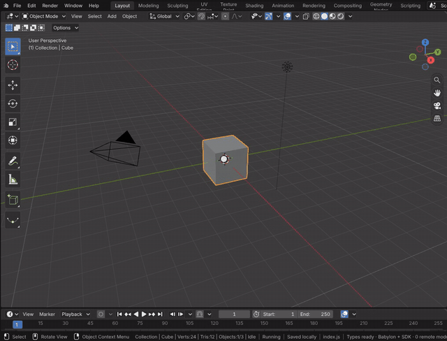
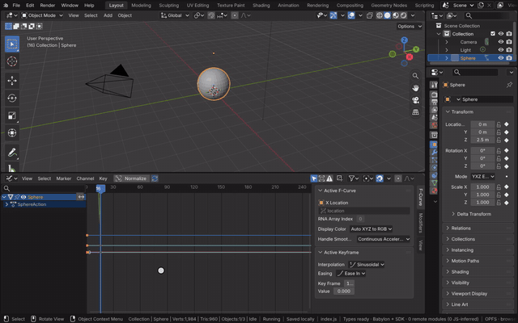
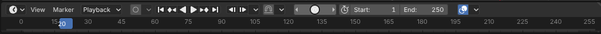

# Keyframe Animation

A keyframe stores a property's value at a frame; between keys Blender interpolates along F-curves. Hovering the 3D
Viewport and pressing I keys the selected objects' location, rotation and scale at the current frame. The Timeline
shows the keys as diamonds, plays the range and jumps between keys. Keys are Blender's actions in the module
(`anim-api.cc`), evaluated by Blender's code.

[Open in Bylonder](https://propolisa.github.io/bylonder/#example=animation)

The demo, Keyframe Animation, is a bouncing ball whose position, squash and color are keyed from code. The steps
below animate the Default Cube by hand.

## Steps

1. **Insert a key.** Select the cube, hover the 3D Viewport and press I. A diamond appears on the Timeline at frame 1
   and the keyed fields in Properties show a key in their decorator.

   

2. **Key a second pose.** Type 40 in the Timeline's current frame field. Press G, X, 4, Enter to move the cube, then
   R, Z, 90, Enter to turn it, and press I again.

   

3. **Play.** Go back to frame 1 and press Space; Space again stops. The cube moves and turns between the keys with
   Blender's default Bezier easing.

   

4. **Edit the keys.** On the Timeline, drag a diamond to retime it; Up and Down arrows jump between keys. View > Show
   Channels lists every F-curve.

   

## Project files

- [index.js](../../examples/animation/index.js): the ball, its tracks and the keys made with `animation.insert` the
  first time the project runs.
- Recorded by [record-keyframe-animation.mjs](../../tools/docs/record-keyframe-animation.mjs).
