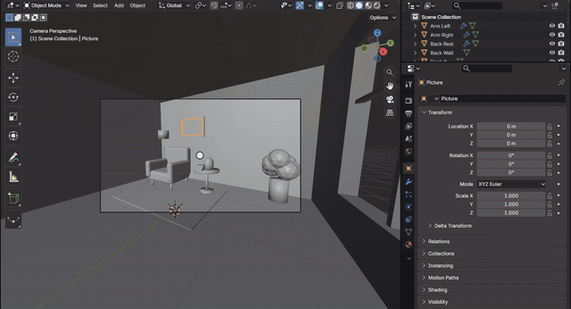
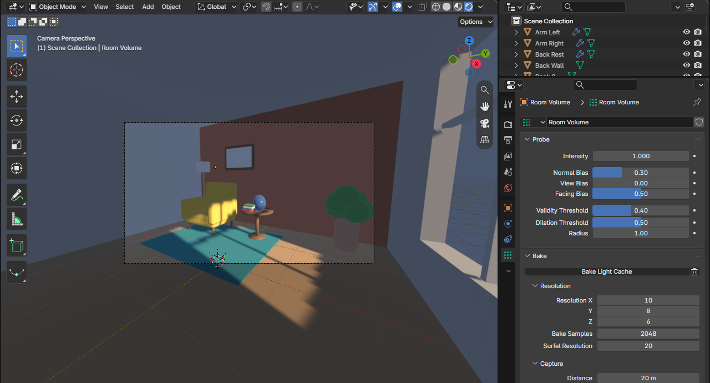
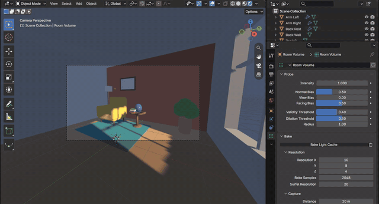
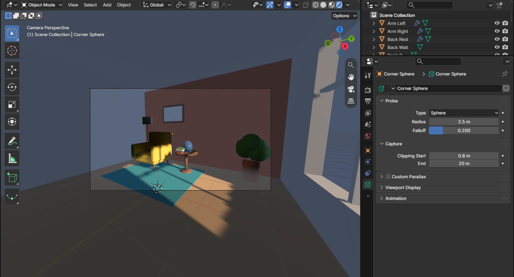
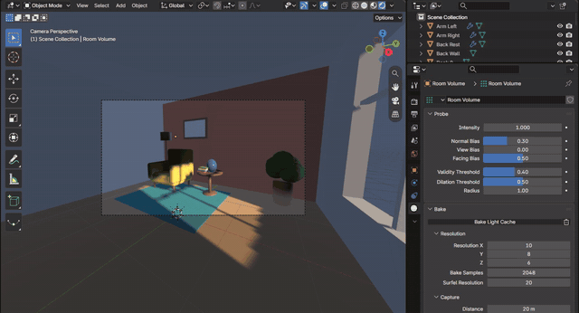
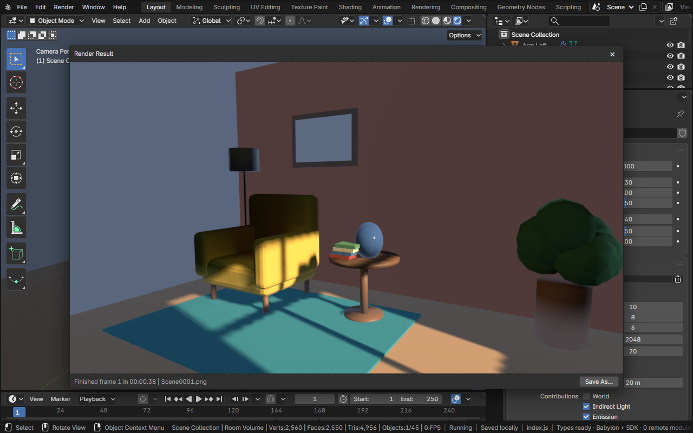

# Light Probes

A light probe records the light at a place in the scene so that EEVEE can light surfaces with what bounces around them,
not only with what comes straight from the lights and the sky. An **Irradiance Volume** is a grid of samples that,
once baked, holds the diffuse light arriving at each one: the floor's sunlit patch warming the ceiling, a red wall
tinting what faces it. A **Sphere** probe draws the scene around it into a cube that glossy surfaces near it reflect.
Bylonder bakes and samples them as EEVEE does, in Material Preview and Rendered shading.

[Open in Bylonder](https://propolisa.github.io/bylonder/#example=light-probes)

The demo, Reading Corner, is made in Blender by a script (`light-probes.py`): a room lit only by a low sun through one
window, an armchair, a side table with a glazed vase, a lamp, books and a plant, with an Irradiance Volume filling the
room and a Sphere probe at the corner.

## Steps

1. **Rendered shading.** Look through the camera (Numpad 0) and pick Rendered (Z > Rendered). Before a bake, every
   surface out of the sun takes the sky's light alone, flat and blue.

   

2. **The Irradiance Volume.** Select Room Volume, a box just inside the walls. Its Resolution is its grid of samples;
   Capture says what it gathers (Indirect Light, Emission, and the World when it is outside).

   

3. **Bake Light Cache.** Properties > Light Probe > Bake > Bake Light Cache. The room fills with the light the floor
   and walls send back: the ceiling warms, the armchair's shadow side picks up the rug's color.

   

4. **The Sphere probe.** Select Corner Sphere. Its Distance is how far its influence reaches; inside it, the vase
   reflects the room as the probe saw it, corrected for where the vase stands.

   

5. **Delete and bake again.** The trash button beside Bake Light Cache deletes the bake: the room goes back to the
   sky's light alone. Bake again after moving the sun or the furniture.

   

6. **Render Image.** Render > Render Image (F12) renders through the camera with the bake.

   

## Project files

- [light-probes.py](../../examples/light-probes/light-probes.py): builds the room, its window and furniture, the
  materials, the sun, the Irradiance Volume and the Sphere probe, and the camera, in Blender 5.2.
- [light-probes.blend](../../examples/light-probes/light-probes.blend): the file the script saves.
- [index.js](../../examples/light-probes/index.js): opens the .blend with Blender's reader.
- Recorded by [record-light-probes.mjs](../../tools/docs/record-light-probes.mjs).
