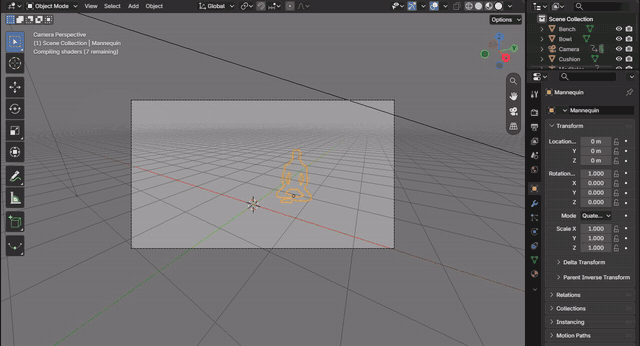
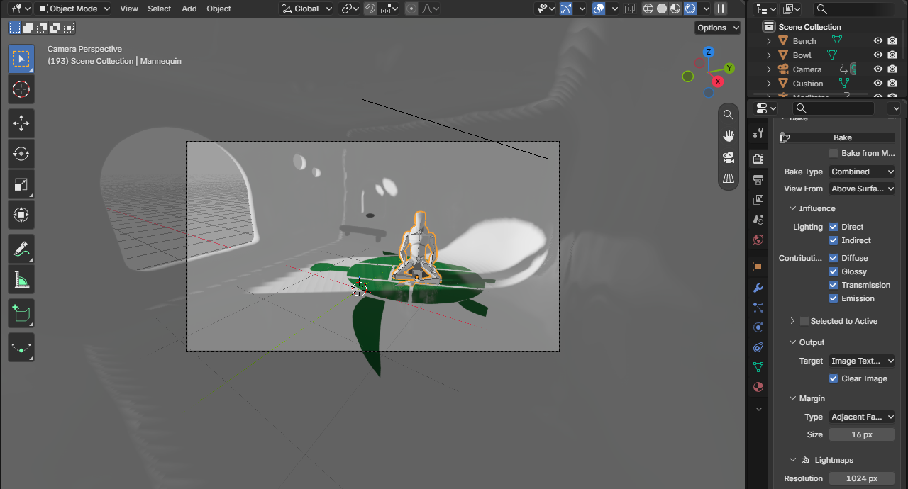
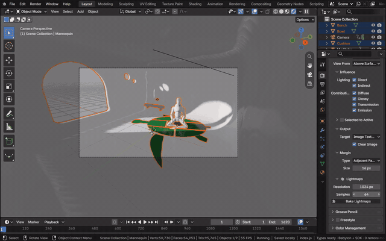
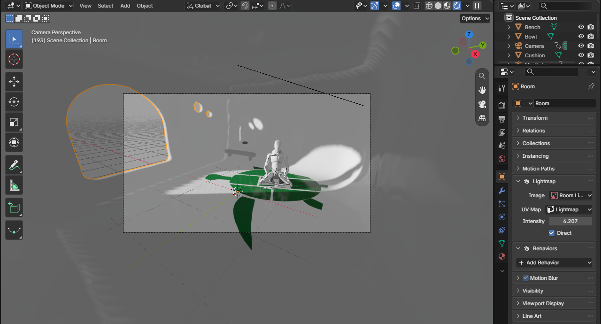
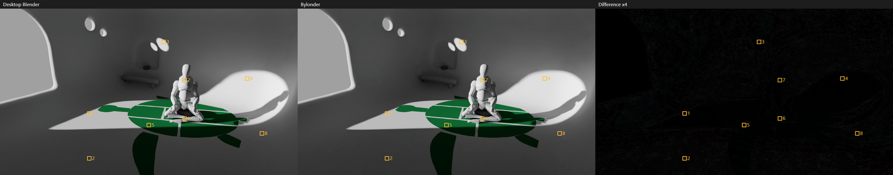

# Lightmaps

A lightmap is an image of the light that reaches a surface, baked once with Cycles: soft shadows, light bouncing off
the floor onto the walls, the dark where a figure meets its cushion. A page that draws it reads one texture instead of
lighting the surface, so it shows the baked light at real-time cost. In Bylonder an object's lightmap is a setting of
its own, Object properties > Lightmap: the image, the UV map it is laid out on (a second UV map, so the material's own
stays as it is), its Intensity and Direct. File > Export > JavaScript draws the object with Babylon's lightmapTexture.

The rule for the image is what Babylon's lightmap slot expects: with Direct on, it is all the light reaching the object
without its colour (Bake Type Diffuse, Direct and Indirect, Color off), and it multiplies the material's colour; with
Direct off, it is the light the object gives back of everything but the lights' direct light (Diffuse with Color, less
the lights' direct light), and it adds to the lights, which still light the object live. Bake Lightmaps bakes by this
rule, so no bake nodes are wired by hand.

[Open in Bylonder](https://propolisa.github.io/bylonder/#example=meditation)

The demo, Meditation, is made in Blender by a script (`meditation.py`): the mannequin seated cross-legged on a cushion
in an earthen room, a green turtle inlaid in the floor, low sun through an arched window and two round ports. The room,
the turtle, the cushion, the bench and the bowl carry lightmaps with Direct on; the figure's has Direct off, so the sun
lights him live while he breathes, sways and settles, which his rig's action does with keys, a Cycles modifier and Noise
modifiers.

## Steps

1. **The scene.** Look through the camera (Numpad 0), pick Rendered shading and play (Space): the figure breathes, the
   chest rising about a centimetre every 4.5 s, and sways too slowly to see at once.

   

2. **The room's lightmap.** Select Room and open Object properties > Lightmap: its image, its UV map, Lightmap, and its
   Intensity, the brightest light it holds. Direct is on: the image holds all the light that reaches the room.

   

3. **The figure's lightmap.** Select Mannequin: Direct is off, so its image holds only the sky's and the room's light,
   and the sun lights it live in the page, as he moves.

   

4. **Cycles.** Properties > Render > Render Engine: Cycles. Render properties > Bake > Lightmaps has Bylonder's Bake
   Lightmaps, with the Resolution of new lightmaps and the Samples of each bake.

   

5. **Bake.** Select the room and press Bake Lightmaps. Each selected mesh gets a UV map named Lightmap (Lightmap Pack,
   where it has none) and is baked by Blender's own bake (Bake Type Diffuse, by its Direct), while the page waits;
   the status bar names the object baking and how far Bake Lightmaps is, and its Cancel stops it after that bake. The light is denoised by Open Image
   Denoise, guided by the surface's normals and colour, then stored over its brightest value as a JPEG packed in the
   .blend, its Intensity that value, and set in Object properties > Lightmap. No bake nodes are left behind. The
   example's room is baked with the turtle's Object properties > Visibility > Ray Visibility > Diffuse off, so the floor
   under the inlay bakes as if it were not there; then the turtle, the cushion, the bench, the bowl and the figure.

   

   

6. **Export.** File > Export > JavaScript: the page draws each lightmapped object with a copy of its material that
   reads the lightmap through the second UV map. The app's bake and desktop Blender's (`meditation.py`, which bakes
   with the same code) draw the same page:

   

## Project files

- [meditation.py](../../examples/meditation/meditation.py): builds the room, the turtle, the cushion, the bench, the
  figure's pose and action, the sun and the camera, then bakes the lightmaps with Cycles in Blender 5.2, through
  Bake Lightmaps' own code ([bylonder_lightmaps.py](../../src/render/bylonder_lightmaps.py)).
- [meditation.blend](../../examples/meditation/meditation.blend): the file the script saves.
- [index.js](../../examples/meditation/index.js): opens the .blend with Blender's reader.
- Recorded by [record-lightmaps.mjs](../../tools/docs/record-lightmaps.mjs).
