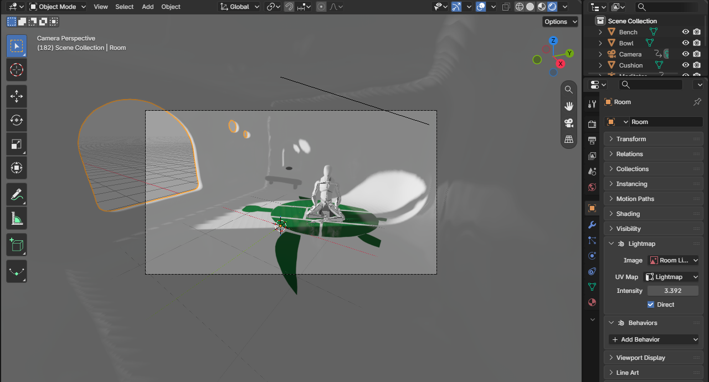
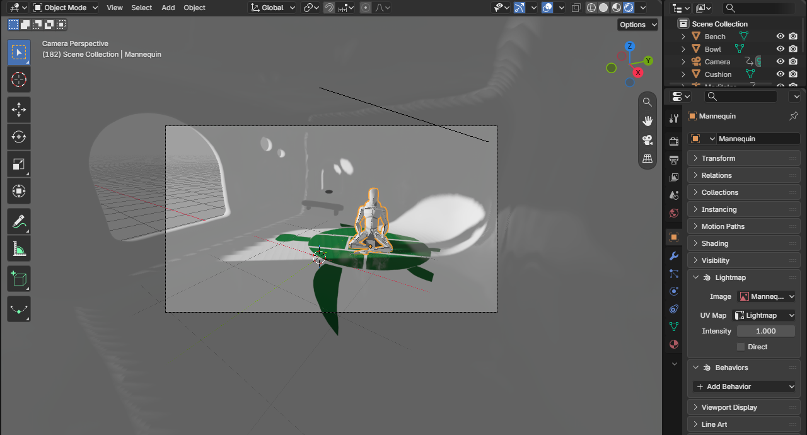

# Lightmaps

A lightmap is an image of the light that reaches a surface, baked once with Cycles: soft shadows, light bouncing off
the floor onto the walls, the dark where a figure meets its cushion. A page that draws it reads one texture instead of
lighting the surface, so it shows the baked light at real-time cost. In Bylonder an object's lightmap is a setting of
its own, Object properties > Lightmap: the image, the UV map it is laid out on (a second UV map, so the material's own
stays as it is), its Intensity and Direct. File > Export > JavaScript draws the object with Babylon's lightmapTexture.

The rule for the image is what Babylon's lightmap slot expects: with Direct on, it is all the light reaching the object
without its colour (Bake Type Diffuse, Direct and Indirect, Color off), and it multiplies the material's colour; with
Direct off, it is the light the object gives back of everything but the lights' direct light (Diffuse, Indirect, Color
on), and it adds to the lights, which still light the object live.

[Open in Bylonder](https://propolisa.github.io/bylonder/#example=meditation)

The demo, Meditation, is made in Blender by a script (`meditation.py`): the mannequin seated cross-legged on a cushion
in an earthen room, a green turtle inlaid in the floor, low sun through an arched window and two round ports. The room,
the turtle, the cushion, the bench and the bowl carry lightmaps with Direct on; the figure's has Direct off, so the sun
lights him live while he breathes, sways and settles, which his rig's action does with keys, a Cycles modifier and Noise
modifiers.

## Steps

1. **The scene.** Look through the camera (Numpad 0), pick Rendered shading and play (Space): the figure breathes, the
   chest rising about a centimetre every 4.5 s, and sways too slowly to see at once.

   

2. **The room's lightmap.** Select Room and open Object properties > Lightmap: its image, its UV map, Lightmap, and its
   Intensity, the brightest light it holds. Direct is on: the image holds all the light that reaches the room.

   

3. **The figure's lightmap.** Select Mannequin: Direct is off, so its image holds only the sky's and the room's light,
   and the sun lights it live in the page, as he moves.

   

4. **Bake.** In desktop Blender: give each object a second UV map (UV Maps > +, then UV > Smart UV Project), pick Cycles,
   Render properties > Bake, Bake Type Diffuse with Color off for a Direct lightmap (Indirect and Color for the
   other), and Bake into an image node selected in its material. Save the image in the .blend (Image > Pack) and set it
   in Object properties > Lightmap. `meditation.py` does all of this.

5. **Export.** File > Export > JavaScript: the page draws each lightmapped object with a copy of its material that
   reads the lightmap through the second UV map.

## Project files

- [meditation.py](../../examples/meditation/meditation.py): builds the room, the turtle, the cushion, the bench, the
  figure's pose and action, the sun and the camera, then bakes the lightmaps with Cycles, in Blender 5.2.
- [meditation.blend](../../examples/meditation/meditation.blend): the file the script saves.
- [index.js](../../examples/meditation/index.js): opens the .blend with Blender's reader.
- Recorded by [record-lightmaps.mjs](../../tools/docs/record-lightmaps.mjs).
