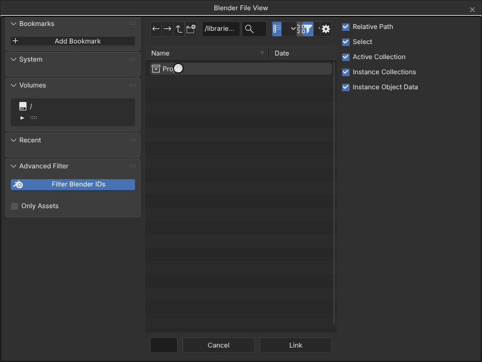
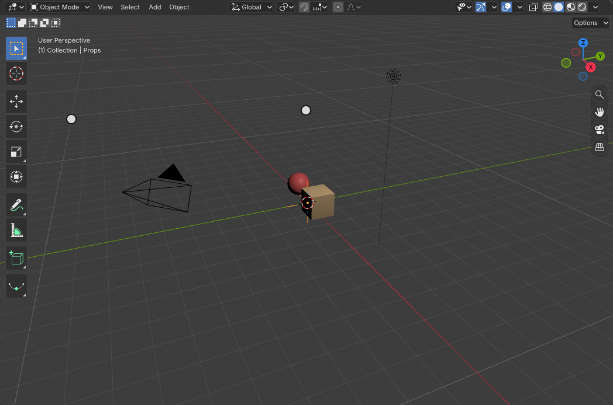
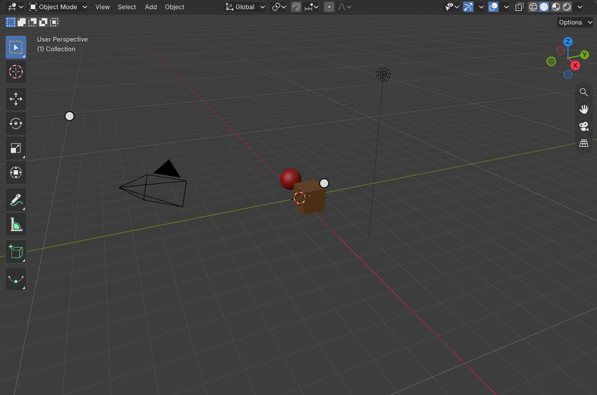
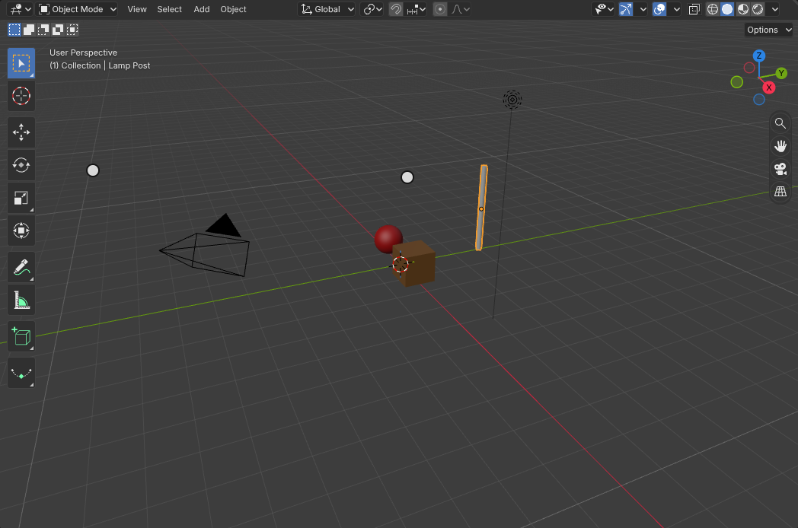
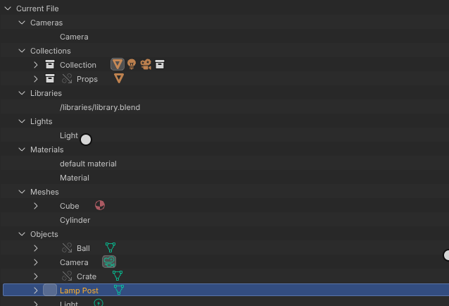

# Link and Append

File > Link and File > Append bring data-blocks from another .blend file into the scene with Blender's own code. Link
keeps them in the other file, the library: they are read from it each time the project opens and cannot be edited
here, except through a library override. Append copies them into the scene, where they are like anything made here.
After choosing the .blend in the browser's file dialog, Blender's File Browser opens inside it, as in Blender: the
data-block types, then their names, with the operator's options at the right (Instance Collections, Localize All,
Select, Active Collection and the others). The project keeps the library in its `libraries` folder, so a saved project
finds its links again. What comes in is Main's, drawn by Babylon, listed by the Outliner's Blender File view and undone
with Ctrl Z.

[Open in Bylonder](https://propolisa.github.io/bylonder/#example=link-append)

The demo, Link and Append, links the Props collection from the example's
[library.blend](../../examples/link-append/libraries/library.blend), makes it a library override and appends the Lamp
Post. The steps below make it from the Default Cube.

## Steps

1. **Link a collection.** In the Default Cube example, click the cube and press Delete. Open File > Link... and pick
   library.blend in the file dialog. Blender's File Browser lists the file's data-block types; double click Collection,
   then Props.

   

2. **The linked collection.** An empty instances the linked collection at the 3D cursor, with the crate and the ball.

   

3. **Make it editable.** With the empty selected, choose Object > Library Override > Make. The crate and the ball are
   now local overrides in the Props collection, kept in sync with the library.

   

4. **Append an object.** Open File > Append..., pick library.blend, double click Object, then Lamp Post. The lamp post
   is a local copy with its own mesh.

   

5. **The library.** Set the Outliner's Display Mode to Blender File: library.blend lists what the scene links from it.

   

## Project files

- [link-append.py](../../examples/link-append/link-append.py): writes libraries/library.blend with Blender 5.2, then
  links, overrides and appends from it in the Default Cube's scene and saves link-append.blend.
- [link-append.blend](../../examples/link-append/link-append.blend): the file the script saves.
- [library.blend](../../examples/link-append/libraries/library.blend): the library.
- [index.js](../../examples/link-append/index.js): opens the .blend with Blender's reader.
- [link-append-fixtures.py](../../tools/blender-reference/link-append-fixtures.py): Blender's own results the test
  compares with ([link-append-wasm.test.js](../../tests/link-append-wasm.test.js)).
- [record-link-append.mjs](../../tools/docs/record-link-append.mjs): records this page's pictures.
