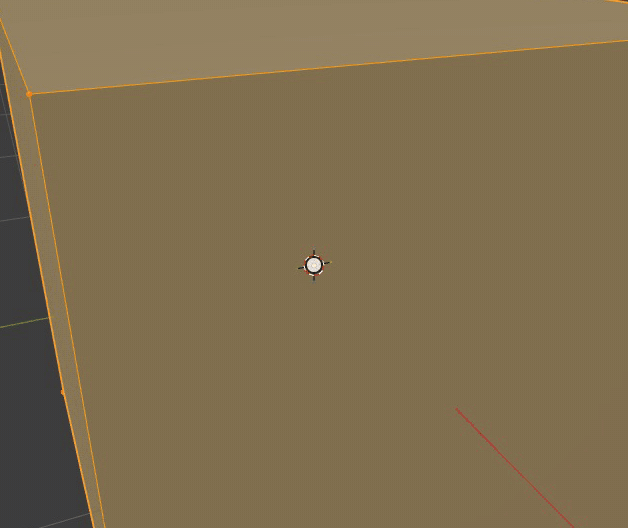
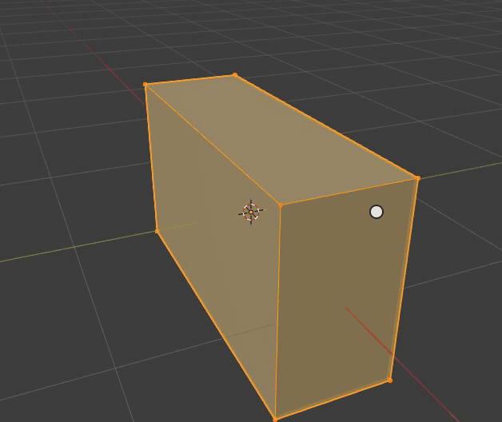
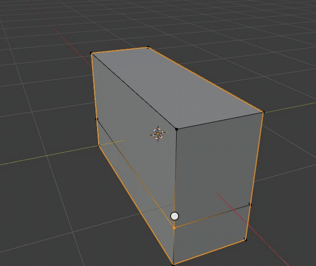
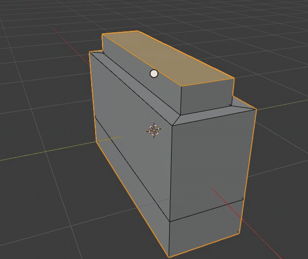
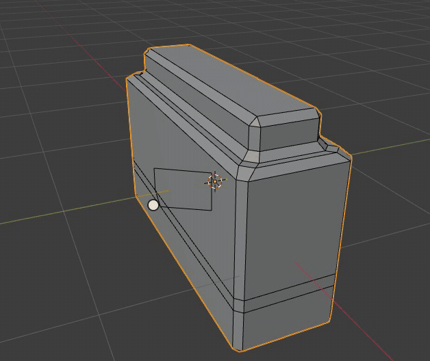
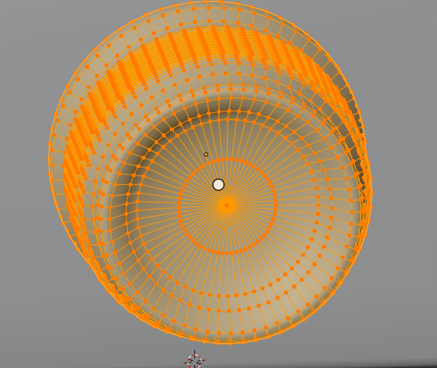
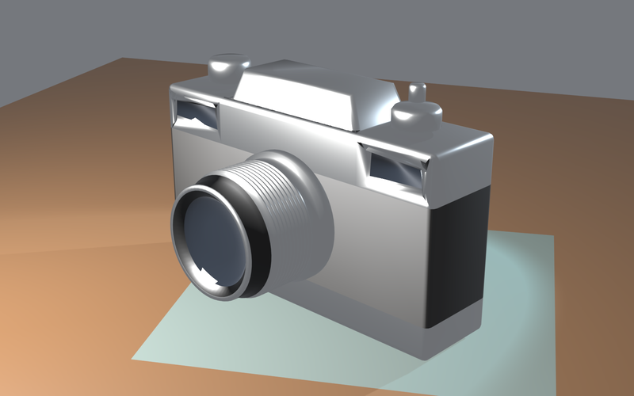

# Mesh Modeling

Edit Mode edits a mesh's vertices, edges and faces with Blender's own tools: Tab enters it, 1, 2 and 3 pick vertex,
edge or face selection, and the tools run Blender's operators in the module, with their keys, modal maps (typed
values, the mouse wheel for segments and cuts), gizmos and the Adjust Last Operation panel. The mesh they edit is
Blender's, so its topology is exactly what Blender would make.

[Open in Bylonder](https://propolisa.github.io/bylonder/#example=mesh-modeling)

The demo, Rangefinder Camera, is made in Blender by a script (`mesh-modeling.py`): a body from a box with loop cuts,
an inset and extruded top plate, inset windows and beveled edges; a lens, two knobs and a shutter button spun from
profiles. The steps below start the body from the Default Cube.

## Steps

1. **A slab.** Open the Default Cube, press Tab, then S Y 0.32 Enter and S Z 0.55 Enter: typed values scale along one
   axis.

   

2. **A loop cut.** Ctrl R over a vertical edge previews a loop around the body (the mouse wheel would add more cuts);
   a click places it, the mouse slides it along the edges and a second click confirms. It marks the leather band.

   

3. **Inset and extrude.** Press 3 for faces and click the top. I 0.12 Enter insets it (or by the mouse); E 0.2 Enter
   extrudes the inset face up into the housing of the viewfinder.

   

4. **Bevel.** A selects everything; Ctrl B bevels the edges, by the mouse or here a typed 0.04, and the wheel adds
   segments while it runs, so the corners round off as cast metal does.

   

5. **Bisect.** With everything selected, the Bisect tool (in the Knife's tool group) cuts the mesh along the line
   dragged across it, through faces front and back.

   

6. **Spin.** The lens is a profile of edges spun 360 degrees about its axis (Spin, or the Spin tool's gizmo), with
   ridges for the focus ring and a recess for the glass. Its topology is rings of quads.

   

7. **Render it.** Out of Edit Mode, Render > Render Image renders the camera on its desk.

   

## Project files

- [mesh-modeling.py](../../examples/mesh-modeling/mesh-modeling.py): builds the camera with Edit Mode's bmesh
  operators, its materials, the desk, lights and camera, in Blender 5.2.
- [mesh-modeling.blend](../../examples/mesh-modeling/mesh-modeling.blend): the file the script saves.
- [index.js](../../examples/mesh-modeling/index.js): opens the .blend with Blender's reader.
- Recorded by [record-mesh-modeling.mjs](../../tools/docs/record-mesh-modeling.mjs).
