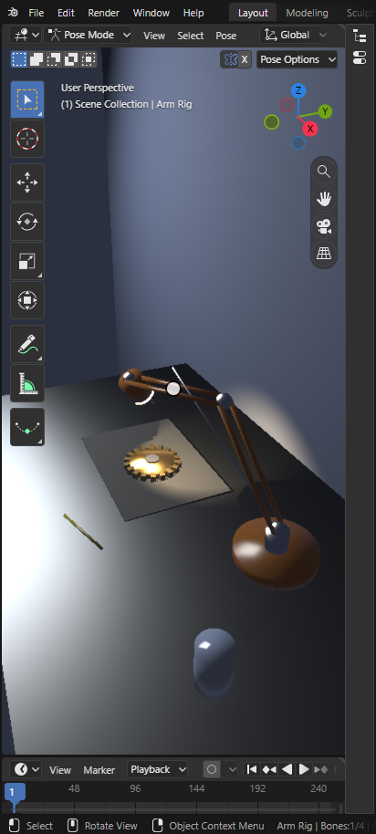
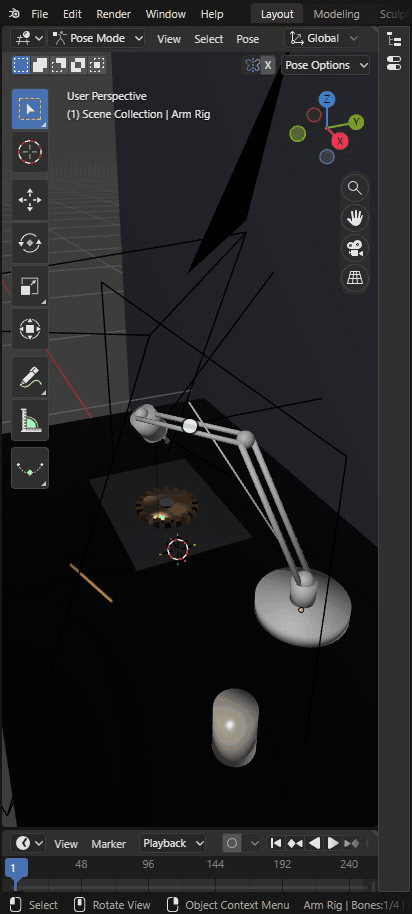
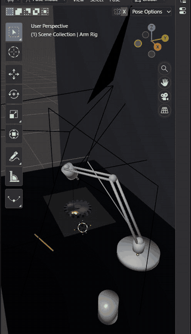
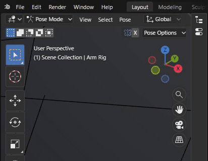
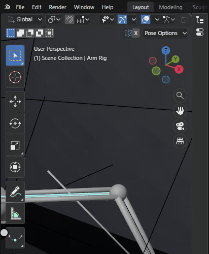
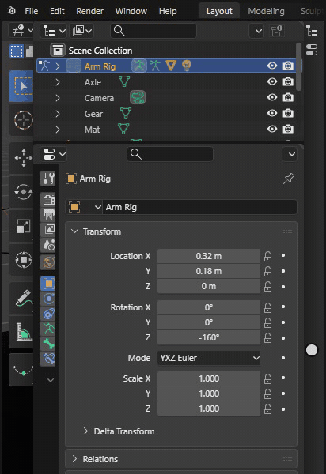
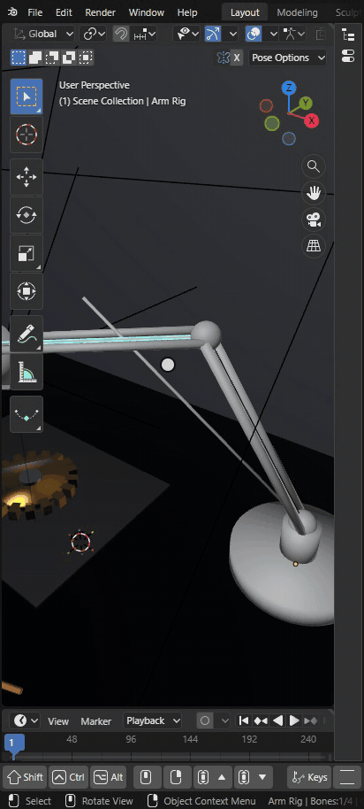
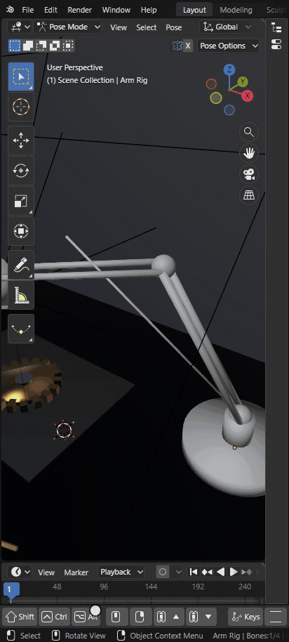
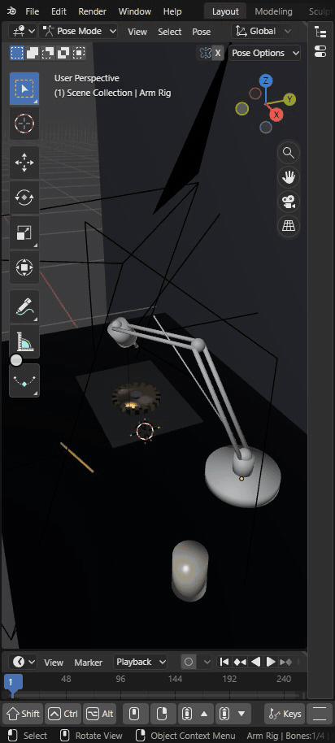

# Touch and Pen

Bylonder runs Blender's own screens on large phones and tablets. A finger is Blender's mouse: Blender's keymaps,
tools, modal operators and context menus run unchanged. Gestures navigate, a press and hold shows a control's tooltip
and then right clicks, and a pinch over the interface sets Preferences > Interface > Resolution Scale. A touch
device's first run sets Preferences > Keymap > Middle Mouse Action to Pan, so two
fingers pan. The design is in `docs/mobile.md`.

[Open in Bylonder](https://propolisa.github.io/bylonder/#example=cube)

The demo is the Default Cube, opened on a phone or a tablet (or with a desktop browser's device emulation).

## Steps

1. **Open the Layout workspace.** The screen is startup.blend's. An area too small for its panels folds into a strip
   on its edge; the topbar, headers and status bar scroll sideways and fade where more is beyond the edge.

   

2. **Open a folded area.** Tap the strip on the right: the Outliner and Properties editor open as a drawer over the
   3D Viewport at a usable width. A tap outside closes it.

   

3. **Navigate.** Drag two fingers to pan, pinch to zoom, drag three fingers to orbit. A tap selects; two fingers
   tapping undo, three redo.

   

4. **Reach a header's far end.** Drag the 3D Viewport's header sideways to its shading buttons and tap Rendered.

   

5. **Press and hold.** Hold a finger on a button: its tooltip shows at 400 ms and stays when you lift; the next tap
   closes it. Keep holding to 800 ms for the right click: on the 3D Viewport, the object context menu.

   

6. **Drag a value.** In the Properties editor's Object tab, drag Location X sideways with one finger: its name and
   value show above the finger. Hold Shift (Fine) beside the readout with a second finger for ten times finer steps,
   or Ctrl (Snap) for Blender's snapped increments; let go to drag at normal speed again.

   

7. **Use an area edge.** Press and hold on the edge between the 3D Viewport and the Timeline: Blender's Area Edge
   Options menu opens, with Vertical Split, Horizontal Split, Join Up, Join Down and Swap Areas. Tap Swap Areas.

   

8. **Carry an area.** Hold the Timeline's header until the ring fills halfway, then drag it over the 3D Viewport:
   the area under the finger is highlighted, and lifting swaps the two.

   

9. **Tap shortcuts.** Tap the cube, then Keys on the touch bar and Move in the pie. While the move runs, the touch
   bar shows its keys as bubbles: tap X, then the numbers button and 2, then Confirm. The cube moves 2 along X.

   

## Project files

The demo is the Default Cube example (`examples/cube`); nothing in its files is specific to touch.
