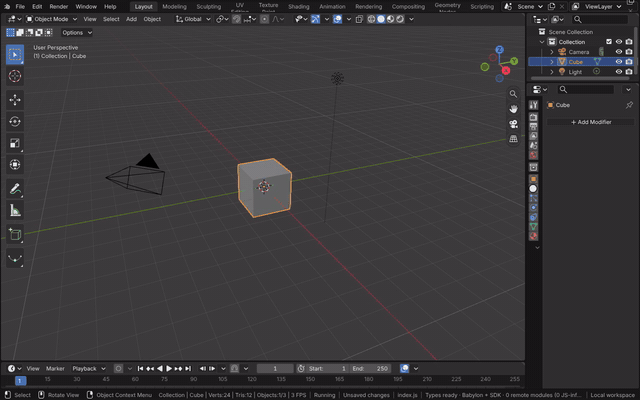
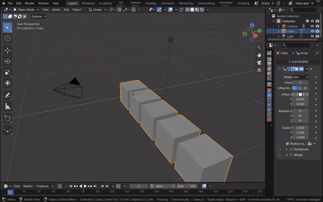

# Modifiers

A modifier changes an object's geometry without touching its mesh data: the stack in Properties > Modifiers runs
from top to bottom, and each modifier can be shown, hidden, reordered, applied or removed. Blender's own modifiers
run Blender's code in the module (`modifiers/modifiers.wasm`), so the result matches Blender's.

[Open in Bylonder](https://propolisa.github.io/bylonder/#example=arrays)

The demo, Array Modifiers, has a spiral stair, a colonnade and a floor of tiles made by two stacked arrays. The steps
below make the floor from the Default Cube.

## Steps

1. **Add an Array.** Open the Default Cube example from the splash screen, select the cube, open Properties >
   Modifiers and pick Add Modifier > Generate > Array. The cube is repeated along X.

   

2. **Set the count and offset.** Click Count, type 5 and press Enter, then set Offset X to 1.2 to leave gaps between
   the copies. Dragging a field changes it live.

   

3. **Stack a second Array.** Add another Array and set its Count to 5, Offset X to 0 and Offset Y to 1.2. It repeats
   the whole row, so the cube becomes a 5 by 5 grid of tiles.

   

> **Tip** The header of each modifier has its name, the edit, viewport and render toggles and a menu with Apply,
> Duplicate, Copy to Selected and Move to First or Last, as in Blender.

## Project files

- [index.js](../../examples/arrays/index.js): the stair, the colonnade and the floor, each with `addModifier` from
  the project SDK.
- Recorded by [record-modifiers.mjs](../../tools/docs/record-modifiers.mjs).
