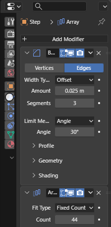
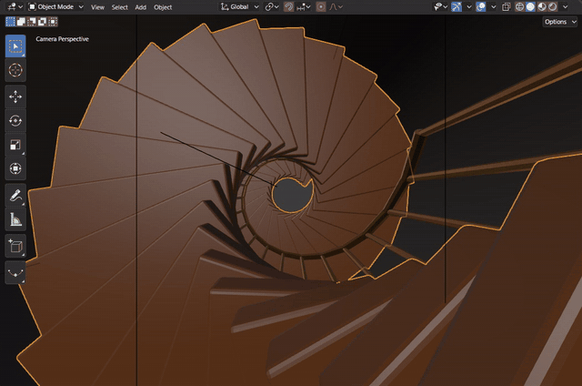
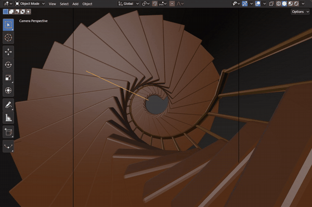

# Modifiers

A modifier changes an object's geometry without touching its mesh data: the stack in Properties > Modifiers runs
from top to bottom, and each modifier can be shown, hidden, reordered, applied or removed. Blender's own modifiers
run Blender's code in the module (`modifiers/modifiers.wasm`), so the result matches Blender's.

[Open in Bylonder](https://propolisa.github.io/bylonder/#example=arrays)

The demo, Spiral Stair, is a stair in a stone tower seen from below. The step is one box: a Bevel rounds its edges and
an Array repeats it, each copy placed by an empty, Turn, that is raised one step and turned 16 degrees. The banister
post and the handrail are one piece each with the same Array. Change the empty and the whole stair follows.

## Steps

1. **The stack.** Select Step and open Properties > Modifiers. Add Modifier > Generate > Bevel rounds the box's edges
   (Amount 0.025 m, Segments 3). Add Modifier > Generate > Array repeats the result: turn off Relative Offset, turn on
   Object Offset and pick Turn as its Object. The Array places each copy where Turn would move the one before it.

   

2. **Set the count.** Click Count and type a number: 8 steps, 20, then the 44 that reach the top. The stack runs again
   on each change.

   

3. **Wind the stair.** Select Turn, hover the 3D Viewport and press R, Z, 8 and Enter: Turn rotates 8 degrees more, so
   every step turns 24 degrees from the last and the stair winds tighter. Ctrl Z undoes it.

   

4. **The rest.** Baluster and Handrail carry the same Array with Turn, so the posts and the rail follow the steps.
   Press Numpad 0 for the camera and pick Rendered shading in the header.

> **Tip** The header of each modifier has its name, the edit, viewport and render toggles and a menu with Apply,
> Duplicate, Copy to Selected and Move to First or Last, as in Blender.

## Project files

- [arrays.py](../../examples/arrays/arrays.py): builds the tower, the step, posts and rail with their modifiers, the
  Turn empty, the lights and the camera in Blender 5.2.
- [arrays.blend](../../examples/arrays/arrays.blend): the file the script saves.
- [index.js](../../examples/arrays/index.js): opens the .blend with Blender's reader.
- Recorded by [record-modifiers.mjs](../../tools/docs/record-modifiers.mjs).
