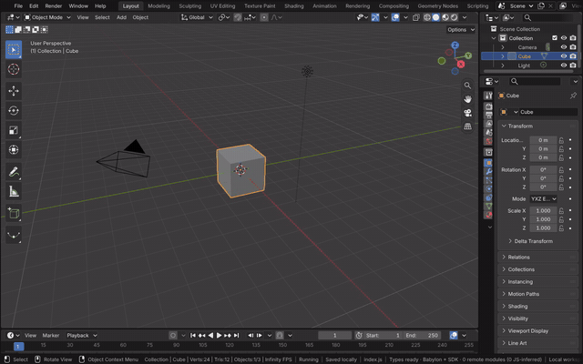
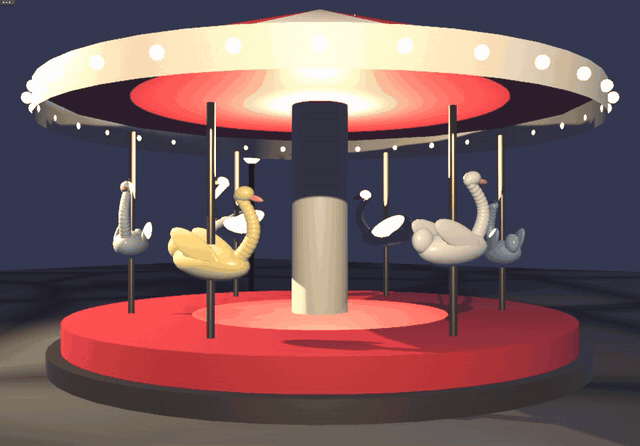
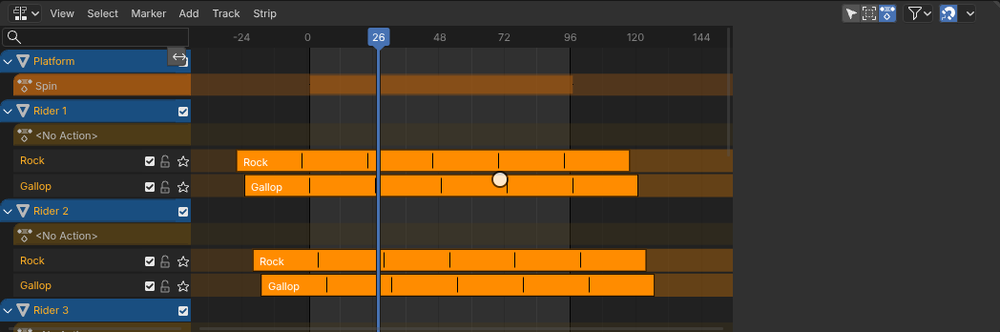

# Nonlinear Animation

The Nonlinear Animation editor (NLA) is Blender's editor for layering actions. Each animated data-block has tracks of
strips; a strip plays an action over a frame range, repeated, scaled, blended in or out, and mixed with the tracks
below it by its blending mode and influence. One action can be placed as strips on many objects, each starting at its
own frame, so a single cycle animates a crowd out of step. The editor is Blender's own, run in the module: its space
and regions, its keymaps and operators (selection, push down, tweak mode, transform, split, duplicate, meta strips,
transitions), the channel list and the main region's strips drawn by Blender's draw code, and the sidebar's strip
panels. Blender's animation system evaluates the strips each frame (the action under the tracks, then each track's
strips), so the scene plays exactly as in Blender.

[Open in Bylonder](https://propolisa.github.io/bylonder/#example=carousel)

The demo is a carousel at dusk. Its six swans share two actions of one 24 frame cycle each: Gallop moves a swan up its
pole and back, Rock pitches it. Each swan has a Gallop track and a Rock track (blended with Add), both repeated six
times, and each swan's strips start a quarter cycle after the previous swan's, so the riders rise and fall as a wave.
The platform turns by an action of its own with linear extrapolation. Warm point and spot lights under the canopy and
from the front, a cool moon and emissive bulbs light the scene.

## Steps

1. **Key a cycle.** In a new file, hover the 3D Viewport and press I to key the cube at frame 1. At frame 7 press G Z 1
   Enter and I; at frame 13 press Alt G and I. The keys make an action, CubeAction: one hop, the kind of cycle the
   example's Gallop and Rock are.

   

2. **Strips of one cycle.** The example's script places Gallop and Rock as strips on six swans (`nla_tracks.new`,
   `strips.new`), each repeated six times and each swan's a quarter cycle later. Play it in Rendered shading.

   

3. **Read the strips.** Switch the Timeline to Nonlinear Animation with its Editor Type menu and drag its top edge up.
   With every object selected (A over the 3D Viewport), Home over the editor shows each swan's Rock and Gallop tracks,
   each pair starting later than the one above. Spin, the platform's action, is on its action line. Click a strip and
   press G to move it in time, or Tab to edit its action in place.

   

## Project files

- [carousel.py](../../examples/carousel/carousel.py): builds the carousel, its materials and lights, the Gallop, Rock
  and Spin actions and every swan's tracks and strips, in Blender 5.2.
- [carousel.blend](../../examples/carousel/carousel.blend): the file the script saves.
- [index.js](../../examples/carousel/index.js): opens the .blend with Blender's reader.
- Recorded by [record-nla.mjs](../../tools/docs/record-nla.mjs).
