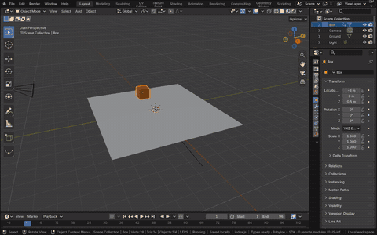
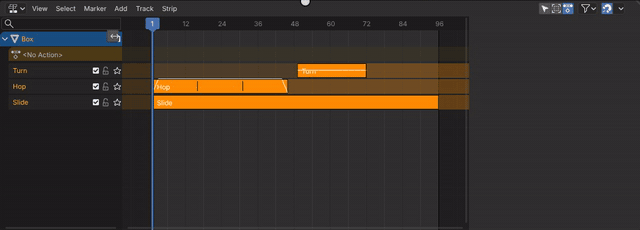
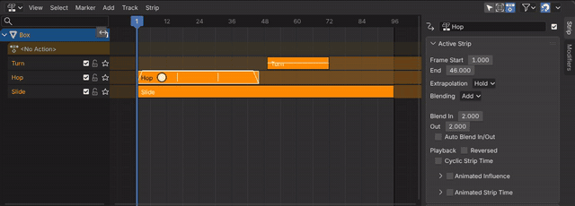
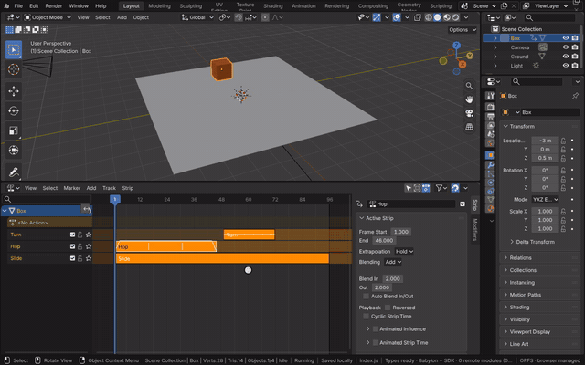

# Nonlinear Animation

The Nonlinear Animation editor (NLA) is Blender's editor for layering actions. Each animated data-block has tracks of
strips; a strip plays an action over a frame range, repeated, scaled, blended in or out, and mixed with the tracks
below it by its blending mode and influence. The editor is Blender's own, run in the module: its space and regions,
its keymaps and operators (selection, push down, tweak mode, transform, split, duplicate, meta strips, transitions),
the channel list and the main region's strips drawn by Blender's draw code, and the sidebar's strip panels. Blender's
animation system evaluates the strips each frame (the action under the tracks, then each track's strips), so the scene
plays exactly as in Blender.

[Open in Bylonder](https://propolisa.github.io/bylonder/#example=nla)

The demo is a box animated by three actions made in Blender by a script (`nla.py`): Slide moves it across the ground,
Hop repeats a hop three times added on top, and Turn combines a quarter turn at half influence from frame 49.

## Steps

1. **Open the editor.** Click the Timeline's Editor Type menu and pick Nonlinear Animation, then drag the border above
   it up. Box lists its action line (`<No Action>`) and the tracks Turn, Hop and Slide with their strips.

   

2. **A strip's properties.** Click the Hop strip: the sidebar (N shows or hides it) has its Strip tab, with its frames,
   extrapolation, blending (Add), blend in and out, influence, and its action clip's repeat and playback scale.

   

3. **Tweak mode.** Press Tab to edit the strip's action in place: the other tracks dim and the Dope Sheet and Graph
   Editor show Hop's keys. Tab again leaves tweak mode.

   

4. **Play it.** Press Space: Blender evaluates the stack each frame, so the box slides, hops three times and turns.

   

5. **Push down.** Key any property (I over the 3D Viewport): the keys make an action on the action line, its keys
   drawn as keyframe shapes. The button beside it (Push Down) moves the action into a new strip, ready to be layered.

## Project files

- [nla.py](../../examples/nla/nla.py): builds the box, its three actions and their tracks and strips, in Blender 5.2.
- [nla.blend](../../examples/nla/nla.blend): the file the script saves.
- [index.js](../../examples/nla/index.js): opens the .blend with Blender's reader.
- Recorded by [record-nla.mjs](../../tools/docs/record-nla.mjs).
