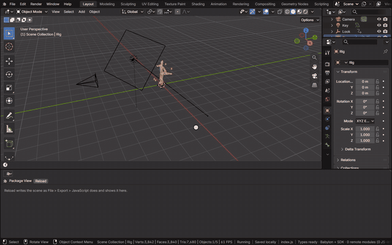
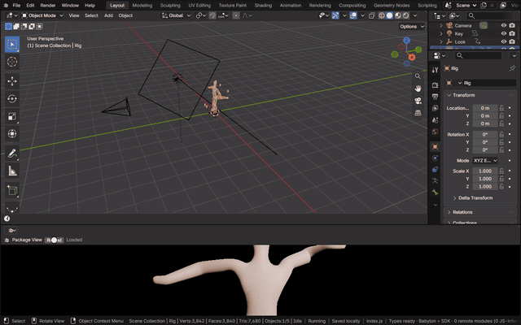

# Package View

The Package View shows the scene the way an exported page does: File > Export > JavaScript's package, written in memory
and loaded with plain Babylon.js and the page's own `load()`. What it shows is what a page shows. It is Bylonder's own
editor, chosen from an area's editor type menu.

[Open in Bylonder](https://propolisa.github.io/bylonder/#example=rigged-character)

## Steps

1. Open an area's editor type menu and choose Package View, then press Reload. The scene is exported and its page loads
   in the area.

   

2. Edit the scene: move an object, change a material's color, move a key. Once the app is idle, the page takes the
   change as a patch, without loading again. Undo and redo reach it the same way.

   

## Project files

The [Rigged Character](../../examples/rigged-character/) example's files.
