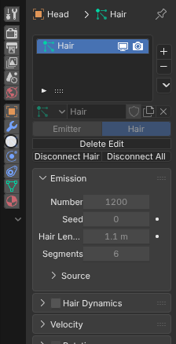
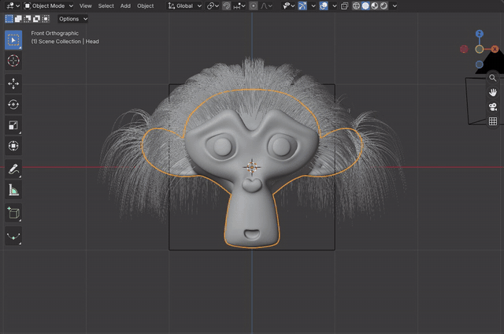
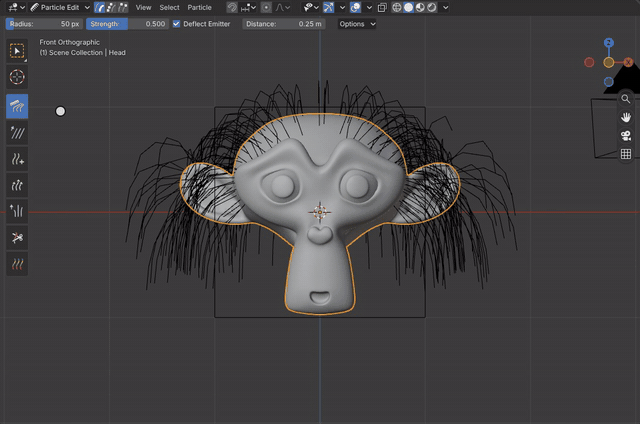
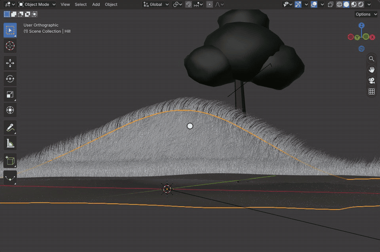

# Particle Hair

Blender's legacy hair is a particle system of type Hair on a mesh: strands grow from the emitter's faces or a vertex
group, children are interpolated around them, and Particle Edit Mode combs, cuts and grows the guide strands. The
system, its children and its edit mode are Blender's code in the module.

[Open in Bylonder](https://propolisa.github.io/bylonder/#example=particle-hair)

The demo is a grassy hill at sunset (`particle-hair.py`). Its grass is one hair system: 2,600 guide blades, eight
interpolated children each, thinning to the tip. The script combs every guide as the Comb brush would, bending it
downwind with a heading that wanders across the hill, so the grass shows the wind's path. In Blender the system starts
as Properties > Particles > + with Type set to Hair. The steps below look at the system and comb more wind into it.

## Steps

1. **The particle system.** Select Hill and open Properties > Particles. The Grass system lists its emission (number,
   hair length), children, roughness, and display settings.

   

2. **Particle Edit Mode.** In the 3D Viewport header, open the mode menu and pick Particle Edit. The toolbar shows the
   brushes (Comb, Smooth, Add, Length, Puff, Cut, Weight) and the header the radius, strength and select mode.

   

3. **Comb.** With the Comb brush, drag over the strands along the path the wind should take; the blades bend along
   the stroke and the children follow their guides. Each drag is one undo step.

   

4. **See it rendered.** Back in Object Mode, Numpad 0 looks through the camera, and Rendered shading draws the blades
   as strips in the Grass material: Hair Info's Intercept through a color ramp, dark at the root and sun-bleached at the
   tip.

   

## Project files

- [particle-hair.py](../../examples/particle-hair/particle-hair.py): builds the hill, the hair system and its
  material, combs it, and adds the tree, sun and camera, in Blender 5.2.
- [particle-hair.blend](../../examples/particle-hair/particle-hair.blend): the file the script saves.
- [index.js](../../examples/particle-hair/index.js): opens the .blend with Blender's reader.
- Recorded by [record-particle-hair.mjs](../../tools/docs/record-particle-hair.mjs).
