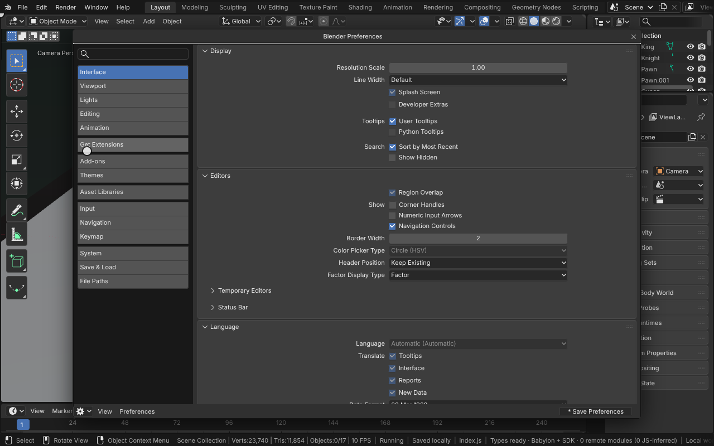
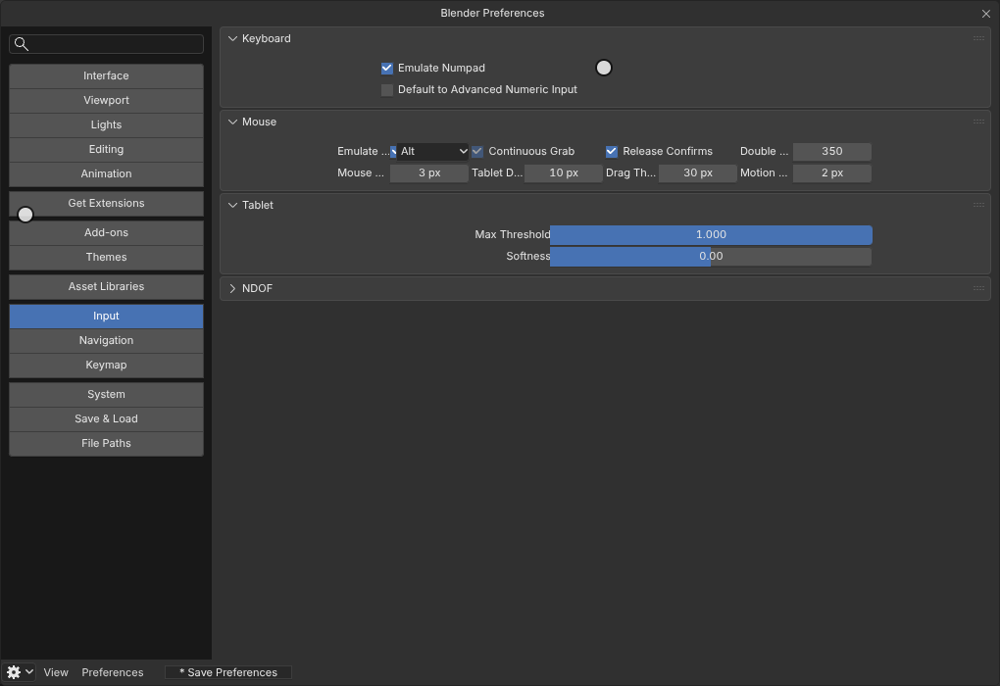
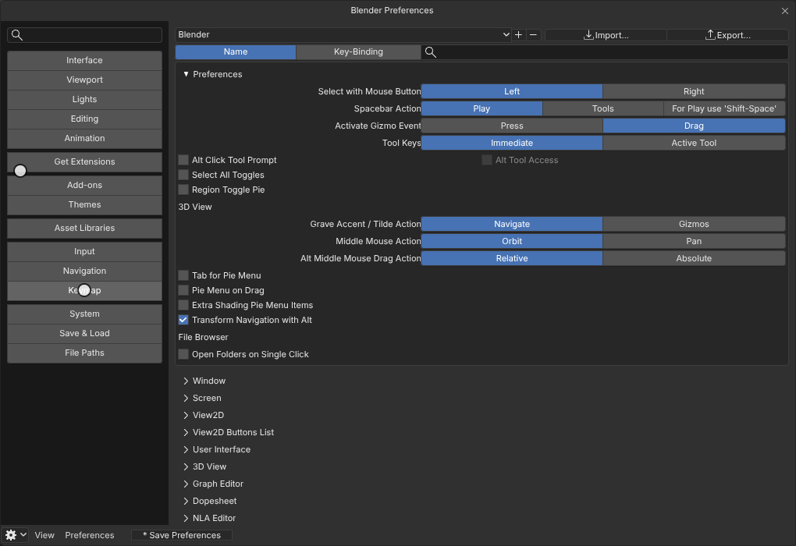
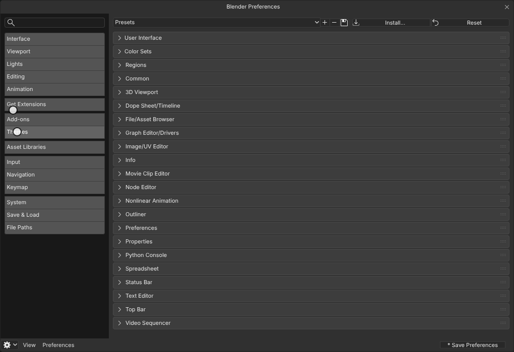
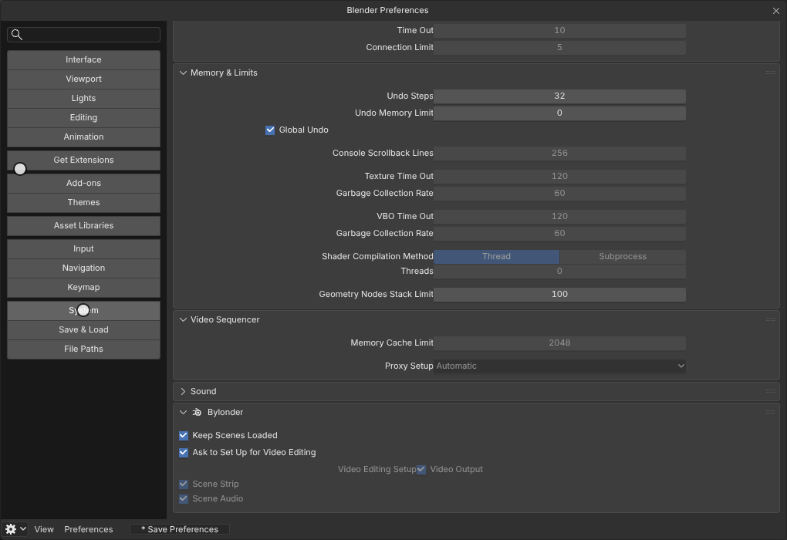

# Preferences

Edit > Preferences opens Blender's Preferences editor: Blender's own `space_userpref` running in the module, its
header, navigation bar and every panel of every section drawn from Blender's Python UI over Blender's Preferences
(`U`). Settings Bylonder honors work as in Blender; the ones a browser cannot honor, or Bylonder does not yet, are
greyed out with their reason in the tooltip, never hidden. Bylonder's own settings are in System > Bylonder, a panel
with the Bylonder icon.

The Preferences belong to the user, not to a project: Save Preferences writes Blender's `userpref.blend`, which this
browser keeps, and startup reads it as Blender does. Auto-Save Preferences saves changed preferences when the page is
hidden or closed, and Load Factory Preferences and Revert to Saved Preferences are Blender's.

[Open in Bylonder](https://propolisa.github.io/bylonder/#example=cube)

The demo is the Default Cube; the steps below change Preferences over it.

## Steps

1. **Open the Preferences.** Edit > Preferences opens Blender's Preferences in a window of its own, which can be moved
   by its title. Preferences can also be shown in any area through its Editor Type menu. With Interface > Editors >
   Temporary Editors > Preferences set to Maximized Area, Edit > Preferences fills the app's area instead.

   

2. **Set up a laptop.** In Input, turn on Emulate 3 Button Mouse and Emulate Numpad (the number row is the numpad).
   Touchpad > Multi-touch Gestures turns on trackpad gestures, and Scroll Direction sets natural scrolling. The table
   below lists each view and navigation action's route without a numpad or a middle mouse button.

   

   | Action | Mouse with a middle button and numpad | Laptop |
   | --- | --- | --- |
   | Orbit | Middle drag | Alt left drag (Emulate 3 Button Mouse), two-finger drag, or drag the navigation gizmo |
   | Pan | Shift middle drag | Shift Alt left drag, Shift two-finger drag, or drag the hand button |
   | Zoom | Wheel, Ctrl middle drag | Ctrl Alt left drag, pinch, Ctrl two-finger drag, or drag the magnifier button |
   | Front, Right, Top views | Numpad 1, 3, 7 | 1, 3, 7 (Emulate Numpad), the backtick View pie, or click the gizmo's axes |
   | Opposite views | Ctrl Numpad 1, 3, 7 | Ctrl 1, 3, 7 (Emulate Numpad), or click an axis again |
   | Perspective and orthographic | Numpad 5 | 5 (Emulate Numpad), or the projection button |
   | Camera view | Numpad 0 | 0 (Emulate Numpad), or the camera button |
   | Frame selected | Numpad . | View > Frame Selected |

   Touch screens map their gestures onto the same trackpad events: one finger orbits, two fingers pan and pinch.

3. **Navigate as you prefer.** Navigation's Orbit Method (Turntable or Trackball), Orbit Around Selection, Auto
   Perspective, Zoom to Mouse Position and Invert Zoom Wheel apply to the 3D Viewport at once: its navigation is
   Blender's own operators, which read them.

4. **Edit the keymap.** Keymap lists Blender's keymaps. Pick Blender or Industry Compatible as the preset; Select With
   Left or Right and Spacebar Action change the keys Blender's preset makes. Click a key item's key and press the new
   key (with its modifiers) to rebind it; Restore puts a keymap back. The changes are kept with the Preferences.

   

5. **Change the theme.** Themes applies a theme to the interface through its design tokens: Reset to Default Theme
   gives Blender Dark, and colors that a token stands for can be edited one by one.

   

6. **Bylonder's settings.** System > Bylonder holds Keep Scenes Loaded and the Video Sequencer's setup: whether it asks
   when the Video Sequencer opens on an empty edit, and the choice it remembers.

   

7. **Keep them.** Save Preferences (or Auto-Save Preferences) keeps them in this browser; reload the page and they
   apply at startup.

## Project files

- [index.js](../../examples/cube/index.js): the Default Cube. Preferences belong to the browser, not to a project.
- Recorded by [record-preferences.mjs](../../tools/docs/record-preferences.mjs).
