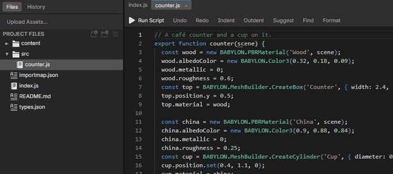
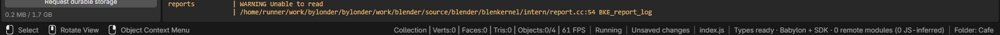
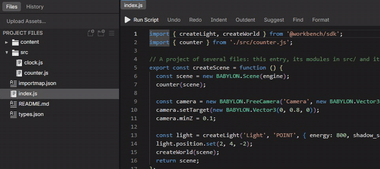

# Project Files

A project is its files: the entry `index.js`, modules in folders such as `src/`, content such as text in `content/`,
and its scene. The code editor's Explorer shows them as VS Code's does. A project lives in the browser by default, or
in a folder on disk opened with File > Open Folder: the folder holds the project's files as they are, its scene as a
.blend (File > Save writes it, as desktop Blender's does) and `bylonder.json`, the project's settings, so the
folder works with git and any editor.

[Open in Bylonder](https://propolisa.github.io/bylonder/#example=project-files)

The demo, Project Files, is a café counter and a cup built by `index.js` with its module in `src/` and a text in
`content/`.

## Steps

1. **Work in the Explorer.** Window > Toggle Project Code shows the code beside the scene. In the Explorer, New Folder
   and New File (its header's buttons, or the right-click menu) name the new item in place; F2 renames, Delete
   deletes, a drag moves a file or folder, and the arrow keys walk the tree and open and close folders. A file with
   unsaved changes shows a dot in the tree and in its tab.

   

2. **Open a folder.** File > Open Folder picks a folder on disk. An empty folder takes the open project's files, and
   its .blend once the scene runs; a folder that holds a project opens it. The status bar names the folder, and File >
   Save (Ctrl S) writes the .blend and every changed file, while Ctrl S in the code editor writes its file.

   

3. **Edit outside the app.** Change a file in the folder with any other tool. When the page has the focus again, the
   Explorer and the code editor show the change; a file with unsaved edits in the app keeps them, and a changed .blend
   opens the project again.

   

## Project files

- [index.js](../../examples/project-files/index.js): builds the scene from its module.
- [src/counter.js](../../examples/project-files/src/counter.js): the counter and the cup.
- [content/menu.txt](../../examples/project-files/content/menu.txt): a text the project keeps.
- Recorded by [record-project-files.mjs](../../tools/docs/record-project-files.mjs).
