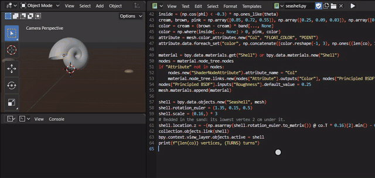
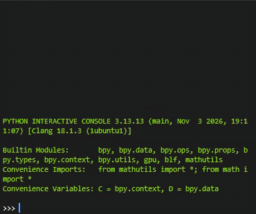
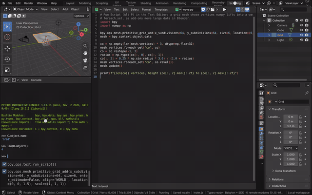
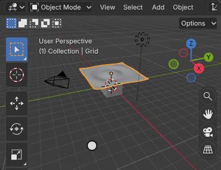

# Python Scripts, Console and Add-ons

Bylonder runs Python as Blender does: CPython 3.13 (Blender's version) with Blender's own `bpy`, `mathutils`, `bmesh`
and numpy 2.3, built into Blender's WebAssembly module. A script's `bpy.data` is the scene you edit, `bpy.ops` runs
Blender's operators, and the classes a script or add-on registers (operators, panels, menus, key map items,
properties) appear in the interface and work as in Blender. Python starts when it is first needed, so it does not slow
down opening the app.

[Open in Bylonder](https://propolisa.github.io/bylonder/#example=python)

The demo, Python Scripts and Add-ons, is a seashell on a beach at golden hour. The shell is built by a script kept in
the file, `seashell.py`: a tube swept along a logarithmic spiral, every vertex and its banded color computed at once
with numpy and written in one `foreach_set`. The file also holds `scatter_cubes.py`, an add-on. The steps below change
the script and run it, use the console and install the add-on.

## Steps

1. **Run a script.** Open the Scripting workspace. In the Text Editor, pick `seashell.py` from the text menu. Change
   `TURNS` from 5.5 to 2.5 and press Alt P (Text > Run Script): the script removes the old shell and builds one with
   fewer whorls.

   

2. **Type in the console.** Hover the Python Console and type `D.objects['Seashell'].dimensions`, then Enter, and
   `len(D.objects['Seashell'].data.vertices)`. `D` is `bpy.data` and `C` is `bpy.context`; Tab completes names and Up
   recalls history.

   

3. **Install the add-on.** Open Edit > Preferences > Add-ons; Python starts. In the section's menu choose Install from
   Disk and pick `scatter_cubes.py` (download it from the project's files first). Blender installs it into your user
   directory, which the browser keeps, and enables it. An extension's `.zip` installs the same way.

   

4. **Use it.** Shift A > Scatter Cubes in the 3D Viewport adds cubes around the 3D cursor; Adjust Last Operation
   changes their count. The sidebar (N) has a Scatter tab, and Ctrl Shift R runs it too.

   

## Project files

- [python.py](../../examples/python/python.py): builds the beach, the light and the camera, keeps the two texts and runs
  `seashell.py`, in Blender 5.2.
- [python.blend](../../examples/python/python.blend): the file the script saves.
- [seashell.py](../../examples/python/seashell.py): the script of step 1.
- [scatter_cubes.py](../../examples/python/scatter_cubes.py): the add-on of steps 3 and 4.
- [index.js](../../examples/python/index.js): opens the .blend with Blender's reader.
- Recorded by [record-python.mjs](../../tools/docs/record-python.mjs).
