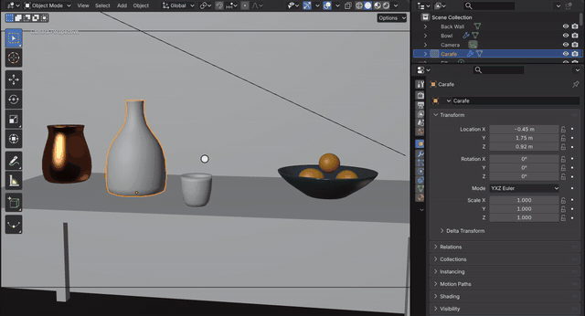
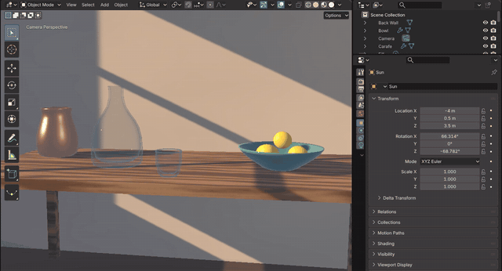
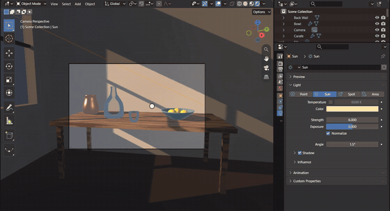
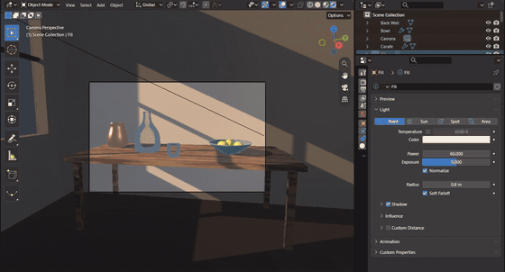
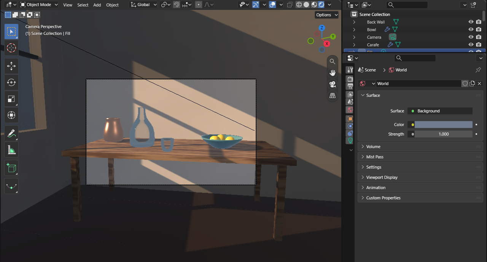
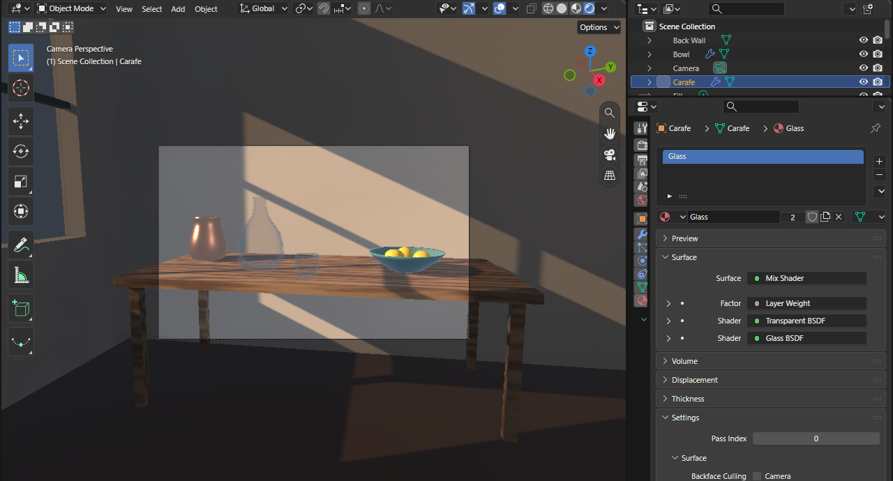
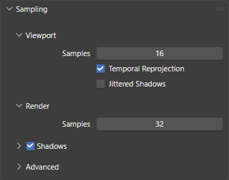
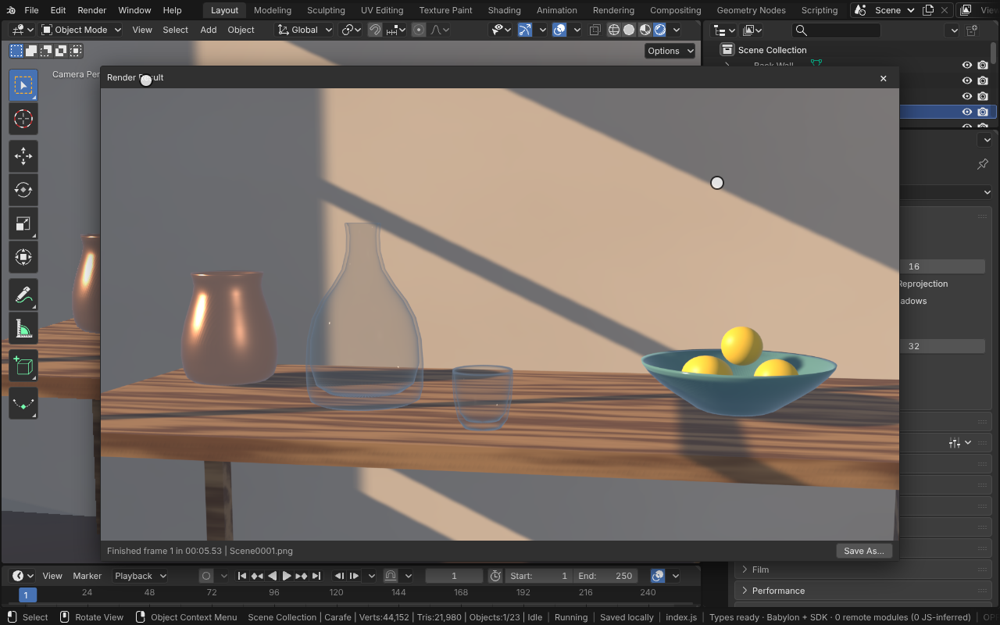

# Rendering

Rendered shading and Render Image draw a scene from Blender's own data the way EEVEE does: Blender's lights with their
strength, color, soft size or angle (for highlights) and Cast Shadow, the world's color as light and reflection (EEVEE's world probe),
Blender's shader nodes for materials, and the film's anti-aliasing over the render's samples. The camera frames the
image through Blender's camera code (lens, sensor and fit), at the resolution in Properties > Output > Format.

[Open in Bylonder](https://propolisa.github.io/bylonder/#example=rendering)

The demo, Window Light, is made in Blender by a script (`rendering.py`): a table by a window, a sun through the panes,
a soft point light for fill, a dusk blue world, and glass, copper, glazed and wood materials.

## Steps

1. **Rendered shading.** Look through the camera (Numpad 0) and pick Rendered in the 3D Viewport's header (or Z >
   Rendered). The lights, shadows and materials draw as EEVEE would draw them.

   

2. **The sun.** Select Sun and press R Z, then move the mouse: a sun's direction is all that places its light, so the
   window's pattern slides along the wall and the table. Its Strength, Color and Angle are in Properties > Light.

   

3. **Cast Shadow.** The Shadow panel's checkbox turns the sun's shadows off and on. With it off, the light passes the
   wall and the window's pattern goes.

   

4. **A fill light.** Select Fill, a point light on the right. Its Power lifts the shadow side of the objects; its
   Radius of 0.8 m spreads its highlights.

   

5. **The world.** Properties > World: the world's Color lights the scene from every side and is what glossy, metallic
   and glass surfaces reflect. Here a dusk blue fills the shadows and tints the copper.

   

6. **Glass.** The carafe's material mixes a Glass BSDF with a Transparent BSDF by a Layer Weight's Fresnel: glass at
   the edges, clear where it faces the camera.

   

7. **Samples.** Properties > Render > Sampling: Render samples are the jittered frames Render Image averages for its
   anti-aliasing and soft shadows; Viewport samples do the same for a still Rendered view.

   

8. **Render Image.** Render > Render Image (F12) renders through the scene camera at the output's resolution, in a
   Render Result window; Image > Save As saves it.

   

## Project files

- [rendering.py](../../examples/rendering/rendering.py): builds the room, the objects, their materials, the lights,
  the world and the camera, in Blender 5.2.
- [rendering.blend](../../examples/rendering/rendering.blend): the file the script saves.
- [index.js](../../examples/rendering/index.js): opens the .blend with Blender's reader.
- Recorded by [record-rendering.mjs](../../tools/docs/record-rendering.mjs).
