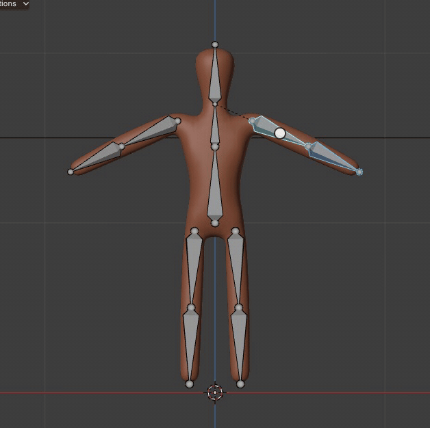
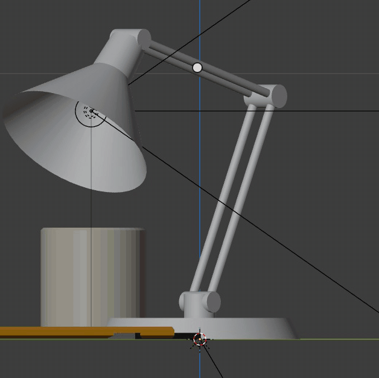
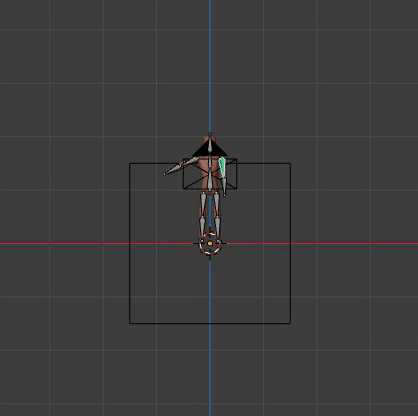
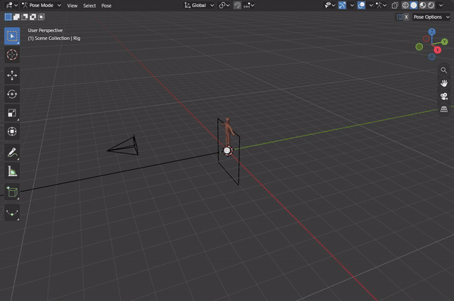

# Rigging and Posing

An armature is a skeleton of bones that deforms a mesh. In Pose Mode each bone is selected, rotated and moved like an
object, and the pose is keyed on the Timeline. Bone collections group bones, and bone constraints limit or drive
them. The armature, its pose evaluation and the Armature modifier run Blender's own code (`docs/armatures.md`).

[Open in Bylonder](https://propolisa.github.io/bylonder/#example=rigged-character)

The demo, Rigged Character, is a figure skinned to an 11 bone rig by automatic weights. It is built by a Blender
script (`rigged-character.py`), so the steps below start from the example and pose it.

## Steps

1. **Enter Pose Mode.** The Rig is selected when the example opens. Hover the 3D Viewport and press Ctrl Tab, or pick
   Pose Mode in the header's mode menu. The bones turn gray and the header shows the Pose menu.

   

2. **Select bones.** Click a bone to select it; Shift click adds a bone to the selection. The last one clicked is the
   active bone, which the Bone tab of the Properties editor shows. Drag a box with the Select Box tool (or press B),
   press C for circle select or Ctrl right drag a lasso; Shift adds and Ctrl subtracts. L over a bone selects the
   bones connected to it.

   

   

3. **Rotate.** Press R, type an angle and press Enter, or move the mouse and click. G moves and S scales the same way.
   Alt R and Alt G clear the rotation and location.

   

4. **Key the pose.** Press I to insert a keyframe for the selected bones. Set the current frame on the Timeline,
   change the pose and press I again. Space plays the animation between the two keys.

   

5. **Bone collections.** Open Properties > Armature (the Data tab). In Bone Collections, + adds a collection and
   Assign puts the selected bones in it. The eye hides a collection's bones.

   

6. **Bone constraints.** Open the Bone Constraints tab, then Add Bone Constraint > Limit Rotation. Enable Limit X, Y
   or Z and set the range; the bone cannot be rotated past it.

   

7. **Weight Paint.** Back in Object Mode, select the Rig, then Shift click the Body so it is active, and pick Weight
   Paint in the header's mode menu: the Rig goes to Pose Mode with it. Alt click a bone to paint its vertex group,
   then drag over the body. Blue is no weight, red full weight; Ctrl paints the inverse. The Overlays popover's Weight
   Paint panel sets the weights' Opacity, Zero Weights and Show Weight Contours.

   

8. **Pose library.** In Pose Mode, select the bones (A) and pick Pose > Create Pose Asset: name the pose and press
   Create; it is saved in the Current File. View > Asset Shelf shows the pose library along the bottom of the 3D
   Viewport. Click a pose to apply it; drag from a pose to the right to blend it in by how far you drag, then release.
   Right click a pose for Apply Pose Flipped, Blend Pose and Select Pose Bones.

   

> **Note** Every step is an undo step: Ctrl Z undoes it as in Blender.

## Project files

- [rigged-character.py](../../examples/rigged-character/rigged-character.py): builds the figure in Blender 5.2: the
  body from a Skin modifier, the rig, and the automatic weights.
- [rigged-character.blend](../../examples/rigged-character/rigged-character.blend): the file the script saves.
- [index.js](../../examples/rigged-character/index.js): opens the .blend with Blender's reader.
- Recorded by [record-rigging.mjs](../../tools/docs/record-rigging.mjs).
