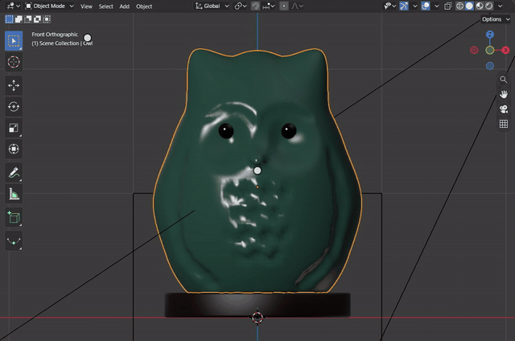
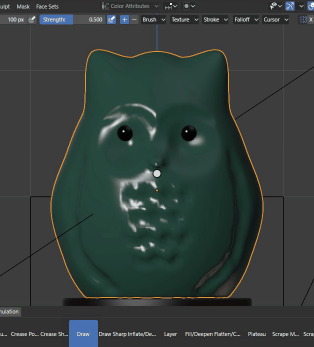
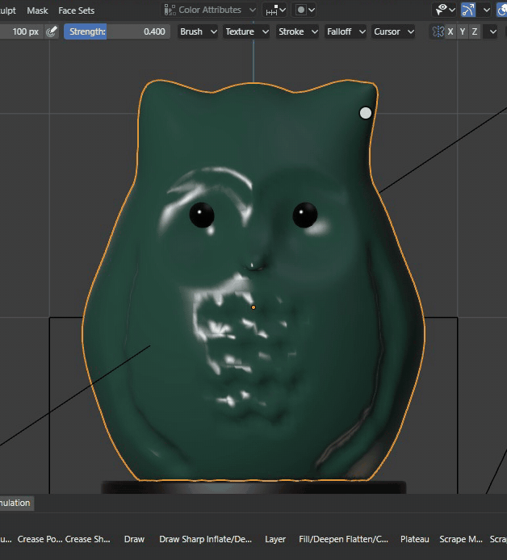
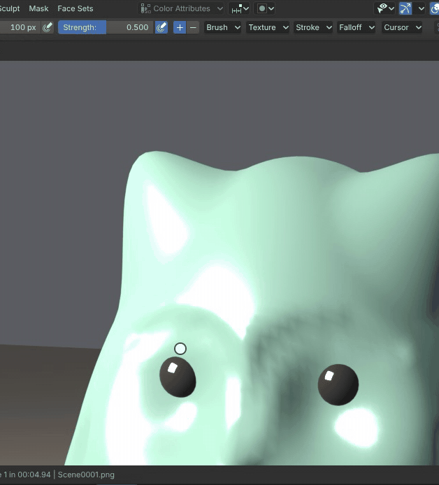
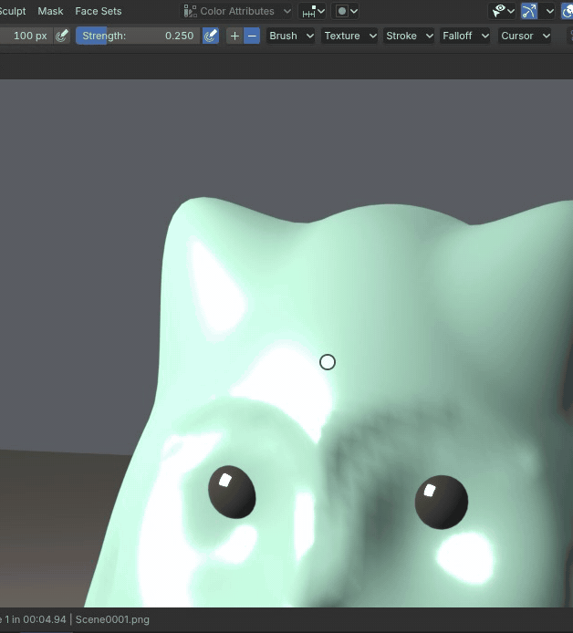
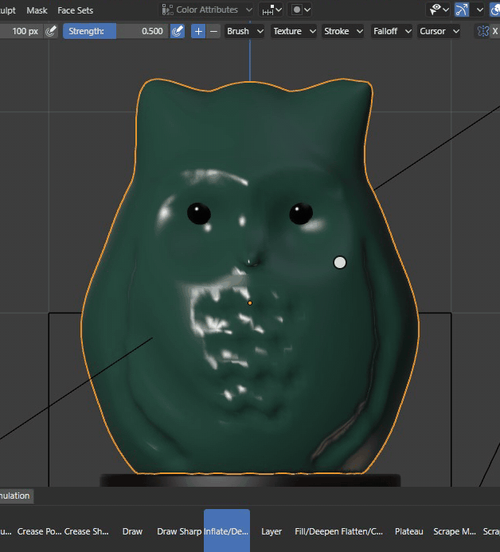

# Sculpting

Sculpt Mode shapes a mesh like clay: each brush moves the vertices under it, weighted by its falloff, as the pointer
drags. The mode, its brushes and strokes are Blender's code in the module: Draw raises (Ctrl lowers), Grab pulls a
region along, Crease cuts a sharp groove, Inflate swells along the normals, and holding Shift smooths with any brush.
Each stroke is one undo step, and Ctrl Z takes it back without leaving the mode.

[Open in Bylonder](https://propolisa.github.io/bylonder/#example=sculpting)

The demo, Ceramic Owl, is made in Blender by a script (`sculpting.py`): a quad sphere of about 10,000 faces shaped
into an owl with ear tufts, a face of two discs, eyes, a beak, wings and rows of feathers, glazed in celadon on a
walnut plinth. The steps sculpt on it further.

## Steps

1. **Sculpt Mode.** Select Owl, press Numpad 1 and Numpad . to frame its face, then pick Sculpt Mode in the 3D Viewport's mode menu. The Draw brush is active, its circle follows the pointer.

   

2. **Grab.** G picks Grab. Drag from an ear tuft upward: the tuft and the region in the brush's circle follow.

   

3. **Draw.** V picks Draw. A stroke over the eyes raises a brow; a stroke along a wing with Ctrl held cuts in.

   

4. **Crease.** Shift C picks Crease Polish. A stroke down from between the eyes cuts a sharp line for the beak.

   

5. **Inflate.** I picks Inflate. A short stroke on a cheek swells it.

   

6. **Smooth and undo.** Holding Shift smooths the forehead with whatever brush is active. Ctrl Z takes the last stroke back and
   stays in Sculpt Mode.

   

## Project files

- [sculpting.py](../../examples/sculpting/sculpting.py): builds the owl from a quad sphere, its glaze, the plinth,
  lights and camera, in Blender 5.2.
- [sculpting.blend](../../examples/sculpting/sculpting.blend): the file the script saves.
- [index.js](../../examples/sculpting/index.js): opens the .blend with Blender's reader.
- Recorded by [record-sculpting.mjs](../../tools/docs/record-sculpting.mjs).
