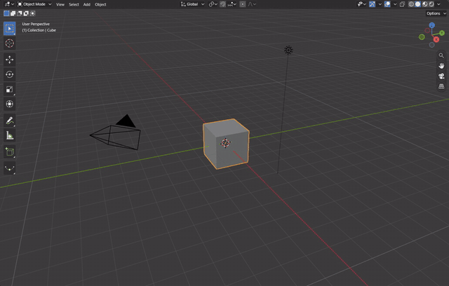
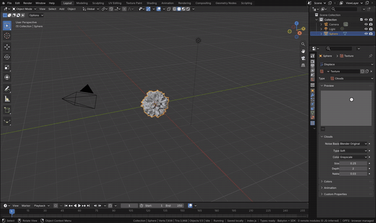
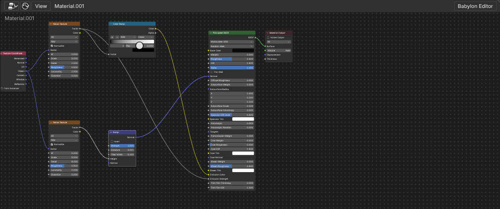

# Shader Nodes

A material's surface is a tree of Blender's shader nodes in the Shader Editor. Each Blender node runs Blender's own
GLSL in Babylon's material, so a node computes what it computes in Blender; an input value changes without a rebuild,
a property such as a Noise Texture's dimensions rebuilds the material as Blender recompiles its shader
(`docs/node-editors.md`). The full workflow is written out in [A displaced lava sphere](../lava-material.md).

[Open in Bylonder](https://propolisa.github.io/bylonder/#example=lava)

The demo, Lava Sphere, is the result made in Blender by `lava.py`. The steps below make it from the Default Cube.

## Steps

1. **The sphere.** In the Default Cube example, click the cube, press X > Delete, then Shift A > Mesh > UV Sphere. In
   Properties > Modifiers add Generate > Subdivision Surface and Deform > Displace. In the Displace panel, the
   Texture field's New makes a texture; in Properties > Texture set its Type to Clouds.

   

2. **The lava material.** Click the Shading tab and New in the Shader Editor (Principled BSDF into Material Output).
   Shift A adds each node (type to search, Enter, click to place); drag from socket to socket to link:
   - Texture Coordinate's Object into two Noise Textures, both set to 4D.
   - The first Noise's Factor into a Color Ramp (black stop at 0.5, the other orange), its Color into Principled
     BSDF's Emission Color, and the Factor into Emission Strength.
   - The second Noise (Detail 8) into Bump's Height, Bump's Normal into Principled BSDF's Normal; a dark Base Color.

   

3. **The result.** Material Preview shows the sphere glowing through its cracks. Every edit rebuilds the material.

   

The [Shader Node Gallery](https://propolisa.github.io/bylonder/#example=shader-gallery) example shows twenty materials of
Blender's common nodes, and a floor four objects cast the sun's shadows on; the smoke test renders it and compares each sphere and floor tile with EEVEE's render of the same file
(`tests/fixtures/shader-gallery-eevee.png`, Standard view transform), and
`tools/blender-reference/shader-gallery-diff.py` measures each sphere's error in display space (CIE76 dE, mean and 99th
percentile inside the sphere or over the tile). Measured with Render Image at 256 by 384 (the aim: mean dE under 3 and 99th percentile under 10):

| Tile | dE mean | dE 99% | Tile | dE mean | dE 99% |
|---|---|---|---|---|---|
| 1 Checker | 1.3 | 5.6 | 13 Diffuse and Glossy mix | 1.7 | 2.8 |
| 2 Voronoi | 0.9 | 3.6 | 14 Diffuse plus Emission | 0.8 | 1.4 |
| 3 Wave | 1.1 | 3.2 | 15 Sheen | 1.9 | 3.5 |
| 4 Brick | 0.9 | 4.5 | 16 Normal Map | 0.8 | 1.6 |
| 5 Magic | 0.7 | 1.9 | 17 Two Glossy lobes | 3.2 | 14.3 |
| 6 Gradient | 0.7 | 1.3 | 18 Glass | 2.0 | 2.3 |
| 7 Geometry normal | 0.7 | 1.5 | 19 Half transparent | 2.8 | 3.4 |
| 8 Fresnel | 0.8 | 1.3 | 20 Metallic Principled | 2.3 | 3.1 |
| 9 Layer Weight | 2.5 | 4.0 | 21 Cube shadow | 2.0 | 18.4 |
| 10 White Noise | 0.8 | 3.2 | 22 Ball shadow | 3.0 | 36.6 |
| 11 Principled | 2.3 | 4.1 | 23 Pole shadow | 2.2 | 19.7 |
| 12 Glossy | 2.4 | 4.0 | 24 Ring shadow | 5.1 | 47.2 |

Through the gallery's Perspective camera (`tests/fixtures/shader-gallery-perspective-eevee.png`), the band of the frame the
floor fills measures mean dE 1.7, 99th percentile 26 (shadow edges).

**EEVEE Parity.** Properties > Render > EEVEE Parity (on by default, marked with the Bylonder icon) turns on Bylonder's
extensions of Babylon's materials that draw as EEVEE does: each reflection lobe lit on its own and an orthographic
view's direction. Off, materials draw as plain Babylon PBR. File > Export asks for its own EEVEE
Parity option, off by default: on, an export adds the view's direction as EEVEE's and a second lobe as Babylon's
clearcoat; off, it lights with Babylon's own blocks. Either way the scene loads in Babylon.js alone
(`tests/export-node-material.test.js`).

> **Note** The header's Babylon Editor toggle opens the same graph in Babylon's Node Material Editor; both editors
> keep one layout.

## Project files

- [lava.py](../../examples/lava/lava.py): builds the sphere, its modifiers, the texture and the material in Blender
  5.2.
- [lava.blend](../../examples/lava/lava.blend): the file the script saves.
- [index.js](../../examples/lava/index.js): opens the .blend with Blender's reader.
- [shader_gallery.py](../../examples/shader-gallery/shader_gallery.py): builds the Shader Node Gallery and renders it
  in EEVEE, the reference the smoke test compares with.
- [lava.mjs](../../tests/e2e/lava.mjs): the steps as real input, used by the smoke test and by
  [record-shader-nodes.mjs](../../tools/docs/record-shader-nodes.mjs).
