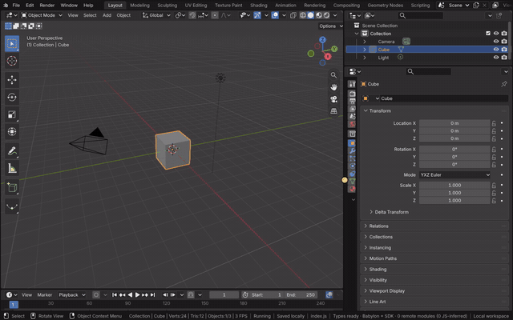
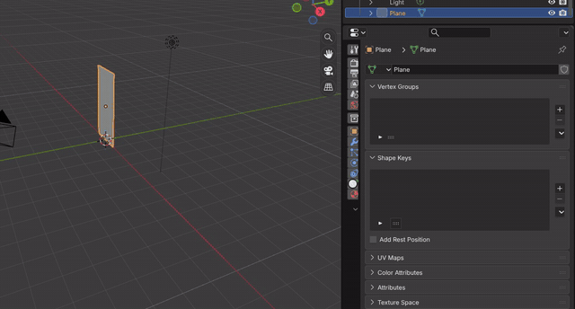
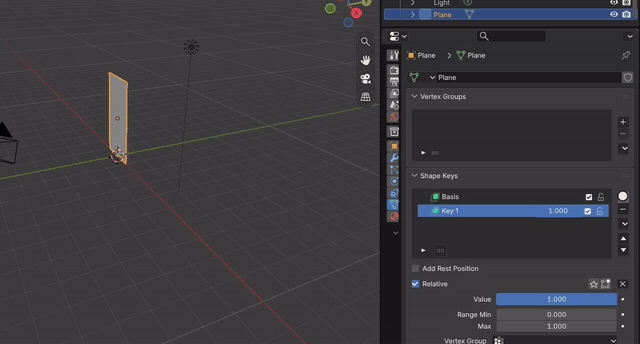
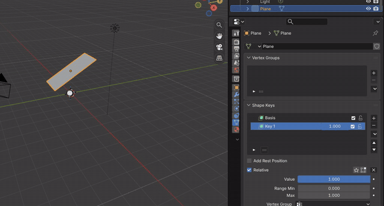
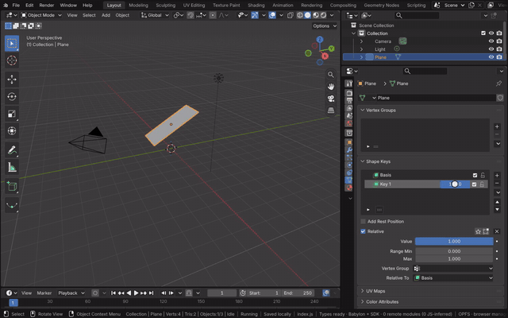
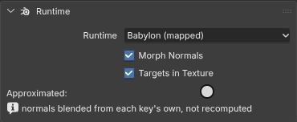
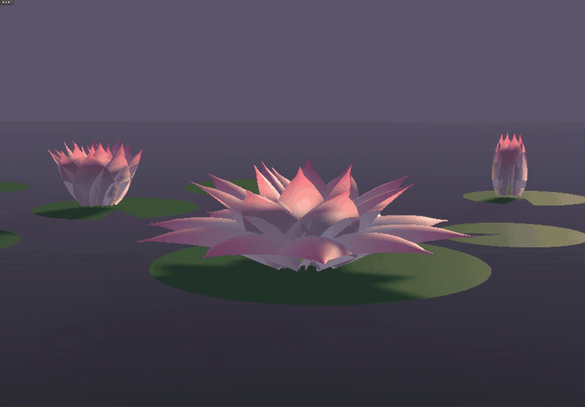

# Shape Keys

Shape keys store other positions of a mesh's vertices: a Basis and keys relative to it, each blended in by its value.
A key's value moves every vertex in a straight line from its place in the relative key towards its place in the key,
so one value can drive a change no transform can, such as many petals opening at once, each by its own angle.
Everything about them is Blender's code in the module: the Key data-block and its key blocks, Properties > Mesh >
Shape Keys (Blender's tree of keys with each key's value, mute and lock), the operators (add, remove, move, clear,
mirror, apply to basis, Blend from Shape), Edit Mode on a key, the shape pinned to the active key, and keying a value
with I. Blender's depsgraph evaluates the keys into the mesh the 3D Viewport draws.

The keys can also be blended by Babylon (docs/runtimes.md): with Shape Keys' Runtime panel on Babylon (mapped), the
mesh is drawn once and each key becomes a target of a Babylon MorphTargetManager, so a value that changes (played or
dragged) only changes a target's influence and the GPU blends it. The blend is Blender's (Basis plus each unmuted
key's value times its offset from its relative key, scaled by its vertex group), so the positions are the same; only
the normals are blended rather than recomputed.

[Open in Bylonder](https://propolisa.github.io/bylonder/#example=lotus)

The demo is a lotus pond. Each flower is one mesh of 24 petals in three rings. Its Basis is the closed bud; the Open
key holds every petal tilted out to its ring's angle, and Curl, relative to Open, bends the tips back. The front
flower keys Open from 0 to 1 over 72 frames and Curl from frame 48; the two flowers behind share the keys at fixed
values (a bud at 0, a half open flower at 0.45). The petals' color runs from white to pink along their UV map, mixed
with a Translucent BSDF, under a low sun.

## Steps

1. **A petal.** In a new file, hover the 3D Viewport and press Delete. Shift A > Mesh > Plane, then S Y 2 Enter
   stretches it, R X 90 Enter stands it up and G Z 2 Enter lifts it.

   

2. **Basis and a key.** Open Properties > Mesh (the Data tab). In Shape Keys, + adds Basis (the shape as it is) and
   + again adds Key 1, the active key.

   

3. **Shape the key.** With Key 1 active, press Tab, A, then R X -60 Enter to tilt the petal open, and Tab back.
   Edit Mode on a key edits that key's positions only; Basis keeps the upright petal.

   

4. **Blend it.** Set Key 1's Value to 0 and drag it to the right: the petal moves from the upright shape to the open
   one.

   

5. **Key the value.** At frame 1 set the value to 0, hover it and press I; at frame 48 set it to 1 and press I again.
   Space plays the opening.

   

6. **Babylon's morph targets.** In Shape Keys' Runtime panel (with the Bylonder icon) pick Babylon (mapped). The petal
   looks the same; the panel lists the normals as the one approximation, and Edit Mode, a modifier or absolute keys
   fall back to Blender with the reason.

   

7. **The lotus.** The example's script makes the same two shapes for every petal of the flower, with a second key on
   top of the first. Open it and play: the keyed flower opens, the others hold their values.

   

## Project files

- [lotus.py](../../examples/lotus/lotus.py): builds the flower mesh with its UV map, the Open and Curl keys and their
  keyed values, the pond, lights and camera, in Blender 5.2.
- [lotus.blend](../../examples/lotus/lotus.blend): the file the script saves.
- [index.js](../../examples/lotus/index.js): opens the .blend with Blender's reader.
- [shape-keys.bench.js](../../bench/shape-keys.bench.js): a frame on a 32k-vertex mesh with two animated keys, on
  Blender (about 16 ms of CPU) and on Babylon (mapped) (about 4 ms).
- Recorded by [record-shape-keys.mjs](../../tools/docs/record-shape-keys.mjs).
