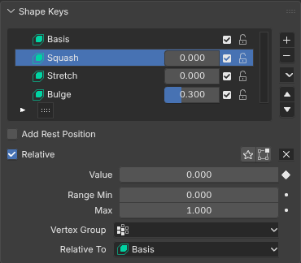
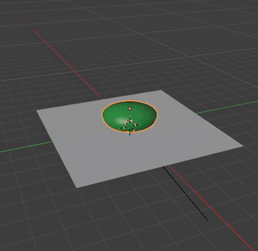
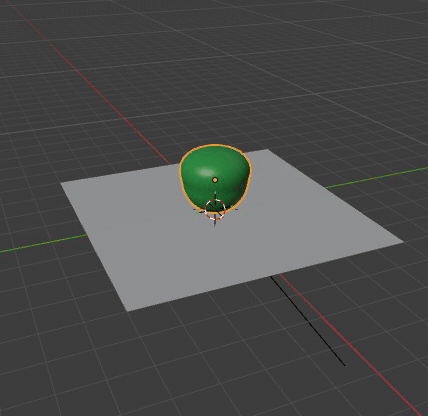

# Shape Keys

Shape keys store other positions of a mesh's vertices: a Basis and keys relative to it, each blended in by its value.
Everything about them is Blender's code in the module: the Key data-block and its key blocks, Properties > Mesh >
Shape Keys (Blender's tree of keys with each key's value, mute and lock), the operators (add, remove, move, clear,
mirror, apply to basis, Blend from Shape), Edit Mode on a key, the shape pinned to the active key, and keying a value
with I. Blender's depsgraph evaluates the keys into the mesh the 3D Viewport draws.

The keys can also be blended by Babylon (docs/runtimes.md): with Shape Keys' Runtime panel on Babylon (mapped), the
mesh is drawn once and each key becomes a target of a Babylon MorphTargetManager, so a value that changes (played or
dragged) only changes a target's influence and the GPU blends it. The blend is Blender's (Basis plus each unmuted
key's value times its offset from its relative key, scaled by its vertex group), so the positions are the same; only
the normals are blended rather than recomputed.

[Open in Bylonder](https://propolisa.github.io/bylonder/#example=shape-keys)

The demo is a jelly blob made in Blender by a script (`shape-keys.py`): Squash and Stretch are keyed to make it
bounce, Bulge swells its top half through the Top vertex group, and Wobble is muted.

## Steps

1. **The keys.** Select Blob and open Properties > Mesh (the Data tab): Shape Keys lists Basis and the keys, each with
   its value, mute checkbox and lock. Below the tree, the active key's range, vertex group and relative key.

   

2. **A value.** Drag Bulge's value: the blob swells where the Top group's weights are high. The pin beside the tree
   shows the active key alone.

   

3. **Edit a key.** Click Stretch, press Tab and move its vertices; Vertex > Blend from Shape mixes another key into it.
   Back in Object Mode the key keeps its new shape.

   

4. **Play it.** Squash and Stretch are keyed (I over a value inserts a key at the current frame). Press Space to play.

   

5. **Babylon's morph targets.** In Shape Keys' Runtime panel (with the Bylonder icon) pick Babylon (mapped). The blob
   looks the same; the panel lists the normals as the one approximation, and Edit Mode, a modifier or absolute keys
   fall back to Blender with the reason.

   

## Project files

- [shape-keys.py](../../examples/shape-keys/shape-keys.py): builds the blob, its vertex group, keys and their keyed
  values, in Blender 5.2.
- [shape-keys.blend](../../examples/shape-keys/shape-keys.blend): the file the script saves.
- [index.js](../../examples/shape-keys/index.js): opens the .blend with Blender's reader.
- [shape-keys.bench.js](../../bench/shape-keys.bench.js): a frame on a 32k-vertex mesh with two animated keys, on
  Blender (about 16 ms of CPU) and on Babylon (mapped) (about 4 ms).
- Recorded by [record-shape-keys.mjs](../../tools/docs/record-shape-keys.mjs).
