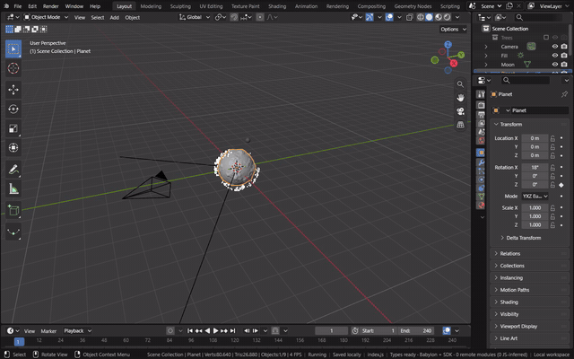
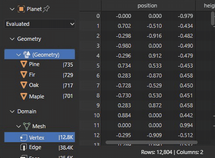
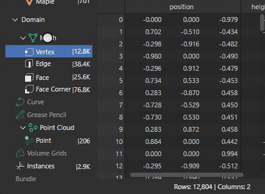

# Spreadsheet

The Spreadsheet shows the data of the active object's geometry as a table, one row per element of a domain and one
column per attribute. It is Blender's own editor: the module runs `space_spreadsheet.cc`, its data set region, its
table drawing and its operators, and the page draws what they record. It shows the evaluated geometry, after the
modifiers, or the original data, and lists every component Geometry Nodes made: the mesh, the point cloud, curves and
instances.

[Open in Bylonder](https://propolisa.github.io/bylonder/#example=geometry-nodes)

The demo is the Geometry Nodes Meadow example ([Geometry Nodes](geometry-nodes.md) builds it). The Meadow's modifier
makes a mesh, a point cloud with a `height` attribute and instances of a Tree group.

## Steps

1. **Open the Spreadsheet.** Click the Geometry Nodes workspace tab. The Spreadsheet is the area at the top left, as in
   Blender's startup file; any area's editor type menu also offers it. It follows the active object.

   

2. **Pick a component and a domain.** Click Point Cloud in the data set tree at the left. The table lists the points,
   with the `position`, `radius` and `height` columns; the footer counts the rows and columns. Instances lists each
   instance with its transform and the geometry it instances.

   

3. **Original data.** Set the menu under the object's name to Original. The table shows the Meadow's own grid, before
   its modifiers; Evaluated shows the result again.

   

## Project files

- [geometry-nodes.mjs](../../examples/geometry-nodes/geometry-nodes.mjs) and
  [geometry-nodes.blend](../../examples/geometry-nodes/geometry-nodes.blend): the scene and its node groups.
- Recorded by [record-spreadsheet.mjs](../../tools/docs/record-spreadsheet.mjs).
