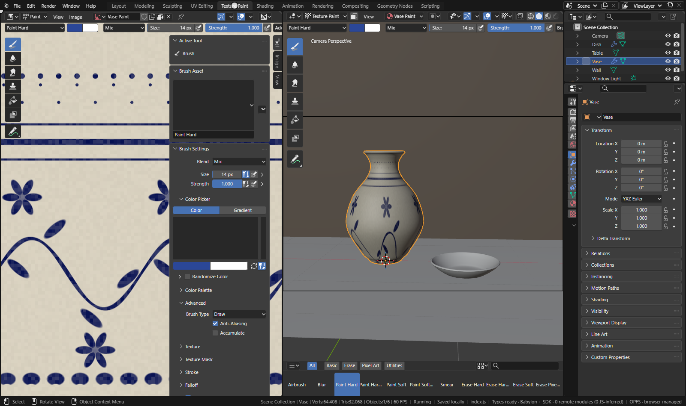
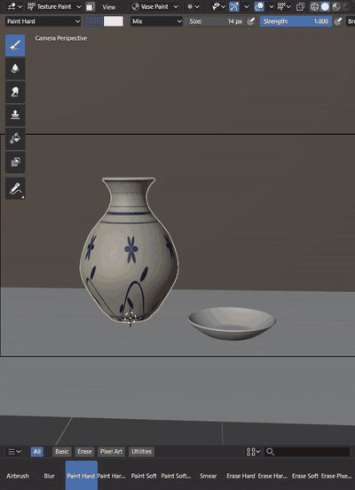
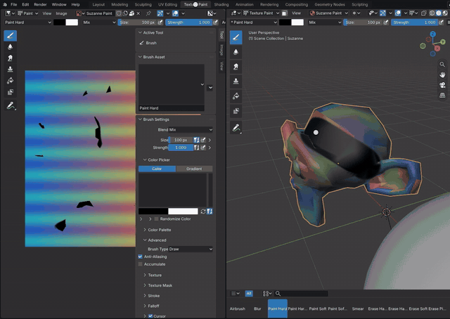
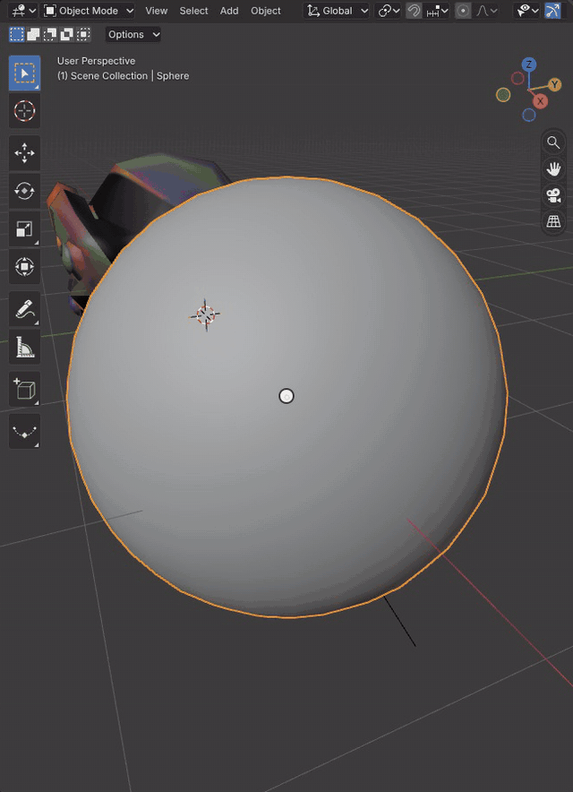

# Texture Paint and Vertex Paint

Texture Paint Mode paints into an image that an object's material shows through its UV map; Vertex Paint Mode paints
the object's color attribute. Strokes run Blender's own paint code in the module (projection painting into the image's
buffer, `paint.image_paint`), and Babylon draws the result: each stroke uploads only the regions of the image it
changed, and the image's mipmaps are made again once painting pauses. Ctrl Z undoes one stroke.

[Open in Bylonder](https://propolisa.github.io/bylonder/#example=texture-paint)

The demo, Texture Paint, has Suzanne unwrapped with Smart UV Project and a packed image in its material's Base Color,
and a sphere with a color attribute. It is built by a Blender script (`texture-paint.py`), so the steps below start
from the example.

## Steps

1. **Open the Texture Paint workspace.** Pick Texture Paint in the topbar's workspace tabs. Suzanne enters Texture
   Paint Mode; the Image Editor on the left shows the image it paints, the 3D Viewport shows the image on Suzanne
   (Solid shading draws the paint slot's texture, as Blender's Workbench does in this mode).

   

2. **Paint on the object.** Drag over Suzanne in the 3D Viewport. The Draw brush paints its color from the tool
   settings; [ and ] change its size. Shift X over a pixel samples its color, and X swaps the two colors. A model
   without an image has none to paint: Texture Slots (the tool settings' popover) adds one with its + button.

   

3. **Paint in the Image Editor.** Drag in the Image Editor: in Paint mode it paints the image directly, and the 3D
   Viewport follows the stroke. Its toolbar and sidebar hold the same brushes and brush settings.

   

4. **Vertex Paint.** Click the sphere in the Outliner, switch the mode menu to Vertex Paint and drag over it. Strokes
   change its active color attribute (Object Data tab, Color Attributes), which Solid shading draws.

   

## Project files

- [texture-paint.py](../../examples/texture-paint/texture-paint.py): the Blender script that builds the demo.
- [texture-paint.blend](../../examples/texture-paint/texture-paint.blend): the file the script saves, with its image
  packed.
- [index.js](../../examples/texture-paint/index.js): opens the .blend with Blender's reader.
- Recorded by [record-texture-paint.mjs](../../tools/docs/record-texture-paint.mjs).
