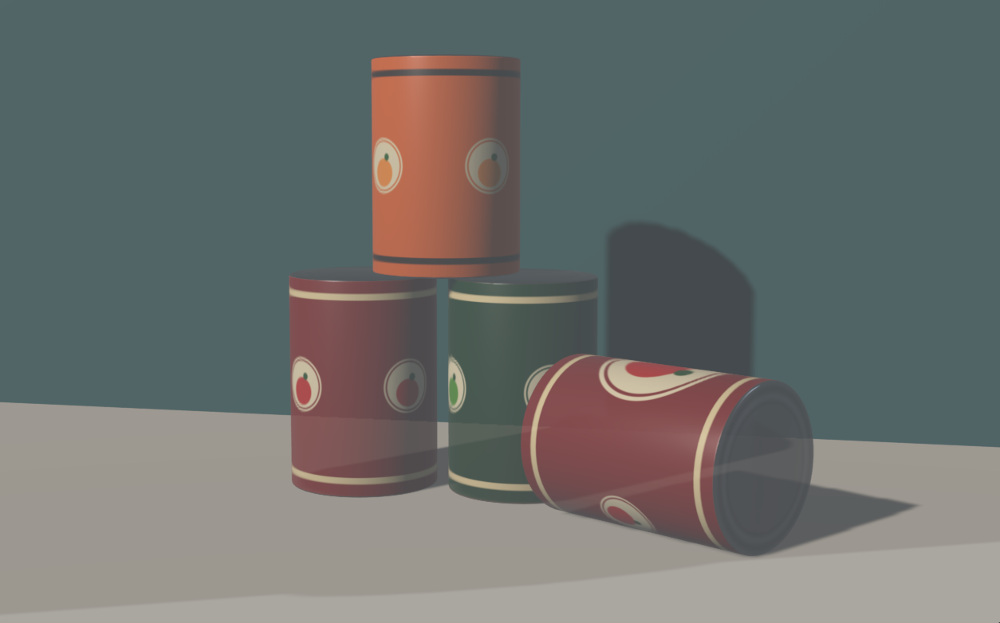
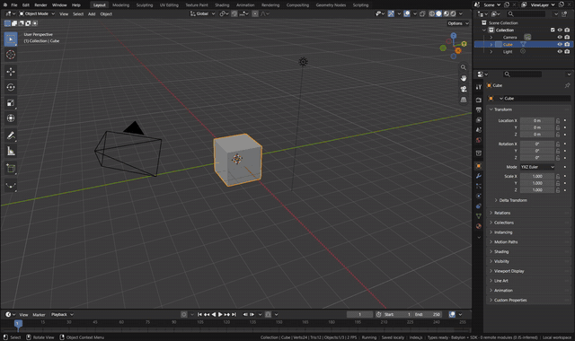
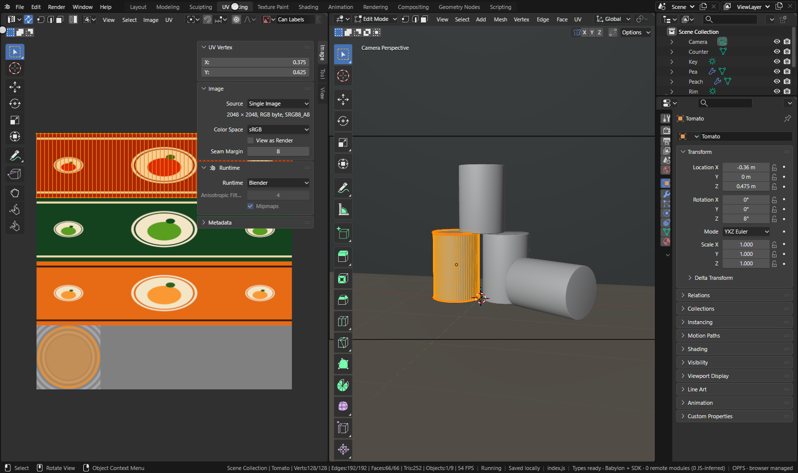
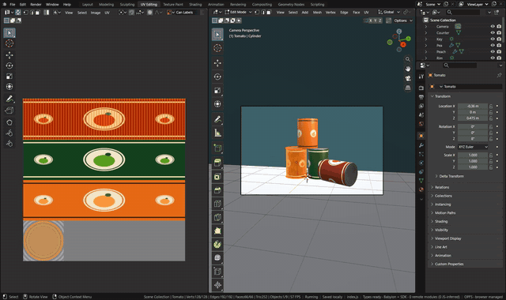

# UV Editing

A UV map places each face corner of a mesh on an image. The UV Editor shows the UVs of the mesh in Edit Mode over the
image, and its operators are Blender's own (`uv.*` in the module, run in Blender's window with the UV Editor's
keymap), as are its header, menus, toolbar and sidebar. Babylon draws the image and the UVs with Blender's overlay
flags (selected, active, pinned), through the editor's View2D.

[Open in Bylonder](https://propolisa.github.io/bylonder/#example=tin-cans)

The demo, Tin Cans, is four food cans on a counter whose labels and lids all come from one 2048 by 2048 image: three
labels stacked as bands and a lid in the bottom corner. Each can's side is unwrapped onto its label's band and its caps
onto the lid, so which label a can wears is only where its UVs sit. It is built by a Blender script (`tin-cans.py`).

## Steps

1. **Unwrap.** In the Default Cube example, click the cube, press X > Delete and Shift A > Mesh > Cylinder. Pick UV
   Editing in the topbar's workspace tabs: the cylinder enters Edit Mode. Hover the 3D Viewport, press A to select all
   and U for the UV menu: Unwrap uses the seams (Edge > Mark Seam), Smart UV Project splits by angle, Cylinder
   Projection wraps the faces around the view's axis, as here.

   

2. **See a can's UVs.** Open the example and pick UV Editing. The Tomato can enters Edit Mode, and the UV Editor on
   the left shows its UVs over the label atlas: the side's island covers the top band, the caps the lid. Home over the
   UV Editor fits the image.

   

3. **Select and move UVs.** In the UV Editor, Alt A deselects, L over the side's island picks it, and G Y -0.25 Enter
   moves it one band down: the can now wears the pea label (Material Preview shows it). Click a UV vertex or drag a
   box with the Select Box tool to pick fewer; R rotates and S scales. P pins the selection, so Unwrap keeps it in
   place; UV > Pack Islands lays the islands out again.

   

## Project files

- [tin-cans.py](../../examples/tin-cans/tin-cans.py): the Blender script that builds the demo, its atlas and the cans'
  UVs.
- [tin-cans.blend](../../examples/tin-cans/tin-cans.blend): the file the script saves, with its image packed.
- [index.js](../../examples/tin-cans/index.js): opens the .blend with Blender's reader.
- Recorded by [record-texture-paint.mjs](../../tools/docs/record-texture-paint.mjs).
