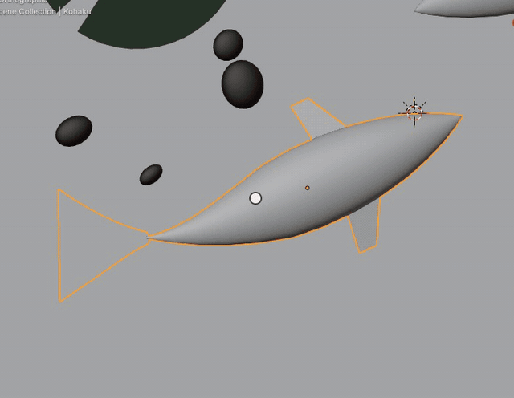
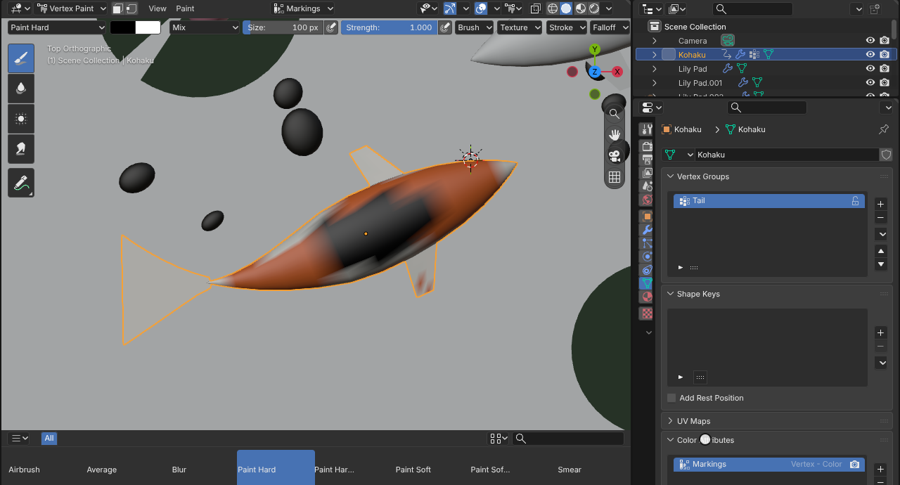
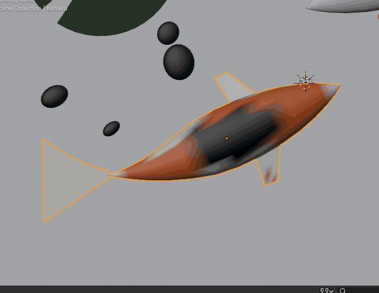
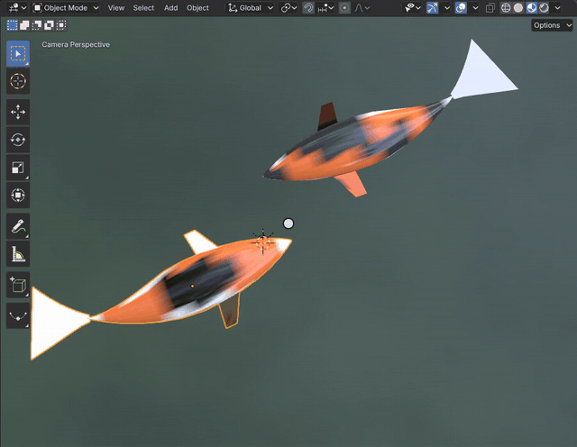
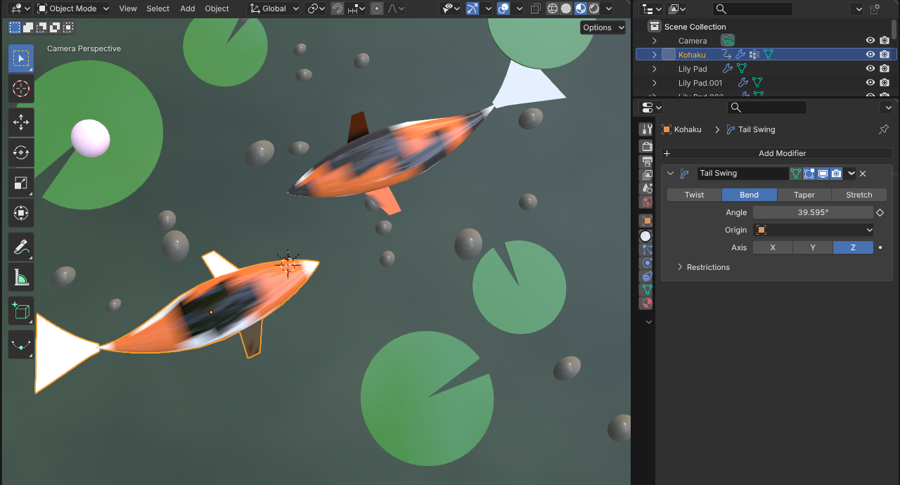

# Vertex and Weight Paint

Vertex Paint paints colors into a mesh's color attribute, a color for each vertex (or face corner) that a material
reads with the Color Attribute node. Weight Paint paints a vertex group's weights, from 0 (blue) to 1 (red), which
modifiers, armatures and particles read to know how much of the mesh they act on. Both modes, their brushes and the
weight overlay are Blender's code in the module, and each stroke is one undo step.

[Open in Bylonder](https://propolisa.github.io/bylonder/#example=vertex-and-weight-paint)

The demo, Koi Pond, is made in Blender by a script (`vertex-and-weight-paint.py`): two koi, a Kohaku and a Showa,
under lily pads. Each fish's markings are its Markings color attribute; its Tail vertex group weighs 0 at the head and
1 at the tail, and a Simple Deform modifier limited to that group bends the tail back and forth.

## Steps

1. **Vertex Paint.** Select Kohaku, look from above (Numpad 7) and frame it, then pick Vertex Paint in the mode menu.
   A stroke along the back paints the brush's color, black here (its color is in the tool settings, and S samples one
   from under the pointer): the Kohaku gets a Sanke's black patch.

   

2. **The color attribute.** Properties > Mesh lists Markings under Color Attributes, beside the Tail vertex group.
   The fish's material reads Markings with a Color Attribute node into its Base Color.

   

3. **Weight Paint.** Pick Weight Paint: the Tail group shows from blue at the head to red at the tail. A stroke across
   the middle of the body paints it toward 1, so more of the fish will bend.

   

4. **Swim.** Back in Object Mode, in Material Preview, press Space: the Simple Deform's bend angle is keyed both
   ways, and the weights decide how much of the fish follows it.

   

5. **The modifier.** Properties > Modifiers: Simple Deform set to Bend about Z; under Restrictions, its Vertex Group
   is Tail.

   

## Project files

- [vertex-and-weight-paint.py](../../examples/vertex-and-weight-paint/vertex-and-weight-paint.py): builds the koi,
  their color attributes, vertex groups and modifiers, the pond, lights and camera, in Blender 5.2.
- [vertex-and-weight-paint.blend](../../examples/vertex-and-weight-paint/vertex-and-weight-paint.blend): the file the
  script saves.
- [index.js](../../examples/vertex-and-weight-paint/index.js): opens the .blend with Blender's reader.
- Recorded by [record-vertex-and-weight-paint.mjs](../../tools/docs/record-vertex-and-weight-paint.mjs).
